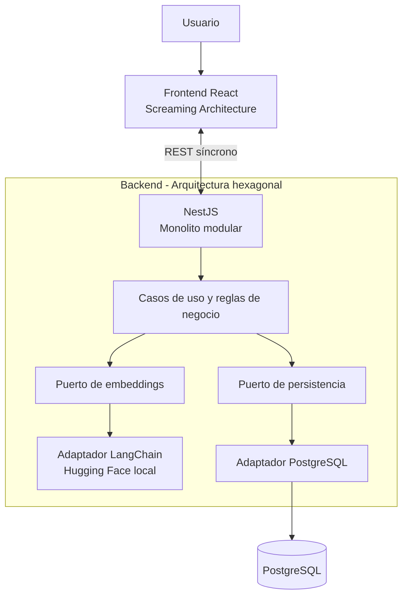

# Bloque 01 — Visión general de la arquitectura

**Estado:** Aprobado con verificaciones documentales pendientes  
**Fecha:** 21 de octubre de 2026  
**Alcance:** Arquitectura de alto nivel del MVP de gestión y validación semántica de frases.

## 1. Visión general de la arquitectura

La solución permite registrar y consultar frases cortas, validar similitud semántica antes del guardado y solicitar confirmación humana cuando exista un posible duplicado. Se compone de una aplicación web React, una API NestJS con arquitectura hexagonal, inferencia de embeddings de Hugging Face integrada en el proceso Node.js mediante LangChain, y persistencia en PostgreSQL.

El MVP prioriza un flujo síncrono y simple. La selección exacta del modelo, las particularidades de la búsqueda vectorial y los contratos específicos se determinarán en bloques posteriores según los artefactos aprobados.

## 2. Estilo arquitectónico

- **Monolito modular:** una aplicación backend desplegable con responsabilidades delimitadas.
- **Backend hexagonal:** los casos de uso dependen de puertos; los adaptadores encapsulan framework, IA y persistencia.
- **Frontend con Screaming Architecture:** la organización hace visibles las capacidades de negocio, no solo las tecnologías.
- **Sin microservicios, colas ni workers de procesamiento para el MVP.**

El monolito comparte ciclo de despliegue, pero reduce la complejidad operativa. La hexagonal se aplicará sin añadir abstracciones que no representen fronteras útiles.

## 3. Estrategia de repositorio

**Un monorepo Git con pnpm workspaces, sin Turborepo.** Frontend y backend son aplicaciones independientes, aunque comparten repositorio y documentación.

Estructura conceptual, no prescriptiva:

```text
semantic-phrase-app/
├── apps/
│   ├── web/              # React; Screaming Architecture
│   └── api/              # NestJS; arquitectura hexagonal
├── docs/
│   └── 03-architecture/
├── package.json
└── pnpm-workspace.yaml
```

No se establece en este bloque la estructura interna de carpetas, paquetes compartidos ni la herramienta de compilación.

## 4. Componentes principales

1. **Frontend React:** interfaz de usuario y flujo de confirmación humana.
2. **API NestJS:** punto de entrada HTTP, coordinación de casos de uso y reglas de validación.
3. **Integración de embeddings:** adaptador de LangChain con un modelo Hugging Face ejecutado localmente dentro del backend Node.js.
4. **Persistencia PostgreSQL:** almacenamiento de frases y metadatos; mecanismo concreto de búsqueda vectorial pendiente de especificación.

La integración IA es un componente lógico del backend, **no un microservicio adicional**.

## 5. Responsabilidades de los componentes

| Componente | Responsabilidad | Fuera de su responsabilidad |
|---|---|---|
| Frontend | Crear y listar frases; presentar validación, errores, puntuación y confirmación/cancelación | Acceder directamente a la base de datos o ejecutar el modelo |
| API / aplicación | Exponer REST; aplicar reglas; coordinar validación y guardado | Contener detalles concretos del proveedor IA o de SQL en el núcleo de negocio |
| Adaptador de IA | Generar embeddings mediante LangChain y el modelo activo | Decidir reglas de negocio o confirmar guardados |
| Adaptador de datos | Guardar y recuperar frases, metadatos y datos vectoriales según diseño posterior | Decidir el significado funcional de un posible duplicado |
| PostgreSQL | Persistencia de datos | Exponer operaciones directamente al navegador |

## 6. Comunicación y dependencias

El frontend se comunica con NestJS mediante **API REST síncrona (HTTP/HTTPS según entorno)**. NestJS coordina la generación de embeddings y consulta la persistencia mediante contratos internos. El resultado de validación debe permitir mostrar la frase más parecida, su puntuación y la necesidad de confirmación cuando corresponda.

Flujo funcional de alto nivel:

1. El usuario introduce una frase y solicita validación.
2. El frontend envía la solicitud REST al backend.
3. El backend obtiene el embedding mediante el puerto de IA y su adaptador LangChain/Hugging Face.
4. El backend consulta las frases existentes para determinar la coincidencia más cercana según la estrategia por definir.
5. La API devuelve el resultado y la puntuación de similitud.
6. Si corresponde, la interfaz pide confirmación humana antes de guardar; el usuario puede confirmar o cancelar.
7. La operación de guardado se ejecuta mediante la API conforme al contrato y las garantías de consistencia que se detallen después.

**Reglas de dependencia:** el dominio y los casos de uso no deben importar LangChain, clientes de base de datos ni detalles del transporte HTTP. Los adaptadores dependen de los contratos apropiados, no al revés. El navegador nunca accede directamente a PostgreSQL ni al modelo.

## 7. Diagrama de arquitectura de alto nivel (Mermaid)



El diagrama expresa dependencias lógicas, no un diseño exhaustivo de módulos o despliegue.

## 8. Principios arquitectónicos

- **Separación de responsabilidades:** UI, reglas de negocio, IA y datos tienen límites explícitos.
- **Inversión de dependencias:** los casos de uso consumen puertos y no detalles de infraestructura.
- **Independencia del proveedor IA:** incorporar modelos o proveedores nuevos debe requerir adaptadores y configuración, evitando cambios en las reglas de negocio cuando el contrato lo permita.
- **API First y SDD:** documentar contratos, criterios de aceptación y errores antes de implementar.
- **Human-in-the-Loop:** la alerta de similitud no guarda ni descarta automáticamente una frase cuando debe intervenir el usuario.
- **Facilidad de pruebas:** negocio y decisiones deben poder probarse con dobles de puertos, sin ejecutar el modelo ni PostgreSQL.
- **Simplicidad:** no introducir infraestructura distribuida o abstracciones no justificadas.
- **Configuración explícita:** el proveedor/modelo activo y el umbral de similitud se gestionan por configuración.
- **Consistencia semántica:** no comparar embeddings de espacios vectoriales incompatibles; un cambio de modelo puede exigir regeneración de vectores y recalibración de umbrales.
- **Organización por negocio:** el frontend sigue Screaming Architecture.

## 9. Decisiones confirmadas y compromisos

| ID | Decisión aprobada | Compromiso asumido |
|---|---|---|
| D01 | Monolito modular | Un único backend desplegable; menor complejidad operativa a costa de despliegue conjunto de sus módulos |
| D02 | Monorepo con pnpm workspaces, sin Turborepo | Gestión coordinada sin orquestador avanzado de tareas |
| D03 | NestJS + LangChain + modelo Hugging Face local; integración extensible | Simplicidad del proveedor inicial; el cambio de modelo exige comprobar compatibilidad y recursos |
| D04 | API REST síncrona; sin colas ni workers en el MVP | Menos infraestructura; latencia de inferencia ligada a la petición |
| D05 | Arquitectura hexagonal en el backend | Mejor aislamiento y pruebas, con algo más de estructura y contratos |
| D06 | Principios anteriores y Screaming Architecture para React | Responsabilidades claras y enfoque por funcionalidades, evitando sobreingeniería |

## 10. Fuentes y puntos pendientes de verificación

### Evidencia disponible

- **Enunciado del reto — `Reto-Tecnico-Fullstack-AI.md`:** localizado en la biblioteca. Exige interfaz de frases, validación semántica con modelo de Hugging Face, API REST Node.js, SQL, puntuación y confirmación humana.
- **Decisiones D01–D06:** aprobadas expresamente durante esta conversación.

### Documentos no verificados

No se localizaron los siguientes archivos exactos en los recursos disponibles durante esta elaboración:

- `docs/00-discovery/product-brief.md`
- `docs/01-ai-feasibility/model-evaluation.md`
- `docs/02-ui/ui-spec.md`

Por ello **no se afirma** cuál fue el modelo específico elegido, sus dimensiones, resultados de evaluación, requisitos operativos ni los detalles de pantallas aprobadas.

### Pendiente para siguientes bloques

- Confirmar el modelo y runtime compatible con LangChain/Node.js según la evaluación aprobada.
- Elegir el mecanismo concreto para búsqueda de similitud (incluida la eventual adopción de pgvector) y la estrategia de compatibilidad de embeddings.
- Detallar contratos REST, manejo de errores y consistencia entre validación y guardado.
- Definir arquitectura interna de frontend, backend, IA y persistencia sin adelantar decisiones no aprobadas.

**Nota:** este documento registra únicamente la arquitectura general aprobada; no representa una implementación ni inicializa proyectos.
