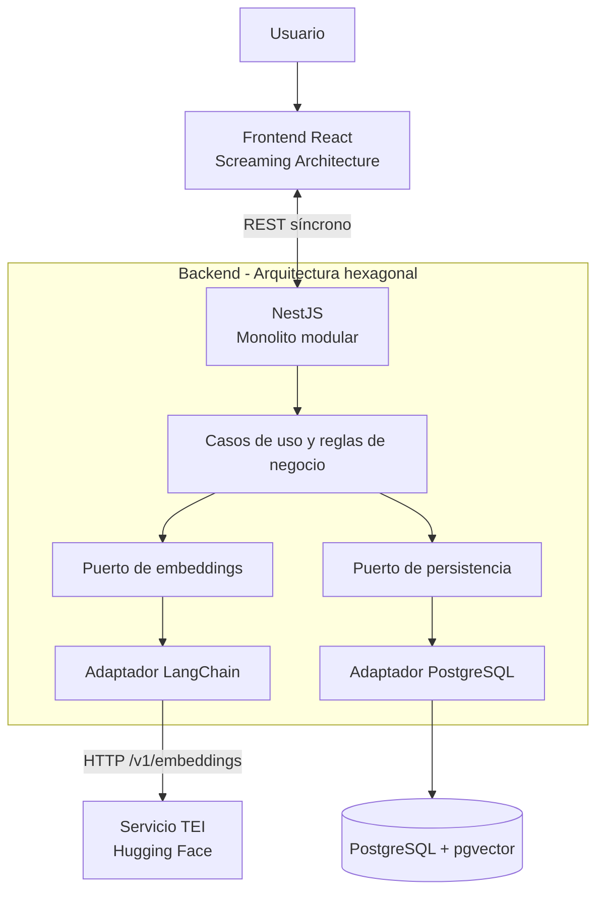

# Bloque 01 — Visión general de la arquitectura

> Revisado contra el código implementado (2026-10-24); ante discrepancia manda el código.

**Estado:** Aprobado; revisado contra el código implementado  
**Fecha:** 21 de octubre de 2026  
**Alcance:** Arquitectura de alto nivel del MVP de gestión y validación semántica de frases.

## 1. Visión general de la arquitectura

La solución permite registrar y consultar frases cortas, validar similitud semántica antes del guardado y solicitar confirmación humana cuando exista un posible duplicado. Se compone de una aplicación web React, una API NestJS con arquitectura hexagonal, inferencia de embeddings de Hugging Face servida por un contenedor Text Embeddings Inference (TEI) y consumida desde el backend mediante LangChain, y persistencia en PostgreSQL con pgvector.

El MVP prioriza un flujo síncrono y simple. El modelo (`sentence-transformers/paraphrase-multilingual-MiniLM-L12-v2`, 384 dimensiones), la búsqueda vectorial (pgvector, coseno Top-1 exacto) y los contratos REST quedaron definidos en los bloques posteriores y en `docs/03-architecture/openapi.yaml`.

## 2. Estilo arquitectónico

- **Monolito modular:** una aplicación backend desplegable con responsabilidades delimitadas.
- **Backend hexagonal:** los casos de uso dependen de puertos; los adaptadores encapsulan framework, IA y persistencia.
- **Frontend con Screaming Architecture:** la organización hace visibles las capacidades de negocio, no solo las tecnologías.
- **Sin microservicios, colas ni workers de procesamiento para el MVP.**

El monolito comparte ciclo de despliegue, pero reduce la complejidad operativa. La hexagonal se aplicará sin añadir abstracciones que no representen fronteras útiles.

## 3. Estrategia de repositorio

**Un repositorio raíz con dos submódulos Git (`apps/frontend` y `apps/backend`), sin pnpm workspaces ni Turborepo.** Frontend y backend son aplicaciones independientes, cada una con su propio `package.json` y `pnpm-lock.yaml`; el repositorio raíz aporta la documentación, `compose.yaml` (PostgreSQL y TEI) y los experimentos.

Estructura real:

```text
semantic-phrase-app/
├── apps/
│   ├── frontend/         # Submódulo Git; React, Screaming Architecture
│   └── backend/          # Submódulo Git; NestJS, arquitectura hexagonal
├── docs/
├── experiments/          # Evaluación de modelos
├── compose.yaml          # PostgreSQL + pgvector y TEI (embeddings)
└── README.md
```

La estructura interna del backend se describe en `02-backend-architecture.md`.

## 4. Componentes principales

1. **Frontend React:** interfaz de usuario y flujo de confirmación humana.
2. **API NestJS:** punto de entrada HTTP, coordinación de casos de uso y reglas de validación.
3. **Integración de embeddings:** adaptador de LangChain (`OpenAIEmbeddings`) que llama por HTTP al servicio `embeddings` (Hugging Face Text Embeddings Inference, contenedor definido en `compose.yaml`). El proceso Node.js no carga el modelo.
4. **Persistencia PostgreSQL + pgvector:** almacenamiento de frases, validaciones temporales y vectores; búsqueda de la coincidencia textual exacta y de la más cercana por distancia coseno (Top-1 exacto, sin índice ANN).

El servicio TEI es un contenedor de apoyo al backend: no contiene reglas de negocio y solo el adaptador de IA lo conoce. El backend sigue siendo un único monolito desplegable.

## 5. Responsabilidades de los componentes

| Componente | Responsabilidad | Fuera de su responsabilidad |
|---|---|---|
| Frontend | Crear, listar y eliminar frases; presentar validación, errores, puntuación y confirmación/cancelación | Acceder directamente a la base de datos o ejecutar el modelo |
| API / aplicación | Exponer REST; aplicar reglas; coordinar validación y guardado | Contener detalles concretos del proveedor IA o de SQL en el núcleo de negocio |
| Adaptador de IA | Generar embeddings llamando al servicio TEI mediante LangChain | Decidir reglas de negocio o confirmar guardados |
| Adaptador de datos | Guardar y recuperar frases, validaciones temporales y vectores | Decidir el significado funcional de un posible duplicado |
| PostgreSQL | Persistencia de datos | Exponer operaciones directamente al navegador |

## 6. Comunicación y dependencias

El frontend se comunica con NestJS mediante **API REST síncrona (HTTP/HTTPS según entorno)**. NestJS coordina la generación de embeddings y consulta la persistencia mediante contratos internos. El resultado de validación debe permitir mostrar la frase más parecida, su puntuación y la necesidad de confirmación cuando corresponda.

Flujo funcional de alto nivel:

1. El usuario introduce una frase y solicita validación.
2. El frontend envía la solicitud REST al backend.
3. El backend obtiene el embedding mediante el puerto de IA y su adaptador LangChain, que llama al servicio TEI.
4. El backend consulta las frases activas: primero coincidencia textual exacta y, si no existe, la más cercana por coseno (Top-1) con el mismo modelo y versión.
5. La API devuelve el resultado y la puntuación de similitud.
6. Si corresponde, la interfaz pide confirmación humana antes de guardar; el usuario puede confirmar o cancelar.
7. El guardado se ejecuta con `POST /api/v1/phrases` y el `validationId`: el backend inserta la frase y después marca la validación como consumida (en una única transacción).

**Reglas de dependencia:** el dominio y los casos de uso no deben importar LangChain, clientes de base de datos ni detalles del transporte HTTP. Los adaptadores dependen de los contratos apropiados, no al revés. El navegador nunca accede directamente a PostgreSQL ni al modelo.

## 7. Diagrama de arquitectura de alto nivel (Mermaid)



El diagrama expresa dependencias lógicas, no un diseño exhaustivo de módulos o despliegue.

## 8. Principios arquitectónicos

- **Separación de responsabilidades:** UI, reglas de negocio, IA y datos tienen límites explícitos.
- **Inversión de dependencias:** los casos de uso consumen puertos y no detalles de infraestructura.
- **Independencia del proveedor IA:** incorporar modelos o proveedores nuevos debe requerir adaptadores y configuración, evitando cambios en las reglas de negocio cuando el contrato lo permita.
- **API First y SDD:** documentar contratos, criterios de aceptación y errores antes de implementar.
- **Human-in-the-Loop:** la alerta de similitud no guarda ni descarta automáticamente una frase cuando debe intervenir el usuario.
- **Facilidad de pruebas:** negocio y decisiones se prueban con dobles de puertos, sin ejecutar el modelo ni PostgreSQL (pruebas unitarias y E2E HTTP con puertos simulados).
- **Simplicidad:** no introducir infraestructura distribuida o abstracciones no justificadas.
- **Configuración explícita:** el proveedor/modelo activo y el umbral de similitud se gestionan por configuración.
- **Consistencia semántica:** no comparar embeddings de espacios vectoriales incompatibles; un cambio de modelo puede exigir regeneración de vectores y recalibración de umbrales.
- **Organización por negocio:** el frontend sigue Screaming Architecture.

## 9. Decisiones confirmadas y compromisos

| ID | Decisión aprobada | Compromiso asumido |
|---|---|---|
| D01 | Monolito modular | Un único backend desplegable; menor complejidad operativa a costa de despliegue conjunto de sus módulos |
| D02 | Repositorio raíz con submódulos Git `apps/frontend` y `apps/backend`; sin workspaces ni Turborepo | Cada aplicación se versiona y se instala por separado |
| D03 | NestJS + LangChain (`OpenAIEmbeddings`) contra un servicio TEI con el modelo Hugging Face; integración extensible mediante puerto | Un contenedor adicional en local; el cambio de modelo exige comprobar compatibilidad y recalibrar el umbral |
| D04 | API REST síncrona; sin colas ni workers en el MVP | Menos infraestructura; latencia de inferencia ligada a la petición |
| D05 | Arquitectura hexagonal en el backend | Mejor aislamiento y pruebas, con algo más de estructura y contratos |
| D06 | Principios anteriores y Screaming Architecture para React | Responsabilidades claras y enfoque por funcionalidades, evitando sobreingeniería |

## 10. Fuentes

- **Enunciado del reto:** [`docs/00-discovery/reto-tecnico.md`](../00-discovery/reto-tecnico.md).
- **Product Brief, evaluación de modelos y UI:** [`product-brief.md`](../00-discovery/product-brief.md), [`model-decision.md`](../01-ai-feasibility/model-decision.md) y [`ui-spec.md`](../02-ui/ui-spec.md). Son registros de decisión históricos; donde difieren del código, vale el código.
- **Decisiones D01–D06:** aprobadas durante el diseño; D02 y D03 se actualizaron arriba para reflejar la implementación.
- **Detalle por bloque:** `02-backend-architecture.md`, `04-ai-architecture.md`, `05-data-architecture.md`, `06-api-security.md`, `07-infrastructure-quality.md` y `openapi.yaml`.
