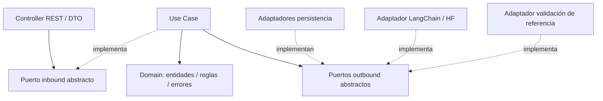

# Bloque 02 — Arquitectura Backend

Cambio incompatible (2026-10-22): `validationId` sustituye a `validationToken`, sin alias.
Se devuelve el UUID v4 aleatorio de la validación persistida, sin firma ni JWT.
Los JWT anteriores dejan de formar parte del contrato; las filas existentes pueden
referenciarse por su UUID. No hay migración ni secreto de firma requerido.
El registro queda fuera de F002: deberá buscar por `validationId`, comprobar
vigencia (`now >= expiresAt` implica expiración), texto, confirmación y estado no
consumido, y consumir la validación atómicamente con el guardado de la frase.
TTL configurable inicialmente de 15 minutos; respuesta y fila comparten expiración.


**Estado:** Aprobado (B02-D01 a B02-D18)  
**Fecha:** 21 de octubre de 2026  
**Ubicación:** `docs/03-architecture/02-backend-architecture.md`  
**Alcance:** Diseño lógico interno de la API NestJS del MVP de validación semántica de frases. No constituye implementación.

## 1. Contexto y restricciones heredadas

El backend es un **monolito modular NestJS/TypeScript** en `apps/api/` dentro de un monorepo con **pnpm workspaces**, sin Turborepo. Expone **REST síncrono**; no incorpora colas ni workers en el MVP. La integración de embeddings usa **LangChain y un modelo Hugging Face local** a través de un adaptador sustituible. El almacenamiento previsto es PostgreSQL; su ORM, esquema y estrategia vectorial se resolverán en otros bloques.

El usuario crea y lista frases y ejecuta una validación semántica previa al guardado. Si existe posible duplicado, el frontend pide confirmación humana. La coincidencia semántica **no es una excepción HTTP**, sino un resultado válido del negocio.

**Fuentes y límites de verificación:** se dispone del enunciado `Reto-Tecnico-Fullstack-AI.md`, de `01-system-overview.md` y de las decisiones explícitas de este Bloque 02. Los archivos exactos `docs/00-discovery/product-brief.md` y `docs/01-ai-feasibility/model-evaluation.md` no estuvieron disponibles para cotejo; por ello no se afirma un modelo específico, dimensiones, métricas ni umbral numérico definitivo. Esta arquitectura no sustituye su validación posterior.

## 2. Estilo y reglas de dependencia

- **Módulos por capacidad:** inicialmente solo `PhrasesModule`, sin separar módulos técnicos para embeddings o seguridad.
- **Hexagonal por módulo:** `domain/`, `application/` e `infrastructure/`; los adaptadores se organizan en `inbound/` y `outbound/`. No existe `InfrastructureModule` independiente.
- **DDD ligero:** entidades con invariantes, objetos de valor solo si aportan reglas, y dos Aggregate Roots independientes: `Phrase` y `PhraseValidation`. No se requiere una clase base `AggregateRoot`.
- **Dirección de dependencias:** dominio no importa NestJS ni tecnologías; aplicación depende de dominio y puertos propios; adaptadores implementan esos puertos. `PhrasesModule` es la raíz de composición con DI.
- **Puertos abstractos:** inbound y outbound se expresan mediante clases abstractas de TypeScript, que también funcionan como referencias de inyección NestJS. Los casos de uso implementan los inbound; los adaptadores concretan los outbound.
- **`shared/` mínimo:** solo preocupaciones genuinamente transversales. No `SharedModule` global por defecto.



> Las flechas continuas indican colaboración conceptual; las discontinuas indican implementación. La dependencia de compilación hacia contratos apunta al interior, incluso cuando la llamada real termina en un adaptador externo.

## 3. Capacidades y responsabilidades

### Dominio

- **`Phrase` (Aggregate Root):** frase registrada y sus invariantes; independiente del modelo de almacenamiento.
- **`PhraseValidation` (Aggregate Root):** validación temporal con identidad propia, expiración y estado de consumo. Puede expirar sin que exista una frase registrada.
- **Value Objects:** opcionales y justificados por invariantes, por ejemplo `SimilarityScore`; no crear `PhraseText` ni otros wrappers sin reglas concretas.
- **Domain Errors:** expresan violaciones de reglas de negocio, sin códigos HTTP.

No se crea un agregado compuesto `Phrase + PhraseValidation`. Un caso de uso puede coordinar ambos sin fusionarlos.

### Aplicación

| Caso de uso | Puerto inbound | Responsabilidad |
|---|---|---|
| `ValidatePhraseUseCase` | `ValidatePhrasePort` | Validar reglas de entrada de negocio, obtener embedding, solicitar coincidencia más cercana, evaluar umbral configurable, almacenar validación temporal y devolver el UUID persistido. |
| `CreatePhraseUseCase` | `CreatePhrasePort` | Verificar referencia, identidad/vigencia/estado de validación y confirmación cuando aplique; registrar frase usando embedding previo y consumir la validación atómicamente. No vuelve a ejecutar inferencia. |
| `ListPhrasesUseCase` | `ListPhrasesPort` | Consultar frases registradas a través del repositorio. |

El contrato de salida de validación informará si hay posible duplicado, coincidencia más cercana y puntaje. La precisión de DTOs, reglas de texto y contrato REST pertenece a la especificación de API.

### Puertos outbound

| Puerto | Finalidad |
|---|---|
| `EmbeddingGeneratorPort` | Generación de embeddings sin exponer LangChain ni el modelo al caso de uso. |
| `PhraseRepositoryPort` | Consultar y registrar frases definitivas según operaciones no transaccionales requeridas. |
| `PhraseValidationRepositoryPort` | Guardar, recuperar y consultar vigencia/consumo de validaciones temporales. |
| `PhraseRegistrationPort` | Guardar frase y consumir validación como **una operación atómica**. |

La búsqueda de la coincidencia más cercana requiere una operación de salida cuya ubicación contractual concreta se revisará en el diseño de persistencia; no se prescribe aquí SQL, pgvector ni un repositorio genérico. Evitar duplicar funciones entre `PhraseRepositoryPort`, `PhraseValidationRepositoryPort` y `PhraseRegistrationPort`.

### Adaptadores

- **HTTP inbound:** controllers, DTOs, validación por `ValidationPipe`, y mappers DTO ↔ comandos/resultados solo cuando aporten valor.
- **Persistencia outbound:** implementaciones de repositorios, del registro atómico y mappers entre modelos de almacenamiento y entidades de dominio, sin introducir ORM en el dominio.
- **Embeddings outbound:** adaptador LangChain/Hugging Face local; futuras implementaciones (p. ej., Bedrock) pueden sustituirlo por configuración/DI. Cambiar de modelo exige verificar espacio vectorial, dimensiones, regeneración de embeddings si corresponde y recalibración de umbral.

## 4. Flujo HITL y consistencia

1. **Validación:** el cliente solicita validar la frase; `ValidatePhraseUseCase` obtiene su embedding, consulta la coincidencia más cercana y aplica el umbral. Guarda una `PhraseValidation` temporal en PostgreSQL y emite un referencia UUID que la identifica.
2. **Decisión humana:** el frontend muestra el resultado. Ante posible duplicado, el usuario puede confirmar o cancelar; cancelar no llama al guardado.
3. **Guardado:** `CreatePhraseUseCase` busca por validationId y comprueba asociación con el texto de la validación, expiración, estado no consumido y confirmación explícita cuando sea necesaria. Recupera el embedding de la validación: **no hay nueva inferencia**.
4. **Atomicidad:** mediante `PhraseRegistrationPort`, la persistencia registra la frase y consume la validación en una misma operación atómica. Un segundo consumo debe rechazarse.
5. **Abandono:** si el usuario cambia de frase o abandona, la validación temporal expira lógicamente. Los registros expirados pueden permanecer físicamente hasta su limpieza.

```mermaid
sequenceDiagram
    actor U as Usuario
    participant FE as Frontend
    participant V as ValidatePhraseUseCase
    participant E as EmbeddingGeneratorPort
    participant VR as PhraseValidationRepositoryPort
    participant C as CreatePhraseUseCase
    participant R as PhraseRegistrationPort
    U->>FE: Escribe y valida frase
    FE->>V: Validar texto
    V->>E: Generar embedding
    E-->>V: Vector
    Note over V: Consultar coincidencia y evaluar umbral
    V->>VR: Guardar validación temporal + embedding
    V-->>FE: Resultado + score + referencia
    alt Usuario cancela
        U->>FE: Cancelar
        Note over FE,VR: No se registra Phrase; validación expirará
    else Usuario decide guardar
        U->>FE: Guardar / confirmar
        FE->>C: Frase + referencia + confirmación
        C->>VR: Recuperar validación y comprobar vigencia
        C->>R: Guardar Phrase + consumir validación
        R-->>C: Resultado atómico
        C-->>FE: Frase guardada
    end
```

**Garantías y límites:** el UUID identifica la fila persistida. El registro debe comprobar texto, vigencia, estado no consumido y confirmación; consume y guarda atómicamente. La consulta previa no bloquea cambios concurrentes del corpus.

**Sin workers en el MVP:** la expiración es lógica (`expires_at`); una política de limpieza física deberá definirse antes del uso sostenido. Un worker o tarea programada se reserva como evolución futura, no como componente aprobado para el MVP.

## 5. Validaciones, errores y respuestas

| Lugar | Responsabilidad |
|---|---|
| Adaptador HTTP | DTOs y `ValidationPipe` para sintaxis, tipos y restricciones de entrada. |
| Domain | `DomainError` para invariantes (p. ej., frase inválida). |
| Application | `ApplicationError` para condiciones del flujo (p. ej., confirmación requerida, validación vencida o ya consumida). |
| Adaptadores externos | Capturar fallos de modelo, base de datos y traducirlos a errores controlados; no filtrar secretos ni excepciones crudas. |
| Infraestructura HTTP compartida | `GlobalExceptionFilter` mapea errores a respuestas HTTP consistentes y oculta detalles internos. |

La posible similitud se representa como **resultado funcional**, no como error de infraestructura. Los códigos HTTP y el esquema exacto de respuesta quedan pendientes de contrato API; no se presupone un catálogo exhaustivo de excepciones.

## 6. Estrategia de pruebas

**Framework aprobado: Jest.**

- **Domain/unit:** entidades, value objects, invariantes, expiración y DomainErrors sin inicializar NestJS.
- **Application/unit:** cada Use Case con dobles de puertos outbound; casos de similitud dentro/fuera del umbral, confirmación, referencia inválida, validación vencida, reutilización, fallo de embedding y ausencia de guardados no autorizados.
- **Adapters/integration:** contratos de persistencia y atomicidad, generación/validación real de la referencia, integración Hugging Face/LangChain y mappers con recursos de prueba aislados.
- **HTTP/E2E:** contratos REST, DTOs, filtro global, flujo de validar/confirmar/cancelar y respuestas de error.

Pruebas unitarias `*.spec.ts` cerca de los componentes; integración y E2E bajo `test/`. Evitar invocar el modelo real en pruebas unitarias y reproducir implementaciones en mocks que no detecten errores reales.

## 7. Estructura de carpetas propuesta

```text
apps/api/
├── src/
│   ├── modules/
│   │   └── phrases/
│   │       ├── domain/
│   │       │   ├── entities/
│   │       │   │   ├── phrase.entity.ts
│   │       │   │   └── phrase-validation.entity.ts
│   │       │   ├── value-objects/
│   │       │   └── errors/
│   │       ├── application/
│   │       │   ├── ports/
│   │       │   │   ├── inbound/
│   │       │   │   └── outbound/
│   │       │   ├── use-cases/
│   │       │   │   ├── validate-phrase.use-case.ts
│   │       │   │   ├── create-phrase.use-case.ts
│   │       │   │   └── list-phrases.use-case.ts
│   │       │   ├── commands/
│   │       │   └── errors/
│   │       ├── infrastructure/
│   │       │   ├── inbound/http/
│   │       │   │   ├── controllers/
│   │       │   │   ├── dtos/
│   │       │   │   └── mappers/
│   │       │   └── outbound/
│   │       │       ├── persistence/
│   │       │       │   ├── models/
│   │       │       │   ├── repositories/
│   │       │       │   └── mappers/
│   │       │       ├── embeddings/
│   │       │       └── security/
│   │       └── phrases.module.ts
│   ├── shared/
│   │   ├── domain/errors/
│   │   ├── application/errors/
│   │   └── infrastructure/
│   │       ├── http/filters/
│   │       └── security/
│   ├── app.module.ts
│   └── main.ts
└── test/
    ├── integration/
    └── e2e/
```

La estructura es **referencial, no una orden de crear todas las carpetas**. DTOs, comandos, mappers, VOs y errores específicos se introducirán solo cuando exista un caso de uso real. `PhrasesModule` realiza el registro de controladores, casos de uso y adaptadores concretos mediante DI de NestJS.

## 8. Registro completo de decisiones

| ID | Decisión aprobada |
|---|---|
| B02-D01 | Organizar NestJS por capacidades de negocio; iniciar con `PhrasesModule`. |
| B02-D02 | Estructura `domain/application/infrastructure` con inbound/outbound; sin módulo de infraestructura propio. |
| B02-D03 | Casos de uso individuales; puertos inbound y outbound explícitos. |
| B02-D04 | Puertos mediante clases abstractas, también utilizadas como referencias DI. |
| B02-D05 | `EmbeddingGeneratorPort` genérico y adaptadores intercambiables; MVP Hugging Face vía LangChain. |
| B02-D06 | `DomainError`, `ApplicationError`, fallos técnicos controlados, DTO/ValidationPipe y filtro HTTP global. |
| B02-D07 | Testing por capas hexagonales; unitarios junto al código, integración y E2E separados. |
| B02-D08 | Tres casos de uso: validar, crear y listar; confirmación gestionada por `CreatePhraseUseCase`. |
| B02-D09 | Referencia UUID de validación; no recalcular similitud al crear. |
| B02-D10 | `shared/` pequeño para componentes transversales, sin módulo global innecesario. |
| B02-D11 | Embedding y resultado de validación temporal en PostgreSQL, identificados por referencia; expiración lógica y limpieza física posterior. |
| B02-D13 | Dos puertos de repositorio especializados: frases y validaciones temporales. |
| B02-D14 | DDD ligero: entidades con comportamiento y VOs mínimos cuando tengan invariantes. |
| B02-D15 | Puerto de registro atómico para registrar frase y consumir validación sin exponer transacciones SQL. |
| B02-D16 | DTOs HTTP, comandos de aplicación y mappers HTTP/persistencia solo cuando hagan falta. |
| B02-D17 | Jest para unitarias, integración y E2E. |
| B02-D18 | Estructura final aprobada; `Phrase` y `PhraseValidation` como Aggregate Roots independientes, sin base `AggregateRoot` obligatoria. |

## 9. Aspectos reservados para otros bloques

- Modelo Hugging Face exacto, librería/runtime compatible, dimensiones, latencia y umbral definitivo: cotejar con `model-evaluation.md`.
- API REST: endpoints, formatos DTO, códigos HTTP, manejo detallado de confirmación y contrato del resultado.
- Persistencia: ORM/query builder, tablas, columnas, índices, pgvector o estrategia de similitud, esquema de validaciones y operaciones atómicas.
- Referencia: UUID persistido, asociación al texto, expiración e invalidación por consumo.
- Consistencia concurrente, retención y limpieza de validaciones expiradas; sin worker en el MVP.
- Configuración/secretos, despliegue y observabilidad detallados.

**Criterio de cierre:** documento de diseño aprobado; no se implementa código, no se inicializan proyectos y ninguna decisión pendiente se trata como confirmada.
