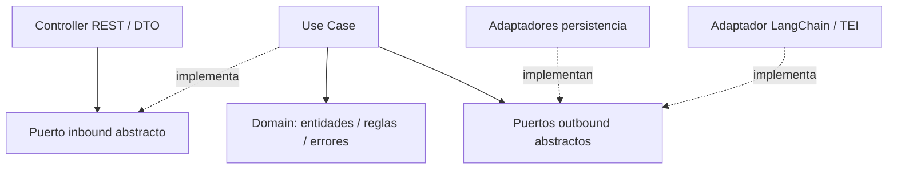
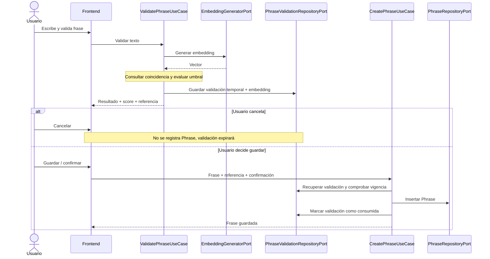

# Bloque 02 — Arquitectura Backend

> Revisado contra el código implementado (2026-10-24); ante discrepancia manda el código.

Cambio incompatible (2026-10-22): `validationId` sustituye a `validationToken`, sin alias.
Se devuelve el UUID v4 aleatorio de la validación persistida, sin firma ni JWT.
Los JWT anteriores dejan de formar parte del contrato; las filas existentes pueden
referenciarse por su UUID. No hay migración ni secreto de firma requerido.
El registro (F003) busca por `validationId`, comprueba existencia, estado no
consumido, vigencia (`now >= expiresAt` implica expiración), texto, modelo/versión y
confirmación, inserta la frase y después marca la validación como consumida (dos
escrituras en una única transacción).
TTL configurable inicialmente de 15 minutos; respuesta y fila comparten expiración.


**Estado:** Aprobado (B02-D01 a B02-D18); revisado contra el código  
**Fecha:** 21 de octubre de 2026  
**Ubicación:** `docs/03-architecture/02-backend-architecture.md`  
**Alcance:** Diseño lógico interno de la API NestJS del MVP de validación semántica de frases, conforme a lo implementado en `apps/backend`.

## 1. Contexto y restricciones heredadas

El backend es un **monolito modular NestJS/TypeScript** en `apps/backend/` (submódulo Git independiente, con su propio `package.json`; sin pnpm workspaces ni Turborepo). Expone **REST síncrono** bajo `/api/v1`; no incorpora colas ni workers. La integración de embeddings usa **LangChain (`OpenAIEmbeddings`) contra un servicio Text Embeddings Inference (TEI)** a través de un adaptador sustituible. El almacenamiento es PostgreSQL con pgvector, accedido con **Drizzle ORM** (ver `05-data-architecture.md`).

El usuario crea, lista y elimina (borrado lógico) frases y ejecuta una validación semántica previa al guardado. Si existe posible duplicado, el frontend pide confirmación humana. La coincidencia semántica **no es una excepción HTTP**, sino un resultado válido del negocio.

**Modelo y umbral:** `sentence-transformers/paraphrase-multilingual-MiniLM-L12-v2`, 384 dimensiones, umbral inicial `0.8538613695045911` (configurable con `AI_SIMILARITY_THRESHOLD`); ver `04-ai-architecture.md` y `docs/01-ai-feasibility/model-decision.md`.

## 2. Estilo y reglas de dependencia

- **Módulos por capacidad:** un único módulo de negocio, `PhrasesModule`, sin separar módulos técnicos para embeddings o seguridad. `AppModule` compone además `ConfigurationModule` (global) y `DatabaseModule` (de `shared/`, importado por `PhrasesModule`).
- **Hexagonal por módulo:** `domain/`, `application/` e `infrastructure/`. Los puertos se separan en `application/ports/inbound` y `outbound`; la infraestructura se organiza por tecnología (`http/`, `persistence/drizzle/`, `embeddings/`). No existe `InfrastructureModule` independiente.
- **DDD ligero:** entidades con invariantes y dos Aggregate Roots independientes: `Phrase` y `PhraseValidation`. Los objetos de valor existentes son `PhraseId` (UUID v4), `PhraseText`, `NormalizedPhraseText`, `PhraseCreatedAt`, `PhraseModel`, `Embedding`, `SimilarityScore` y `PhraseValidationMatch`. No hay clase base `AggregateRoot` ni `PhraseFactory`.
- **Dirección de dependencias:** dominio no importa NestJS ni tecnologías; aplicación depende de dominio y puertos propios; adaptadores implementan esos puertos. `PhrasesModule` es la raíz de composición con DI.
- **Puertos abstractos:** inbound y outbound se expresan mediante clases abstractas de TypeScript, que también funcionan como referencias de inyección NestJS. Los casos de uso implementan los inbound; los adaptadores concretan los outbound.
- **`shared/` mínimo:** solo preocupaciones transversales: `ConfigurationPort` con su módulo global `ConfigurationModule`, `DatabaseModule`/`DatabaseProvider`, `PaginatedResult` y el manejo Problem Details. No hay `SharedModule`.



> Las flechas continuas indican colaboración conceptual; las discontinuas indican implementación. La dependencia de compilación hacia contratos apunta al interior, incluso cuando la llamada real termina en un adaptador externo.

## 3. Capacidades y responsabilidades

### Dominio

- **`Phrase` (Aggregate Root):** frase registrada y sus invariantes; independiente del modelo de almacenamiento. Se elimina lógicamente (`status`, `deleted_at`).
- **`PhraseValidation` (Aggregate Root):** validación temporal con identidad propia, expiración y estado de consumo. Puede expirar sin que exista una frase registrada.
- **Value Objects:** `PhraseText` (1–280 puntos de código para entradas nuevas, hasta 500 al leer datos históricos, sin caracteres de control), `Embedding` (384 componentes finitos), `SimilarityScore`, `PhraseValidationMatch` (decide `requiresConfirmation` con umbral inclusivo `>=`), entre otros.
- **Domain Errors:** expresan violaciones de reglas de negocio, sin códigos HTTP.

No se crea un agregado compuesto `Phrase + PhraseValidation`. Un caso de uso puede coordinar ambos sin fusionarlos.

### Aplicación

| Caso de uso | Puerto inbound | Responsabilidad |
|---|---|---|
| `ValidatePhraseUseCase` | `ValidatePhrasePort` | Obtener embedding, solicitar la coincidencia (`findValidationMatch`), evaluar el umbral configurable en `PhraseValidationMatch`, almacenar la validación temporal y devolver el UUID persistido. |
| `CreatePhraseUseCase` | `CreatePhrasePort` | Comprobar, en este orden: existencia (`INVALID_VALIDATION_ID`), no consumida, vigencia, texto exacto, modelo/versión (`INCOMPATIBLE_MODEL`) y confirmación; insertar la frase con el embedding previo y marcar la validación como consumida (en una única transacción vía `PhraseRegistrationPort`). No vuelve a ejecutar inferencia. |
| `ListPhrasesUseCase` | `ListPhrasesPort` | Consultar frases registradas a través del repositorio. |
| `DeletePhraseUseCase` | `DeletePhrasePort` | Eliminar lógicamente una frase activa (soft delete) a través del repositorio. |

La salida de validación informa si hay posible duplicado, coincidencia más cercana y puntaje. DTOs, reglas de texto y contrato REST están en `06-api-security.md` y `openapi.yaml`.

### Puertos outbound

| Puerto | Finalidad |
|---|---|
| `EmbeddingGeneratorPort` | Generación de embeddings sin exponer LangChain ni el modelo al caso de uso. |
| `PhraseRepositoryPort` | `save`, `findValidationMatch` (coincidencia textual exacta y luego Top-1 coseno, filtrado por modelo/versión y frases activas), `list` y `softDelete`. |
| `PhraseValidationRepositoryPort` | `save`, `update` (p. ej. `consumedAt`) y `findById` de validaciones temporales. |
| `ConfigurationPort` (`shared/`) | Lectura de configuración sin acoplar los casos de uso a `ConfigService`. |

No existe un puerto de registro atómico: guardar la frase y consumir la validación son dos llamadas independientes (ver sección 4).

### Adaptadores

- **HTTP:** controllers (`PhrasesController`, `PhraseValidationsController`), DTOs, validación por `ValidationPipe` global, `PhrasesMapper` y filtros de errores (uno global, `ProblemDetailsFilter`, y filtros por ruta).
- **Persistencia:** `DrizzlePhraseRepository` y `DrizzlePhraseValidationRepository` con sus mappers y modelos Drizzle, sin introducir ORM en el dominio. Todo fallo de consulta se traduce a `DatabaseError`.
- **Embeddings:** `HuggingFaceEmbeddingAdapter` (LangChain `OpenAIEmbeddings` contra TEI); está enlazado por `useClass` en `PhrasesModule`. Cambiar de modelo exige verificar espacio vectorial, dimensiones, regeneración de embeddings si corresponde y recalibración de umbral.

## 4. Flujo HITL y consistencia

1. **Validación:** el cliente solicita validar la frase; `ValidatePhraseUseCase` obtiene su embedding, consulta la coincidencia más cercana y aplica el umbral. Guarda una `PhraseValidation` temporal en PostgreSQL y emite una referencia UUID v4 que la identifica.
2. **Decisión humana:** el frontend muestra el resultado. Ante posible duplicado, el usuario puede confirmar o cancelar; cancelar no llama al guardado.
3. **Guardado:** `CreatePhraseUseCase` busca por `validationId` y comprueba existencia, estado no consumido, expiración, texto idéntico, modelo/versión y confirmación explícita cuando sea necesaria. Recupera el embedding de la validación: **no hay nueva inferencia**.
4. **Consumo (atómico):** el caso de uso llama a `PhraseRegistrationPort.register(phrase, validationId)`. El adaptador Drizzle abre una transacción: `UPDATE ... SET consumed_at WHERE id = ? AND consumed_at IS NULL` y `INSERT` de la frase. Si cualquier paso falla se revierte todo (500 `DATABASE_ERROR`, reintento seguro); si el `UPDATE` no afecta filas se lanza `VALIDATION_ALREADY_USED` (409), por lo que dos solicitudes concurrentes con el mismo `validationId` producen una sola frase.
5. **Abandono:** si el usuario cambia de frase o abandona, la validación temporal expira lógicamente. Los registros expirados pueden permanecer físicamente hasta su limpieza.



**Garantías y límites:** el UUID identifica la fila persistida. El registro comprueba texto, vigencia, estado no consumido, modelo y confirmación, y guarda y consume en una única transacción con consumo condicional. La consulta previa no bloquea cambios concurrentes del corpus.

**Sin workers:** la expiración es lógica (`expires_at`) y no existe limpieza física automática; las filas expiradas o abandonadas se eliminan manualmente.

## 5. Validaciones, errores y respuestas

| Lugar | Responsabilidad |
|---|---|
| Adaptador HTTP | DTOs y `ValidationPipe` para sintaxis, tipos y restricciones de entrada. |
| Domain | `DomainError` (y subclases como `InvalidPhraseTextError`, `InvalidEmbeddingError`) para invariantes. |
| Application | Errores de flujo como `PhraseRegistrationError` (con `reason`), `PhraseNotFoundError` e `IncompatiblePhraseCollectionError`; son clases `Error` simples, sin clase base `ApplicationError`. |
| Adaptadores externos | `AiUnavailableError` (inferencia) y `DatabaseError` (persistencia); no filtran secretos ni excepciones crudas. |
| Infraestructura HTTP | `ProblemDetailsFilter` global (`application/problem+json`: `title`, `status`, `detail`, `code`, `errors?`) más filtros por ruta en `infrastructure/http/filters/` que traducen errores concretos. No existe `GlobalExceptionFilter`. |

La posible similitud se representa como **resultado funcional**, no como error de infraestructura. El catálogo de códigos y estados está en `06-api-security.md` y `openapi.yaml`.

## 6. Estrategia de pruebas

**Framework: Jest** (con `ts-jest` y `supertest` para HTTP).

- **Domain/unit:** entidades, value objects e invariantes sin inicializar NestJS.
- **Application/unit:** cada caso de uso con dobles de puertos outbound.
- **Adapters/unit:** adaptador de embeddings (con `fetch` simulado), repositorios Drizzle y mappers, controladores y filtros.
- **HTTP/E2E:** `test/*.e2e-spec.ts` con `AppModule` real y los puertos de repositorio, embeddings y configuración sustituidos; verifican contratos REST, DTOs, Problem Details y los flujos de validar, registrar y eliminar. `pnpm test` ejecuta las unitarias y `pnpm test:e2e` las E2E.

No hay pruebas de integración contra PostgreSQL ni TEI reales en el backend; la regresión semántica offline vive en `experiments/`.

Pruebas unitarias `*.spec.ts` junto a los componentes; E2E y `fixtures/` bajo `test/`.

## 7. Estructura de carpetas

```text
apps/backend/
├── src/
│   ├── modules/phrases/
│   │   ├── domain/
│   │   │   ├── entities/            # phrase, phrase-validation
│   │   │   ├── enums/
│   │   │   ├── types/
│   │   │   ├── value-objects/
│   │   │   └── errors/
│   │   ├── application/
│   │   │   ├── ports/{inbound,outbound}/
│   │   │   ├── use-cases/           # validate, create, list, delete
│   │   │   └── errors/
│   │   ├── infrastructure/
│   │   │   ├── embeddings/          # huggin-face/ (sic), errors/
│   │   │   ├── http/                # controllers, dtos, filters, mapper, validation
│   │   │   └── persistence/drizzle/ # phrase/, phrase-validation/
│   │   └── phrases.module.ts
│   ├── shared/
│   │   ├── application/             # pagination, ports/outbound (configuration)
│   │   └── infrastructure/          # configuration, database, http (filters, problem-detail, validation)
│   ├── app.module.ts
│   ├── configure-app.ts
│   └── main.ts
├── test/                            # *.e2e-spec.ts, fixtures/
├── drizzle/migrations/
└── specs/                           # Spec Kit (001–004)
```

El directorio `huggin-face/` conserva la errata del código. `PhrasesModule` registra controladores, casos de uso, repositorios, adaptador de embeddings y filtros mediante DI de NestJS.

## 8. Registro completo de decisiones

| ID | Decisión aprobada |
|---|---|
| B02-D01 | Organizar NestJS por capacidades de negocio; iniciar con `PhrasesModule`. |
| B02-D02 | Estructura `domain/application/infrastructure`; puertos inbound/outbound en `application/ports/`; sin módulo de infraestructura propio. |
| B02-D03 | Casos de uso individuales; puertos inbound y outbound explícitos. |
| B02-D04 | Puertos mediante clases abstractas, también utilizadas como referencias DI. |
| B02-D05 | `EmbeddingGeneratorPort` genérico y adaptadores intercambiables; MVP Hugging Face vía LangChain. |
| B02-D06 | `DomainError`, errores de aplicación simples, fallos técnicos controlados (`AiUnavailableError`, `DatabaseError`), DTO/ValidationPipe, `ProblemDetailsFilter` global y filtros por ruta. |
| B02-D07 | Testing por capas hexagonales; unitarios junto al código y E2E HTTP bajo `test/`. |
| B02-D08 | Cuatro casos de uso: validar, crear, listar y eliminar (lógico); confirmación gestionada por `CreatePhraseUseCase`. |
| B02-D09 | Referencia UUID de validación; no recalcular similitud al crear. |
| B02-D10 | `shared/` pequeño para componentes transversales, sin módulo global innecesario. |
| B02-D11 | Embedding y resultado de validación temporal en PostgreSQL, identificados por referencia; expiración lógica y limpieza física posterior. |
| B02-D13 | Dos puertos de repositorio especializados: frases y validaciones temporales. |
| B02-D14 | DDD ligero: entidades con comportamiento y VOs mínimos cuando tengan invariantes. |
| B02-D15 | **Vigente:** `PhraseRegistrationPort` con adaptador Drizzle transaccional (UPDATE condicional de consumo + INSERT de la frase). |
| B02-D16 | DTOs HTTP, comandos de aplicación y mappers HTTP/persistencia solo cuando hagan falta. |
| B02-D17 | Jest para unitarias y E2E (con supertest); sin pruebas de integración contra servicios reales. |
| B02-D18 | Estructura final aprobada; `Phrase` y `PhraseValidation` como Aggregate Roots independientes, sin base `AggregateRoot` obligatoria. |

## 9. Aspectos resueltos en otros bloques y límites conocidos

- Modelo, runtime y umbral: `04-ai-architecture.md` y `model-decision.md`.
- API REST, códigos HTTP y errores: `06-api-security.md` y `openapi.yaml`.
- Persistencia (Drizzle, tablas, índices, búsqueda pgvector): `05-data-architecture.md`.
- Entorno local, scripts y calidad: `07-infrastructure-quality.md`.
- Límites conocidos: sin limpieza física de validaciones expiradas, sin validación de esquema de la configuración, y listado que lee también la columna `embedding`.
