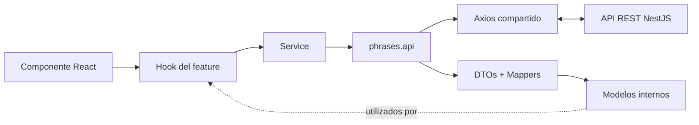
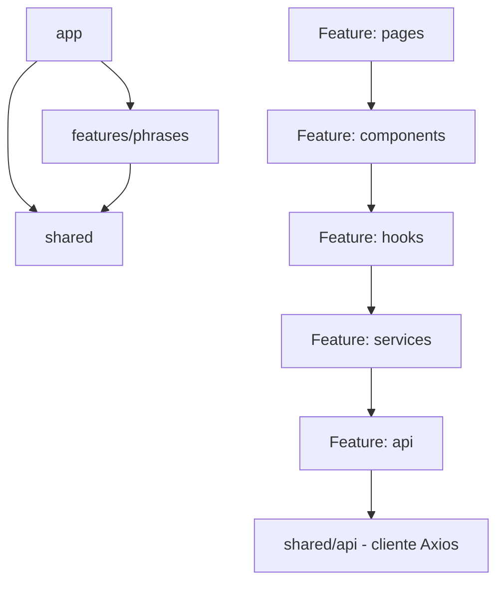

# Bloque 03 — Arquitectura Frontend

**Proyecto:** Semantic Phrase App  
**Estado:** Aprobado — decisiones B03-D01 a B03-D16  
**Fecha:** 21 de octubre de 2026  
**Ubicación prevista en el repositorio:** `docs/03-architecture/03-frontend-architecture.md`  
**Alcance:** diseño interno del frontend React/TypeScript del MVP; no constituye implementación.

## 1. Visión general

El frontend permite listar frases registradas, ingresar una frase, solicitar su validación semántica y, si existe una coincidencia potencial, mostrar el resultado y solicitar la decisión humana antes de guardar. Consumirá una API REST síncrona expuesta por NestJS. La similitud detectada es un **resultado funcional**, no un error HTTP.

La aplicación reside en `apps/frontend/` de un monorepo administrado mediante **pnpm workspaces, sin Turborepo**. Se construye con React y TypeScript sobre **Vite**, se organiza mediante **Screaming Architecture por funcionalidades** y utiliza **un único feature inicial: `phrases`**. No replica la arquitectura hexagonal ni los agregados del backend.

El backend conserva la autoridad sobre validación semántica, reglas de negocio, vigencia y consumo del token de validación, y persistencia. El frontend conserva la responsabilidad de la experiencia de usuario y del flujo de confirmación. Los endpoints y campos exactos se ajustarán al contrato OpenAPI aprobado cuando esté disponible.

## 2. Principios arquitectónicos

1. **Organización por capacidad de negocio:** el árbol de carpetas debe revelar `phrases` como funcionalidad principal.
2. **Simplicidad:** no agregar clases, interfaces o capas adicionales para operaciones que no las necesitan. El acceso a la API siempre pasa por un service.
3. **Responsabilidades explícitas:** presentación, estado de UI, coordinación y HTTP tienen límites diferentes.
4. **Anti-Corruption Layer ligera:** los contratos DTO externos se traducen a modelos internos en la frontera API cuando existe transformación; los componentes no consumen DTOs directamente.
5. **Colocalización:** componentes, páginas, hooks y services tienen carpetas autocontenidas; tipos, pruebas y utilidades cercanos a sus consumidores.
6. **Dependencias controladas:** `shared/` nunca importa funcionalidades ni composición de aplicación; no se permiten ciclos.
7. **API-first y testabilidad:** el comportamiento observable y las pruebas del flujo crítico son prioritarios.
8. **Human-in-the-Loop:** el usuario confirma o cancela el guardado cuando hay posible duplicado; un fallo técnico nunca se interpreta como validación aprobada.

## 3. Organización por features

El MVP tendrá `features/phrases/`, que contiene registro, listado, validación y confirmación. No se crearán `create-phrase`, `list-phrases` ni `phrase-validation` como features separados. Aunque en backend existan `Phrase` y `PhraseValidation` como agregados independientes, el frontend organiza las capacidades según la experiencia funcional, no por correspondencia obligatoria con agregados.

Las páginas pertenecen al feature: `features/phrases/pages/phrases/`. `app/` aloja el enrutamiento y los providers; **no habrá una carpeta global `pages/`**. `shared/` almacena únicamente componentes, clientes y utilidades verdaderamente transversales.

## 4. Capas pragmáticas y responsabilidades

| Ubicación                | Responsabilidad                                                                   | No debe hacer                                        |
| ------------------------ | --------------------------------------------------------------------------------- | ---------------------------------------------------- |
| `app/`                   | Inicio de la aplicación, rutas, providers globales                                | Reglas de frases o llamadas de negocio               |
| `pages/` del feature     | Composición de la pantalla y secciones                                            | HTTP directo, transformación de DTOs                 |
| `components/`            | Renderizado, interacción y accesibilidad                                          | Acceder a Axios o DTOs de NestJS                     |
| `hooks/`                 | Estado React y del flujo, composición de React Hook Form/TanStack Query, handlers | Implementar transporte HTTP o lógica de persistencia |
| `services/`              | Único punto de acceso a `api/` desde el feature; coordina lógica de aplicación    | Importar React                                       |
| `interfaces/`            | Tipos/modelos internos del feature                                                | Depender de contratos HTTP externos                  |
| `schemas/`               | Validación local de formularios con Zod                                           | Sustituir validación de negocio del backend          |
| `api/`                   | Funciones HTTP de frases y ACL mediante DTOs y mappers                            | Gestionar estado visual, modales o navegación        |
| `shared/api/`            | Configuración y normalización técnica del cliente Axios                           | Interpretar reglas específicas de frases             |
| `shared/components/ui/`  | Componentes visuales genéricos                                                    | Importar código de `features/`                       |

**Services obligatorios.** Los hooks no llaman a `phrases.api.ts` directamente: toda conexión con la API pasa por un service, que es independiente de React y comprobable sin él.

## 5. Convenciones y estructura de carpetas

Todos los **archivos** y directorios de unidades se denominan en **kebab-case**. Los símbolos TypeScript conservan sus convenciones: componentes, tipos e interfaces en `PascalCase`; funciones, hooks y variables en `camelCase`; constantes globales en `UPPER_SNAKE_CASE` cuando corresponda.

| Tipo de archivo               | Patrón                                             | Ejemplo                           |
| ----------------------------- | -------------------------------------------------- | --------------------------------- |
| Componente                    | `.component.tsx`                                   | `phrase-form.component.tsx`       |
| Página                        | `.page.tsx`                                        | `phrases.page.tsx`                |
| Hook                          | `.hook.ts` (o `.tsx` si contiene JSX)              | `use-phrases.hook.ts`             |
| Service                       | `.service.ts`                                      | `phrase-submission.service.ts`    |
| Tipos propios                 | `.types.ts`                                        | `phrase-form.types.ts`            |
| Tipos/modelo interno          | `.interfaces.ts` (o `.enum.ts` para enumeraciones) | `phrase.interfaces.ts`            |
| DTO                           | `.dto.ts`                                          | `phrase-response.dto.ts`          |
| Mapper                        | `.mapper.ts`                                       | `phrase.mapper.ts`                |
| Schema                        | `.schema.ts`                                       | `phrase.schema.ts`                |
| Función API                   | `.api.ts`                                          | `phrases.api.ts`                  |
| Utilidades/constantes         | `.util.ts` / `.constants.ts`                       | `phrase-form.util.ts`             |
| Provider                      | `.provider.tsx`                                    | `query.provider.tsx`              |
| Estilos propios opcionales    | `.scss`                                            | `phrase-form.scss`                |
| Prueba                        | `.spec.ts` / `.spec.tsx`                           | `phrase-form.spec.tsx`            |
| Exportación pública de unidad | `index.ts`                                         | `components/phrase-form/index.ts` |

**Estructura de referencia (no lista obligatoria de archivos):**

```text
apps/frontend/
├── src/
│   ├── app/
│   │   ├── app.component.tsx
│   │   ├── app.router.tsx
│   │   └── providers/
│   │       └── query.provider.tsx
│   ├── features/
│   │   └── phrases/
│   │       ├── pages/
│   │       │   └── phrases/
│   │       │       ├── index.ts
│   │       │       ├── phrases.page.tsx
│   │       │       ├── phrases.types.ts              # si aplica
│   │       │       └── phrases.spec.tsx              # prueba pertinente
│   │       ├── components/
│   │       │   ├── phrase-form/
│   │       │   │   ├── index.ts
│   │       │   │   ├── phrase-form.component.tsx
│   │       │   │   ├── phrase-form.types.ts           # si aplica
│   │       │   │   ├── phrase-form.spec.tsx
│   │       │   │   ├── phrase-form.util.ts            # opcional
│   │       │   │   └── phrase-form.scss               # opcional
│   │       │   ├── phrase-list/
│   │       │   │   ├── index.ts
│   │       │   │   ├── phrase-list.component.tsx
│   │       │   │   ├── phrase-list.types.ts           # si aplica
│   │       │   │   └── phrase-list.spec.tsx
│   │       │   └── similarity-confirmation/
│   │       │       ├── index.ts
│   │       │       ├── similarity-confirmation.component.tsx
│   │       │       ├── similarity-confirmation.types.ts
│   │       │       └── similarity-confirmation.spec.tsx
│   │       ├── hooks/
│   │       │   ├── use-phrases/
│   │       │   │   ├── index.ts
│   │       │   │   ├── use-phrases.hook.ts
│   │       │   │   ├── use-phrases.types.ts           # si aplica
│   │       │   │   └── use-phrases.spec.ts
│   │       │   └── use-phrase-submission/
│   │       │       ├── index.ts
│   │       │       ├── use-phrase-submission.hook.ts
│   │       │       ├── use-phrase-submission.types.ts # si aplica
│   │       │       └── use-phrase-submission.spec.ts
│   │       ├── services/
│   │       │   └── phrase-submission/
│   │       │       ├── index.ts
│   │       │       ├── phrase-submission.service.ts
│   │       │       ├── phrase-submission.types.ts     # si aplica
│   │       │       └── phrase-submission.spec.ts
│   │       ├── interfaces/
│   │       │   ├── phrase.interfaces.ts
│   │       │   ├── phrase-validation.interfaces.ts
│   │       │   └── phrase-match-type.enum.ts
│   │       ├── schemas/
│   │       │   └── phrase.schema.ts                   # compartido por el feature
│   │       ├── utils/                                 # solo utilidades de varios consumidores
│   │       ├── api/
│   │       │   ├── phrases.api.ts
│   │       │   ├── dtos/
│   │       │   │   ├── phrase.dto.ts
│   │       │   │   └── validation.dto.ts
│   │       │   └── mappers/
│   │       │       ├── phrase.mapper.ts
│   │       │       └── validation.mapper.ts
│   │       └── __tests__/
│   │           └── phrase-submission.integration.spec.tsx
│   ├── shared/
│   │   ├── api/
│   │   │   └── http-client.ts
│   │   └── components/
│   │       └── ui/
│   │           ├── button/
│   │           │   ├── index.ts
│   │           │   └── button.component.tsx
│   │           ├── input/
│   │           │   ├── index.ts
│   │           │   └── input.component.tsx
│   │           └── modal/
│   │               ├── index.ts
│   │               └── modal.component.tsx
│   ├── main.tsx
│   └── index.css
├── package.json
└── tsconfig.json
```

`main.tsx` se conserva como **punto de entrada convencional** del runtime, una excepción práctica a los sufijos por responsabilidad. No se crearán archivos `types`, tests o services vacíos. `index.ts` expone únicamente las funciones, componentes y tipos públicos, mediante exportaciones explícitas; el código interno importa archivos hermanos directamente para evitar ciclos.

## 6. Gestión de estado y datos

- **Estado local:** `useState` para entradas y UI transitoria; `useReducer` solo para transiciones locales que justifiquen una máquina de estados simple.
- **Formularios:** React Hook Form administra valores, errores de formulario, touched y submit; Zod define validaciones sintácticas del cliente por medio de `@hookform/resolvers`.
- **Estado remoto:** TanStack Query administra listado, consultas, mutaciones, estados de carga y errores e invalidación posterior al guardado.
- **Estado compartido:** `useContext` solo cuando aparezca una necesidad concreta; no Redux ni Zustand en el MVP.
- **Validación temporal:** resultado, coincidencia, puntaje y token asociado a la frase permanecen en el flujo de envío; si cambia el texto, el frontend invalida el resultado anterior y exige una nueva validación.

Las respuestas de TanStack Query y de los hooks orientadas a componentes serán **modelos internos**, nunca DTOs HTTP.

## 7. Comunicación REST y capa anticorrupción

`shared/api/http-client.ts` centraliza la configuración de Axios (URL base por entorno, errores técnicos y timeouts cuando proceda). `features/phrases/api/phrases.api.ts` encapsula operaciones de negocio sobre REST. `api/dtos/` modela contratos de transporte y `api/mappers/` adapta entre DTOs y modelos internos; cuando la estructura coincide sin transformación real, se evita un mapper artificial.



La capa API transforma tanto respuestas como solicitudes si lo requiere el contrato. Los detalles de serialización, rutas, nombres de campos, código de estado y formato de errores serán contrastados con la especificación REST posterior; este documento no fija endpoints inventados. Axios no exige interceptors por defecto. Las reintentos de mutaciones no deben configurarse de forma que dupliquen guardados.

## 8. Componentes, navegación y estilos

**React Router** se configura desde `app/app.router.tsx` y registra inicialmente una pantalla del feature `phrases`; no introduce pantallas adicionales ficticias. `pages/phrases/phrases.page.tsx` compone los componentes específicos. Se podrán agregar rutas nuevas sin cambiar la organización funcional.

`shared/components/ui/` aloja controles genéricos (`button`, `input`, `modal`, etc.) y cada uno puede ser autocontenido. `features/phrases/components/` contiene interfaces específicas como formulario, listado y confirmación semántica.

**Tailwind CSS** es el sistema principal de estilos integrado en la compilación; no se usará el CDN del prototipo en la aplicación final. SCSS solo se añade a una unidad si expresa una necesidad concreta; requerirá la dependencia de Sass cuando realmente se utilice. No se adoptan shadcn/ui ni una librería visual completa. Los controles propios deben respetar semántica HTML, etiquetado, foco, teclado y accesibilidad del modal.

## 9. Validaciones, errores y feedback

- Zod valida el formulario de forma local. El backend continúa siendo la fuente de autoridad para las reglas y para la similitud semántica.
- `shared/api/` convierte errores de transporte en una forma técnica consistente y evita filtrar información sensible.
- El feature interpreta los errores funcionales y muestra mensajes adecuados. TanStack Query expone estados `pending`, `error` y `success`.
- Durante validación o guardado, la UI indica progreso y previene dobles envíos.
- Una posible coincidencia muestra frase similar y score, y ofrece confirmar o cancelar. **La similitud no es una excepción**.
- Si el usuario cancela, no se solicita el guardado. Si el token vence o el backend rechaza la operación, la interfaz solicita repetir la validación; nunca guarda implícitamente.
- Ante falla de red o backend se conserva el texto introducido y se ofrece reintentar cuando sea seguro.

## 10. Estrategia de testing

Herramientas aprobadas: **Vitest + React Testing Library + MSW**. No se incorpora Playwright al MVP. Ver alternativas evaluadas en [Alternativas de librerías evaluadas](#alternativas-de-librerías-evaluadas) al final de este documento. Preferir pruebas de comportamiento y casos límite, no snapshots masivos ni cobertura artificial.

| Sujeto           | Enfoque                                                         | Ubicación                                           |
| ---------------- | --------------------------------------------------------------- | --------------------------------------------------- |
| Componente       | Interacción, accesibilidad esencial, errores y estados visibles | `components/<nombre>/<nombre>.spec.tsx`             |
| Página           | Composición e integración funcional pertinente                  | `pages/<nombre>/<nombre>.spec.tsx`                  |
| Hook             | Estados, transiciones e invalidaciones                          | `hooks/<nombre>/<nombre>.spec.ts` o `.tsx`          |
| Service          | Coordinación pura mediante dobles de API                        | `services/<nombre>/<nombre>.spec.ts`                |
| Mapper           | Transformaciones, nulos, fechas y límites de contrato           | Test junto a su `.mapper.ts`                        |
| HTTP/flujo       | Comportamiento con respuestas simuladas por MSW                 | `features/phrases/__tests__/*.integration.spec.tsx` |

Escenarios prioritarios: listado inicial y vacío, formulario inválido, validación en curso, resultado sin coincidencia, posible duplicado con confirmación/cancelación, guardado exitoso, invalidación del listado, error de red, expiración de validación, cambio de texto posterior a validación y prevención de doble envío.

## 11. Reglas de dependencias y exportaciones



1. `shared/` no importa `app/` ni `features/`.
2. `app/` compone providers y rutas; puede importar la página pública del feature.
3. Los componentes no deben acceder al HTTP ni a DTOs; consumen props, hooks y modelos internos. Los hooks no importan `api/` directamente: pasan por un service.
4. Los hooks no importan `app/`; los services no importan React.
5. DTOs se limitan a la frontera API; los modelos internos no dependen de Axios.
6. Se permiten importaciones directas dentro del feature, pero sin ciclos ni acceso indiscriminado a los archivos internos de otras unidades.
7. `index.ts` es la **API pública** de cada carpeta autocontenida (componentes, páginas, hooks, services). Exportar explícitamente y evitar barrels generales que oculten dependencias.
8. Las utilidades permanecen en el consumidor; se elevan a nivel de feature cuando tienen varios consumidores y a `shared/` solo cuando son genuinamente transversales.
9. No se exige una carpeta por DTO, mapper o modelo, ni puertos, repositorios abstractos ni use cases formales.

## 12. Registro de decisiones aprobadas

| ID      | Decisión aprobada                                                                                                                 |
| ------- | --------------------------------------------------------------------------------------------------------------------------------- |
| B03-D01 | Screaming Architecture por features; DTOs + mappers + modelos internos como ACL; sin arquitectura hexagonal frontend              |
| B03-D02 | Hooks para estado React; services obligatorios como único acceso a la API                                                         |
| B03-D03 | Un único feature inicial `phrases`                                                                                                |
| B03-D04 | React Hooks + TanStack Query para estado remoto; sin Zustand/Redux                                                                |
| B03-D05 | Axios con cliente HTTP centralizado                                                                                               |
| B03-D06 | React Hook Form + Zod + resolver para formularios                                                                                 |
| B03-D07 | Tailwind CSS y componentes UI propios; SCSS opcional cuando se justifique                                                         |
| B03-D08 | Errores técnicos normalizados en `shared/api/`; feedback funcional dentro de `phrases`                                            |
| B03-D09 | React Router desde el inicio; una página inicial                                                                                  |
| B03-D10 | Vitest + React Testing Library + MSW; sin Playwright inicial                                                                      |
| B03-D11 | Dependencias controladas, `shared/` mínimo, `app/` para configuración y páginas dentro del feature                                |
| B03-D12 | Aprobación de la estructura base y de su enfoque ligero; servicios/mappers no artificiosos y tests cercanos                       |
| B03-D13 | Archivos en kebab-case con sufijos `.component`, `.page`, `.hook`, `.service`, `.model`, `.dto`, `.mapper`, `.schema` y similares |
| B03-D14 | Componentes y páginas en carpetas autocontenidas, con `index.ts` y tipos/tests/utilidades/SCSS colocalizados cuando corresponda   |
| B03-D15 | Tipos cercanos a su responsabilidad y hooks autocontenidos (`index.ts`, `.hook.ts`, `.types.ts`, `.spec.ts`)                      |
| B03-D16 | Services también autocontenidos (`index.ts`, `.service.ts`, `.types.ts`, `.spec.ts`)                                   |

## Alternativas de librerías evaluadas

| Decisión                                                           | Alternativas consideradas                                         | Justificación                                                                                                                                                                                                                                                                                                                    |
| ------------------------------------------------------------------ | ----------------------------------------------------------------- | -------------------------------------------------------------------------------------------------------------------------------------------------------------------------------------------------------------------------------------------------------------------------------------------------------------------------------- |
| Vite                                                               | Create React App, `webpack` configurado a mano, Next.js           | CRA está deprecado oficialmente; Next.js añade SSR/routing de servidor innecesario para una SPA pura; Vite da dev server y HMR rápidos con configuración mínima.                                                                                                                                                                 |
| Axios como cliente HTTP centralizado (`shared/api/http-client.ts`) | `fetch` nativo                                                    | Los interceptors de Axios centralizan baseURL, headers y errores técnicos, que es justo el punto de la capa anticorrupción de la Sección 7; con `fetch` habría que reconstruir esa capa a mano.                                                                                                                                  |
| React Hook Form + Zod (`@hookform/resolvers`)                      | Formik                                                            | Inputs no controlados (menos re-renders que Formik) y reutiliza la misma librería de esquemas (Zod) que ya se usa en otras fronteras del proyecto.                                                                                                                                                                               |
| TanStack Query para estado remoto                                  | Redux, Zustand                                                    | No hay estado global complejo en el MVP: TanStack ya cubre cache e invalidación de red sin el boilerplate de una store.                                                                                                                                                                                                          |
| Tailwind CSS + componentes UI propios                              | shadcn/ui o librería visual completa; SCSS como sistema principal | Utility-first sin runtime ni tema a mantener aparte; el proyecto tiene pocos controles propios (`button`, `input`, `modal`) y no justifica el peso de una librería de componentes completa. SCSS queda disponible solo para casos puntuales.                                                                                     |
| React Router                                                       | TanStack Router                                                   | Estándar de facto con menor curva de entrada; TanStack Router añade generación de tipos de rutas que no aporta valor con una sola pantalla activa.                                                                                                                                                                               |
| Vitest + React Testing Library + MSW                               | Jest + RTL; Playwright                                            | Vitest corre sobre el mismo motor que Vite (el dev server), sin configuración de transform aparte como exigiría Jest aquí. Playwright es E2E de navegador real, fuera de alcance del MVP. **Nota de alcance:** en el código, MSW se usa hoy en un único spec (`phrases.data.spec.ts`, el POST de creación), no en toda la suite. |

## 13. Trazabilidad y verificaciones pendientes

**Bases confirmadas en artefactos de arquitectura disponibles:** `01-system-overview.md` establece React, el monorepo pnpm, REST síncrono, enfoque HITL y frontend por funcionalidad; `02-backend-architecture.md` define validación temporal, token, guardado y consumo atómico en backend. El enunciado del reto exige formulario, listado, validación, coincidencia, puntuación y confirmación. Las decisiones B03-D01 a B03-D16 constan de la aprobación explícita en la conversación.

**No verificado:** no se localizaron copias exactas de `docs/00-discovery/product-brief.md`, `docs/02-ui/ui-spec.md` ni `prototypes/ui/index.html` en los recursos accesibles. En consecuencia, esta especificación **no afirma** colores, medidas, componentes definitivos del prototipo ni contenido no observado de esos archivos. Al obtenerlos, cotejar la composición de la UI sin modificar silenciosamente decisiones aprobadas.

**Pendiente de otros bloques:** contratos REST exactos, nomenclatura de campos y códigos de error, detalles del token, configuración operativa del modelo y de la persistencia. No son decisiones del frontend en este bloque.

---

**Límite del entregable:** documento de arquitectura únicamente. No se ha implementado código, configurado dependencias ni inicializado aplicaciones.
