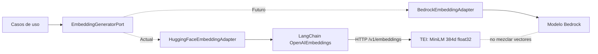

# Bloque 04 — Arquitectura de Inteligencia Artificial

**Proyecto:** Semantic Phrase App  
**Estado:** Aprobado — decisiones B04-D01 a B04-D11  
**Alcance:** Integración de IA para validación semántica de frases (`apps/backend`). Ante discrepancia con el código, manda el código.  
**Fuera de alcance:** persistencia y SQL (`05-data-architecture.md`), endpoints, errores HTTP y registro de frases (`06-api-security.md`), casos de uso y puertos de persistencia (`02-backend-architecture.md`).

## 1. Visión general

La IA **advierte sobre posibles duplicados; no decide guardar ni rechazar** (_Human-in-the-Loop_, HITL). Para cada frase nueva se genera un embedding, se busca la frase activa más cercana por similitud coseno y se compara la puntuación con un umbral. El resultado es una advertencia que el usuario confirma o cancela.

- La inferencia **no corre en Node.js**: la hace un contenedor _Text Embeddings Inference_ (TEI) de Hugging Face (`embeddings` en `compose.yaml`), al que el backend llama por HTTP (`POST /v1/embeddings`, API compatible con OpenAI).
- El backend solo conoce el puerto `EmbeddingGeneratorPort`; LangChain y TEI son detalles de infraestructura.
- No hay chains, agentes, herramientas LLM, colas ni workers.
- El embedding se genera una sola vez, al validar; el registro posterior lo reutiliza sin nueva inferencia.

## 2. Modelo y configuración desplegada

Modelo único activo (B04-D02): `sentence-transformers/paraphrase-multilingual-MiniLM-L12-v2`, 384 dimensiones.

| Propiedad           | Evaluada (experimentos)                  | Desplegada (código y `compose.yaml`)                                  |
| ------------------- | ---------------------------------------- | --------------------------------------------------------------------- |
| Artefacto / runtime | `Xenova/…` con `@huggingface/transformers` | TEI `cpu-arm64-1.9.4` (contenedor)                                    |
| Revisión del modelo | —                                        | `e8f8c211226b894fcb81acc59f3b34ba3efd5f42`                            |
| Precisión           | ONNX `q8`                                | `float32` (`--dtype float32`)                                         |
| Pooling             | Mean                                     | Mean (`--pooling mean`)                                               |
| Normalización       | L2 en el pipeline                        | Salida ya normalizada; el adaptador no renormaliza ni comprueba norma |
| Truncado            | —                                        | `--auto-truncate=false`                                               |
| Umbral              | `0.8538613695045911`                     | `0.8538613695045911` (`AI_SIMILARITY_THRESHOLD`)                      |

**Riesgo conocido:** el umbral se calibró con vectores `q8` y se aplica a vectores `float32`; no hay recalibración con el runtime desplegado.

**Calidad:** MiniLM se eligió por viabilidad y mejor resultado en el flujo probado, no por calidad apta para producción. En el holdout del flujo completo acertó 12/20; detectó solo 2 de 10 positivos (8 falsos negativos, 0 falsos positivos). Mediciones, datasets y método: `docs/01-ai-feasibility/model-decision.md` y `experiments/semantic-similarity/`.

## 3. Puerto y adaptador

`EmbeddingGeneratorPort` es una clase abstracta TypeScript (referencia de DI de NestJS) con una operación: `generate(text) → GeneratedEmbedding`.

| Campo de `GeneratedEmbedding` | Significado                                                                    |
| ----------------------------- | ------------------------------------------------------------------------------ |
| `embedding`                   | Value object `Embedding`: 384 componentes numéricos finitos (`Embedding.DIMENSIONS`) |
| `model.id`                    | Modelo (`AI_MODEL`)                                                            |
| `model.version`               | Configuración efectiva (`AI_EMBEDDING_VERSION`, formato `tei-<sha256>`)        |

`HuggingFaceEmbeddingAdapter` (`infrastructure/embeddings/huggin-face/`) implementa el puerto con `OpenAIEmbeddings` de LangChain apuntando a `${AI_EMBEDDINGS_URL}/v1` (`apiKey` vacía, `maxRetries: 0`, `timeout = AI_INFERENCE_TIMEOUT_MS`). No usa modelos de OpenAI. Responsabilidades:

1. Llamar a TEI con `embedQuery(text)`.
2. Construir el `Embedding` del dominio (valida dimensión y valores).
3. Adjuntar `PhraseModel` con `AI_MODEL` y `AI_EMBEDDING_VERSION` tal como están configurados (no se verifican contra `/info` de TEI).
4. Convertir cualquier fallo (red, timeout, 429/500, JSON inválido, vector inválido) en `AiUnavailableError`.

El adaptador no elige candidatos, no consulta SQL, no aplica umbrales. `PhrasesModule` lo enlaza con `useClass`; no hay `AiModule` aparte.

## 4. Similitud y umbral

**Embeddings.** Misma configuración TEI para la consulta y los vectores almacenados. Sin chunking (entradas cortas). La normalización no garantiza distinguir negaciones, fechas, entidades ni acciones opuestas.

**Recuperación.** Top-1 exacto por distancia coseno de pgvector (puntuación `1 - distancia`, acotada a [-1, 1]), sin índice ANN, reranker ni Top-K. La consulta y el desempate están en `05-data-architecture.md`.

**Decisión.** `PhraseValidation` compara la puntuación con el umbral de forma inclusiva (`score >= umbral`). La selección del candidato es de persistencia; la decisión de alertar, de aplicación.

**Calibración.** El umbral `0.8538613695045911` sale de 40 validaciones de calibración (máximo de decisiones correctas; empates: menos FP, menos FN, umbral más alto) y se evaluó sin ajustar en un holdout de 20. No se recalibra con ese mismo holdout. `AI_SIMILARITY_THRESHOLD` no se valida: un valor no numérico produce `NaN` y desactiva la alerta vectorial.

Si cambian el modelo, la configuración de generación o la definición de “posible duplicado”, hay que evaluar de nuevo, calibrar con datos etiquetados independientes y validar en un holdout separado. **Un puntaje de 0,85 no es una probabilidad de 85 %**: el umbral solo detecta coincidencias potenciales para revisión humana.

## 5. Configuración y arranque

**B04-D03.** El modelo no se carga en NestJS. En `onModuleInit` el adaptador exige `AI_EMBEDDING_DIMENSIONS=384` y hace una inferencia de prueba contra TEI; si no responde, el proceso termina con `AiUnavailableError`. `docker compose up -d --wait` debe completarse antes de iniciar el backend. La primera vez, TEI descarga el modelo en el volumen `embeddings_data` (puede tardar varios minutos).

| Variable                  | Valor / política                                                                                      |
| ------------------------- | ----------------------------------------------------------------------------------------------------- |
| `AI_EMBEDDINGS_URL`       | `http://127.0.0.1:8080` desde el host; `http://embeddings:80` en la red Docker. Sin validación        |
| `AI_MODEL`                | `sentence-transformers/paraphrase-multilingual-MiniLM-L12-v2` (debe coincidir con `--model-id` de TEI) |
| `AI_EMBEDDING_VERSION`    | `tei-<sha256 del descriptor del perfil TEI>`; se copia a cada vector                                  |
| `AI_EMBEDDING_DIMENSIONS` | `384`; otro valor hace fallar el arranque                                                             |
| `AI_SIMILARITY_THRESHOLD` | `0.8538613695045911` por defecto                                                                      |
| `AI_INFERENCE_TIMEOUT_MS` | `5000` en el ejemplo; se pasa al SDK sin validar                                                      |

Pooling, precisión y `--auto-truncate=false` se fijan en los argumentos de TEI en `compose.yaml`, no en variables del backend. Cambiar modelo, revisión o parámetros de TEI exige actualizar `AI_MODEL` y `AI_EMBEDDING_VERSION` de forma coordinada. La imagen es `cpu-arm64`; en otra arquitectura hay que ajustar imagen y plataforma. Referencia: `apps/backend/.env.example`.

## 6. Errores de IA

**B04-D09.** Timeout configurable, errores técnicos controlados y reintento **manual** desde la interfaz. Sin reintentos automáticos, fallback entre modelos ni cambio de proveedor a mitad de una validación. Un fallo técnico nunca se presenta como “sin duplicados” ni genera referencia utilizable.

| Escenario                                                | Política                                                          |
| -------------------------------------------------------- | ----------------------------------------------------------------- |
| TEI no responde al arrancar / dimensión distinta de 384  | El proceso no arranca (`AiUnavailableError` o error de configuración) |
| Inferencia excede el timeout                             | El SDK aborta; `AiUnavailableError` → 503 `AI_UNAVAILABLE`        |
| Embedding con NaN, infinito o dimensión distinta de 384  | `Embedding` lo rechaza; el adaptador lanza `AiUnavailableError`   |
| Similitud sobre el umbral                                | Resultado funcional de posible duplicado, no una excepción        |

El catálogo completo de errores HTTP, incluidos los de persistencia y compatibilidad de modelo, está en `06-api-security.md`.

## 7. Versionado de embeddings y cambio de modelo

**B04-D08.** Cada vector se guarda con `model_id` y `model_version`, y la búsqueda filtra por ambos. No se comparan embeddings de versiones incompatibles; el nombre del modelo o la dimensión no bastan para garantizar compatibilidad. `model.version` debe cambiar con cualquier variación de revisión, pooling, precisión o configuración que altere el espacio vectorial. Cambiar de modelo no es cambiar una variable: los vectores anteriores no se reutilizan, y no hay backfill automático.

**Cambio controlado (manual en el MVP):**

1. Evaluar el nuevo modelo (dimensiones, pooling, normalización, recursos, compatibilidad con el puerto).
2. Calibrar su propio umbral con datos adecuados.
3. Solo si hace falta, regenerar con una tarea administrativa manual los embeddings de las frases existentes.
4. Comprobar cobertura completa de vectores válidos y compatibles.
5. Activar modelo, versión y umbral de forma coordinada, evitando búsquedas mixtas.

No habrá orquestador de migraciones, doble escritura, plugins dinámicos ni ejecución multimodelo. Almacenamiento y activación: `05-data-architecture.md`.

**B04-D11.** Hoy solo existe el adaptador TEI. Un futuro `BedrockEmbeddingAdapter` podría implementar el mismo puerto sin tocar dominio ni casos de uso, pero exigiría evaluación y migración de embeddings. No hay selección dinámica por solicitud.

El diagrama muestra extensibilidad de diseño, no dos proveedores implementados.

## 8. Pruebas

**B04-D10.** Pruebas técnicas con Jest y regresión semántica ligera, sin plataforma de evaluación continua.

- **Adaptador** (`HuggingFaceEmbeddingAdapter`, `fetch` simulado): éxito, timeout, 429/500, JSON inválido, dimensión incorrecta y comprobación de arranque.
- **Casos de uso:** puertos simulados; no hay inferencia real. El E2E simula TEI.
- **No cubierto en el backend:** integración real contra TEI y regresión semántica; esta última vive en `experiments/semantic-similarity/`.

Las evaluaciones de **pares aislados** y de **validación completa contra frases almacenadas** deben mantenerse separadas; sus umbrales no son intercambiables. Mejoras semánticas o umbrales alternativos exigen datos nuevos o un conjunto reservado no usado antes.

## 9. Decisiones y trade-offs

| ID      | Decisión                                                                                       | Trade-off y límite                                                  |
| ------- | ---------------------------------------------------------------------------------------------- | ------------------------------------------------------------------- |
| B04-D01 | LangChain (`OpenAIEmbeddings`) + servicio TEI (contenedor) mediante adaptador hexagonal         | Un contenedor adicional; el modelo no consume memoria en NestJS     |
| B04-D02 | MiniLM multilingüe, 384 dimensiones (evaluado en `q8`, desplegado en `float32`)                 | Viabilidad y rendimiento favorables; detección semántica limitada   |
| B04-D03 | Comprobación de arranque contra TEI (inferencia de prueba y dimensión 384)                      | El backend no arranca si TEI no responde                            |
| B04-D04 | `EmbeddingGeneratorPort` retorna `GeneratedEmbedding` (embedding + modelo id/versión)           | Más metadatos; habilita comprobaciones de compatibilidad            |
| B04-D05 | Mean pooling y salida normalizada en TEI; similitud coseno en pgvector                          | Vectores coherentes, sin resolver errores semánticos                |
| B04-D06 | Top-1 exacto con contrato extensible                                                            | Sin múltiples candidatos ni reranking                               |
| B04-D07 | Umbral por modelo calibrado; MiniLM inicia en `0.8538613695045911`                              | Trazable al flujo completo; holdout detectó solo 2/10 positivos     |
| B04-D08 | Versionado de embeddings y migración manual controlada                                          | Cambio de modelo exige operación administrativa                     |
| B04-D09 | Timeout configurable, error controlado y reintento manual                                       | Sin failover automático                                             |
| B04-D10 | Jest + regresión offline ligera                                                                 | Evidencia semántica limitada a los datasets existentes              |
| B04-D11 | Configuración por entorno + NestJS DI (`useClass`); un proveedor activo                         | Cambio por despliegue y migración coordinada; sin registry dinámico |

**Alternativas evaluadas**

| Decisión                                         | Alternativas                                                                                  | Justificación                                                                                                                                                                        |
| ------------------------------------------------ | --------------------------------------------------------------------------------------------- | ------------------------------------------------------------------------------------------------------------------------------------------------------------------------------------ |
| Contenedor TEI consumido por HTTP                | Modelo in-process con `@huggingface/transformers` (como se evaluó primero)                    | TEI aísla el ciclo de vida del modelo con su propio healthcheck; NestJS no carga pesos. In-process acopla ambos ciclos y obliga a reiniciar el backend para cambiar el modelo.        |
| LangChain `OpenAIEmbeddings` como cliente de TEI | `fetch` directo contra `/v1/embeddings`; `@huggingface/inference`                             | TEI es compatible con OpenAI y `OpenAIEmbeddings` aporta una interfaz `Embeddings` estándar. Con `fetch` habría que implementar headers, timeout y parseo en el propio adaptador.      |

## 10. Pendientes

- Recalibrar o validar el umbral `0.8538613695045911` con los vectores `float32` de TEI (se calibró con `q8`).
- Contrastar `AI_EMBEDDING_VERSION` con `/info` de TEI (hoy se copia de la configuración).
- Validar la configuración `AI_*` al arrancar (hoy es ad hoc).
- Aceptar como limitación del reto los 8 falsos negativos de 10 positivos del holdout, hasta tener datos nuevos que justifiquen un cambio.
