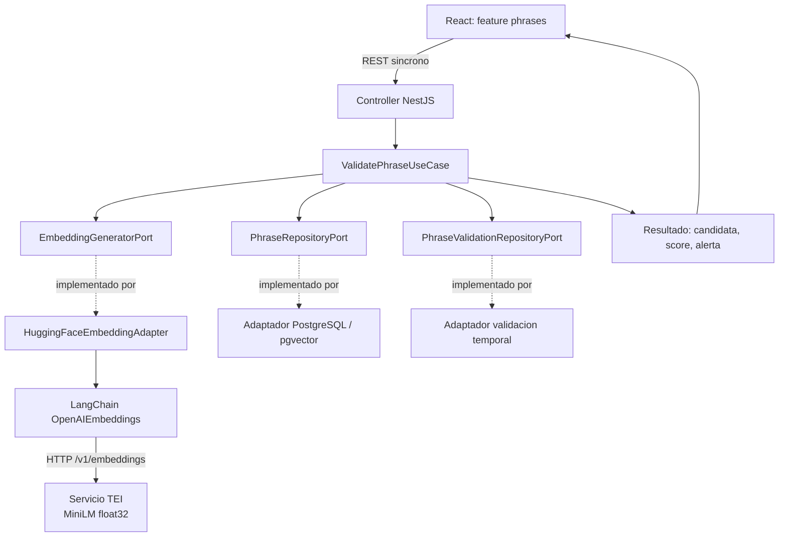
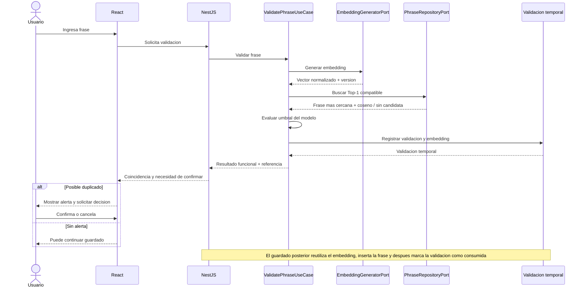
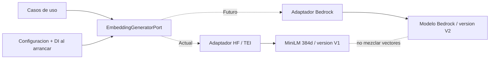

# Bloque 04 — Arquitectura de Inteligencia Artificial

> Revisado contra el código implementado (2026-10-24); ante discrepancia manda el código.

Cambio incompatible (2026-10-22): `validationId` sustituye a `validationToken`, sin alias.
Se devuelve el UUID v4 aleatorio de la validación persistida, sin firma ni JWT.
Los JWT anteriores dejan de formar parte del contrato; las filas existentes pueden
referenciarse por su UUID. No hay migración ni secreto de firma requerido.
El registro (F003) busca por `validationId`, comprueba vigencia (`now >= expiresAt`
implica expiración), texto, modelo/versión, confirmación y estado no consumido, inserta
la frase y después marca la validación como consumida (en una única transacción).
TTL configurable inicialmente de 15 minutos; respuesta y fila comparten expiración.

**Proyecto:** Semantic Phrase App  
**Estado:** Aprobado — decisiones B04-D01 a B04-D11; B04-D01, D03 y D11 revisadas contra el código  
**Fecha:** 21 de octubre de 2026  
**Ubicación:** `docs/03-architecture/04-ai-architecture.md`  
**Alcance:** Integración de IA para validación semántica de frases, conforme a lo implementado en `apps/backend`.

## 1. Visión general

La aplicación valida una frase nueva contra las frases registradas y, cuando detecta una posible coincidencia semántica, solicita confirmación humana (*Human-in-the-Loop*, HITL). La IA **advierte sobre posibles duplicados; no decide autónomamente guardar ni rechazar**. La validación y la creación son operaciones distintas: `ValidatePhraseUseCase` genera un embedding, busca la coincidencia más cercana, evalúa el umbral y registra la validación temporal; `CreatePhraseUseCase` reutiliza el embedding de la validación previa y no vuelve a inferir.

La solución se ejecuta dentro de un **monolito modular NestJS/TypeScript**, con un solo módulo de negocio inicial (`PhrasesModule`), arquitectura hexagonal y API REST síncrona. El frontend React conserva la experiencia de confirmación; no ejecuta embeddings ni calcula decisiones de similitud. No hay colas ni workers. **La inferencia no corre dentro del proceso Node.js**: se delega en un contenedor *Text Embeddings Inference* (TEI) de Hugging Face (`embeddings` en `compose.yaml`) al que el backend llama por HTTP (`POST /v1/embeddings`, API compatible con OpenAI).

**Límite del bloque:** responsabilidades y contratos de IA; endpoints, SQL y seguridad están en los bloques 05 y 06.

## 2. Base documental, evidencias y restricciones

### 2.1 Decisiones heredadas

- `01-system-overview.md`: monolito modular, REST síncrono, Hugging Face mediante LangChain y TEI, puertos hexagonales, HITL y modelos sustituibles.
- `02-backend-architecture.md`: `PhrasesModule`, puertos abstractos TypeScript, `EmbeddingGeneratorPort`, `PhraseRepositoryPort`, `PhraseValidationRepositoryPort`; cuatro casos de uso; validación temporal con referencia UUID y persistencia previa del embedding; **Jest** para pruebas backend.
- `03-frontend-architecture.md`: feature `phrases` con Screaming Architecture; el frontend interpreta las posibles coincidencias como resultados funcionales y los fallos de inferencia como errores técnicos.
- Evaluación de modelos suministrada por el usuario, titulada **“Evaluación y decisión de modelo para el MVP”**, fechada 20–21/10/2026: prueba de viabilidad local y del flujo completo con PostgreSQL y pgvector.

**Límite de verificación:** la evaluación hace referencia a DEC-022, que retiró el 75 % de accuracy como condición obligatoria de entrega; esta afirmación procede de la evaluación (`model-decision.md`), no de una revisión independiente del Product Brief.

### 2.2 Configuración evaluada y configuración desplegada

| Propiedad | Evaluada (experimentos) | Desplegada (código y `compose.yaml`) |
|---|---|---|
| Modelo original | `sentence-transformers/paraphrase-multilingual-MiniLM-L12-v2` | Igual, revisión `e8f8c211226b894fcb81acc59f3b34ba3efd5f42` |
| Artefacto / runtime | `Xenova/…` con `@huggingface/transformers` `3.8.1` | TEI `cpu-arm64-1.9.4` (contenedor) |
| Formato y precisión | ONNX, `q8` | `float32` (`--dtype float32`) |
| Dispositivo | CPU | CPU |
| Pooling | Mean | Mean (`--pooling mean`) |
| Normalización | L2 (aplicada en el pipeline) | La salida del endpoint compatible ya viene normalizada; el adaptador no renormaliza ni comprueba la norma |
| Truncado | — | `--auto-truncate=false` |
| Dimensiones | 384 | 384 (se exige al arrancar) |
| Umbral del flujo | `0.8538613695045911` | `0.8538613695045911` por defecto (`AI_SIMILARITY_THRESHOLD`) |

Este es el **modelo único activo** (B04-D02). **Riesgo conocido:** el umbral se calibró con vectores `q8` de Transformers.js y se aplica a vectores `float32` de TEI; no hay una recalibración registrada con el runtime desplegado. Los vectores `Xenova` anteriores conservan su identidad (modelo/versión) y quedan excluidos de la comparación coseno.

### 2.3 Resultados de AI Feasibility

| Medición MiniLM | Resultado observado |
|---|---:|
| Comparación de pares v2 — calibración | 31/40 (77,5 %) |
| Comparación de pares v2 — holdout | 13/20 (65 %) |
| Umbral diagnóstico de pares | `0.6763989282227754` |
| Flujo completo — calibración | 22/40 (55 %) |
| Flujo completo — holdout | **12/20 (60 %)** |
| Flujo holdout: TP / TN / FP / FN | **2 / 10 / 0 / 8** |
| Flujo holdout: errores de recuperación Top-1 | 0 |
| Flujo holdout: p95 `validate` | 7,81 ms |
| Inferencia caliente: mediana / p95 (8 repeticiones) | 2,85 / 6,07 ms |
| Carga desde caché | 394,4 ms |
| Pico de memoria RSS | 690,6 MiB |
| Descarga inicial observada | 129,1 MiB |

Las mediciones de rendimiento fueron tomadas en macOS `arm64`, Node.js `v22.12.0`, CPU y `q8`, con muestras pequeñas. El p95 del flujo incluye embedding y búsqueda con tres frases activas y modelo precargado; **no representa la latencia de la API HTTP completa**. La prueba comprobó funcionamiento sin red con caché de modelo preparada; caché vacía o incompleta impidió inicializar.

**Interpretación:** MiniLM se eligió por viabilidad, menor consumo y mejor resultado en el flujo probado frente a BGE-M3, **no por una calidad semántica ya apta para producción**. Con el umbral inicial, quedaron sin alerta 8 de 10 positivos del holdout; la principal limitación fue la decisión por umbral, no la recuperación Top-1 en esa muestra. El umbral de pares (`0.6763989282227754`) no se debe reemplazar por el del flujo: ambos corresponden a tareas y conjuntos distintos. La etiqueta de “duplicado potencial” significa que conviene advertir para revisión humana, no igualdad textual ni probabilidad calibrada.

## 3. Integración con LangChain

El caso de uso no importa LangChain, modelos ni proveedores. Consume `EmbeddingGeneratorPort` y recibe un `GeneratedEmbedding { embedding: Embedding, model: PhraseModel { id, version } }`. `HuggingFaceEmbeddingAdapter` (en `infrastructure/embeddings/huggin-face/`) crea un `OpenAIEmbeddings` de LangChain apuntando a `${AI_EMBEDDINGS_URL}/v1` con `apiKey` vacía, `maxRetries: 0` y `timeout = AI_INFERENCE_TIMEOUT_MS`. No usa modelos de OpenAI.

Responsabilidades del adaptador:

1. Llamar a TEI con `embedQuery(text)`; el modelo y su caché pertenecen al contenedor.
2. Construir el `Embedding` del dominio, que exige 384 componentes numéricos finitos.
3. Adjuntar `PhraseModel` con `AI_MODEL` y `AI_EMBEDDING_VERSION` tal como están configurados (no se verifican contra `/info` de TEI).
4. Convertir cualquier fallo (red, timeout, 429/500, JSON inválido, vector inválido) en `AiUnavailableError`.
5. Registrar en el log el modelo, la longitud del texto, las primeras componentes del vector y la duración.

El adaptador no escoge candidatos, no consulta SQL, no aplica umbrales ni emite referencias. LangChain se mantiene como detalle de infraestructura; **no se usan chains, agentes ni herramientas LLM**.

## 4. Puertos, adaptadores y responsabilidades

### 4.1 Contrato conceptual del puerto

`EmbeddingGeneratorPort` es una **clase abstracta TypeScript**, utilizable como referencia de Dependency Injection de NestJS, conforme al Bloque 02. Su única operación es `generate(text) → GeneratedEmbedding`.

| Campo de `GeneratedEmbedding` | Significado |
|---|---|
| `embedding` | Value object `Embedding` (384 componentes finitos; la constante `Embedding.DIMENSIONS` fija la dimensión) |
| `model.id` | Identificador del modelo (`AI_MODEL`) |
| `model.version` | Identificador de la configuración efectiva (`AI_EMBEDDING_VERSION`, formato `tei-<sha256>`) |

`model.version` debe distinguir combinaciones incompatibles de revisión/pesos, pooling, precisión y configuración que alteren el espacio vectorial. No debe asumirse que el nombre del modelo, ni solo su dimensión, garanticen compatibilidad; por eso la búsqueda vectorial filtra por `model_id` y `model_version`.

### 4.2 División funcional

| Elemento | Responsabilidad |
|---|---|
| `ValidatePhraseUseCase` | Obtener embedding, solicitar la coincidencia (`findValidationMatch`), establecer el resultado funcional (la comparación `score >= umbral` vive en `PhraseValidationMatch`); coordinar validación temporal y referencia |
| `EmbeddingGeneratorPort` | Abstraer generación y metadatos del embedding |
| `HuggingFaceEmbeddingAdapter` | LangChain `OpenAIEmbeddings` contra TEI, comprobación de arranque y conversión de fallos |
| `PhraseRepositoryPort` | `findValidationMatch`: coincidencia textual exacta y, si no hay, Top-1 coseno; sin exponer pgvector al caso de uso |
| Adaptador de persistencia | Ejecutar la búsqueda exacta Top-1 por distancia coseno y devolver frase y puntuación |
| `PhraseValidationRepositoryPort` | Conservar la validación temporal, incluido su embedding, según arquitectura backend aprobada |
| `CreatePhraseUseCase` | Reutilizar el embedding validado, insertar la frase y marcar la validación como consumida (una transacción), sin segunda inferencia |
| Frontend | Mostrar posible coincidencia, puntuación y permitir confirmación/cancelación |

No se creará `AiModule` separado ni `InfrastructureModule` genérico sin necesidad justificada; `PhrasesModule` conserva la composición de dependencias.

## 5. Pipeline de validación semántica

1. El usuario ingresa una frase y solicita validación desde React.
2. La API pasa el comando al `ValidatePhraseUseCase`.
3. El caso de uso solicita un embedding al `EmbeddingGeneratorPort`.
4. El adaptador obtiene de TEI un vector de 384 dimensiones y lo devuelve con los metadatos de modelo/versión configurados.
5. El caso de uso llama una sola vez a `PhraseRepositoryPort.findValidationMatch`, que busca primero una coincidencia **textual exacta** (texto normalizado, frases activas, sin importar el modelo) y, si no hay, la de **mayor similitud coseno** (Top-1 exacto en pgvector, frases activas con el mismo `model_id` y `model_version`).
6. El repositorio devuelve, cuando existe, la frase más cercana y su puntuación coseno (`null` en las coincidencias textuales), que siempre exigen confirmación. Desempates: textual `created_at DESC, id DESC`; vectorial `distancia ASC, id ASC`.
7. `PhraseValidationMatch` compara la puntuación con el umbral vigente (inclusivo, `>=`) y determina si debe emitirse una alerta de posible duplicado.
8. La validación temporal conserva el embedding generado y la información necesaria para que el registro posterior no requiera inferencia adicional; el mecanismo de referencia y su persistencia siguen el Bloque 02.
9. El frontend presenta la coincidencia y su puntaje; cuando corresponde, solicita confirmación humana antes de guardar.
10. `CreatePhraseUseCase` verifica las condiciones, usa el embedding anterior, inserta la frase y después marca la validación como consumida (en una única transacción).

**Caso sin frases activas:** no hay coincidencia (`match: null`); resultado funcional válido, sin puntuación. **Caso con frases activas pero ninguna del modelo/versión actual y sin igualdad textual:** el repositorio lanza `IncompatiblePhraseCollectionError` y la API responde 500 `INTERNAL_ERROR`. **Caso con fallo técnico:** se interrumpe la validación y no se devuelve un resultado de “sin duplicados”.

## 6. Embeddings, similitud y umbral

### 6.1 Generación y normalización

Se aplica el mismo procesamiento (el servicio TEI con su configuración fija: mean pooling, `float32`, salida normalizada) al embedding de consulta y a los almacenados; la dimensión 384 se exige al arrancar y en el value object `Embedding`. No se aplica chunking: las entradas del MVP son frases cortas, no documentos extensos. La normalización no garantiza distinguir negaciones, fechas, entidades ni acciones opuestas.

La similitud coseno entre vectores `a` y `b` es `cos(a,b) = (a·b) / (||a|| ||b||)`. Con vectores unitarios, equivale al producto punto, pero el repositorio usa el operador de distancia coseno de pgvector y convierte a puntuación `1 - distancia`, acotada a [-1, 1] para absorber ruido de punto flotante.

### 6.2 Recuperación y selección

La búsqueda es **Top-1 exacta**, sin índice ANN, reranker ni pipeline Top-K. La selección de la frase más cercana pertenece a la persistencia; la decisión de alertar pertenece a aplicación. No se requieren por ahora contratos de búsqueda múltiple ni cross-encoders. Se mantiene la posibilidad de extender el contrato cuando exista evidencia funcional que lo exija.

### 6.3 Calibración y configuración

El valor por defecto para el **flujo completo** es **`0.8538613695045911`**, configurable con `AI_SIMILARITY_THRESHOLD` (en el código no hay validación de rango: un valor no numérico produce `NaN` y desactiva la alerta vectorial). Procede de una calibración de 40 validaciones y fue evaluado sin ajustarlo en el holdout de 20. El evaluador eligió el umbral que maximizó decisiones correctas en calibración, resolviendo empates por menos FP, menos FN y umbral más alto. No se recalibrará a partir del mismo holdout publicado, pues introduciría sesgo.

Si cambia el modelo, la configuración de generación o la definición de “posible duplicado”, hay que ejecutar una evaluación nueva, calibrar con datos etiquetados independientes y validar en un holdout separado. **Un puntaje 0,85 no significa 85 % de probabilidad de duplicado.** El umbral detecta coincidencias potenciales para HITL, no ofrece certeza semántica.

## 7. Configuración y ciclo de vida

**B04-D03: comprobación de arranque.** El modelo no se carga en NestJS. Durante el arranque (`onModuleInit`) el adaptador exige `AI_EMBEDDING_DIMENSIONS=384` y hace una inferencia de prueba contra TEI; si el servicio no responde, el proceso termina con `AiUnavailableError`. Por eso `docker compose up -d --wait` debe completarse antes de iniciar el backend. En TEI, la primera vez se descarga el modelo en el volumen `embeddings_data` (puede tardar varios minutos).

Configuración real (variables de entorno del backend, ver `apps/backend/.env.example`):

| Variable | Valor / política |
|---|---|
| `AI_EMBEDDINGS_URL` | `http://127.0.0.1:8080` desde el host; `http://embeddings:80` dentro de la red Docker. Sin validación |
| `AI_MODEL` | `sentence-transformers/paraphrase-multilingual-MiniLM-L12-v2` (debe coincidir con `--model-id` de `compose.yaml`) |
| `AI_EMBEDDING_VERSION` | `tei-<sha256 del descriptor del perfil TEI>`; se copia tal cual a cada vector |
| `AI_EMBEDDING_DIMENSIONS` | `384`; si es otro valor el arranque falla |
| `AI_SIMILARITY_THRESHOLD` | `0.8538613695045911` por defecto |
| `AI_INFERENCE_TIMEOUT_MS` | `5000` en el ejemplo; se pasa al SDK sin validar |
| `PHRASE_VALIDATION_TTL_MINUTES` | `15` por defecto |

`AI_PROVIDER` no existe: el adaptador está enlazado por `useClass` en `PhrasesModule`. El pooling, la precisión (`float32`) y `--auto-truncate=false` se fijan en los argumentos de TEI en `compose.yaml`, no en variables del backend. Cambiar modelo, revisión o parámetros de TEI exige actualizar `AI_MODEL` y `AI_EMBEDDING_VERSION` de forma coordinada. La imagen de `compose.yaml` es `cpu-arm64`; en otra arquitectura hay que ajustar imagen y plataforma.

## 8. Errores y resiliencia

**B04-D09:** timeout configurable, errores técnicos controlados y reintento **manual** desde la interfaz. No habrá reintentos automáticos, fallback entre modelos ni cambio de proveedor a mitad de una validación.

| Escenario | Política |
|---|---|
| TEI no responde al arrancar / dimensión distinta de 384 | El proceso no arranca (`AiUnavailableError` o error de configuración) |
| Inferencia excede el timeout | El SDK aborta la petición; la API responde 503 `AI_UNAVAILABLE` y no se crea la validación |
| Embedding con NaN, infinito o dimensión distinta de 384 | `Embedding` lo rechaza y el adaptador lo convierte en `AiUnavailableError` (503 `AI_UNAVAILABLE`); no se comprueba la norma |
| Búsqueda vectorial falla | `DatabaseError` → 500 `DATABASE_ERROR`; no se responde “sin duplicados” |
| Embedding incompatible con los almacenados | Las filas de otro modelo/versión se filtran; si hay filas activas pero ninguna compatible y no hay igualdad textual, 500 `INTERNAL_ERROR`; en el registro, validación de otro modelo → 409 `INCOMPATIBLE_MODEL` |
| Similitud sobre el umbral | Resultado funcional de posible duplicado, no una excepción HTTP |

El contrato de errores REST está en `06-api-security.md`. Una validación que falló técnicamente no genera referencia utilizable.

## 9. Versionado, migración y cambio de proveedores

**B04-D08:** cada embedding se asocia a la identidad efectiva de su espacio vectorial. No se comparan embeddings generados bajo versiones incompatibles. Cambiar de modelo no equivale a modificar una variable y reutilizar los vectores anteriores. Los vectores se guardan con `model_id` y `model_version`; no hay backfill automático.

**Política de cambio controlado, sin automatización en el MVP:**

1. Seleccionar y evaluar el nuevo modelo; verificar dimensiones, pooling, normalización, recursos y compatibilidad con el puerto.
2. Calibrar su propio umbral sobre un conjunto adecuado de datos.
3. Ejecutar, **solo cuando se necesite**, una tarea administrativa manual que regenere los embeddings de frases existentes con la nueva versión; se permite reutilizar el adaptador y las operaciones por lotes si procede.
4. Comprobar que todas las frases que participarán en búsquedas tienen vector válido, versión compatible y cobertura completa.
5. Activar el proveedor/modelo y umbral correspondientes **de forma coordinada**, evitando búsquedas mixtas; en caso de error, mantener la versión previa operativa o suspender temporalmente la validación hasta restablecer consistencia.

El MVP **no incluirá** orquestador de migraciones, doble escritura permanente, registro dinámico de plugins, ejecución multimodelo simultánea ni script automático obligatorio desde el inicio. Los detalles de almacenamiento y activación atómica se definirán en el bloque de persistencia.

**B04-D11:** `PhrasesModule` enlaza el puerto abstracto con `HuggingFaceEmbeddingAdapter` mediante `useClass` (no hay selección por configuración). Hoy solo se implementa este adaptador (TEI). Un futuro `BedrockEmbeddingAdapter` podrá implementar el mismo puerto; exigiría evaluación y migración de embeddings y posiblemente nuevas credenciales/configuraciones, pero no cambios en el dominio ni en los casos de uso mientras se respete el contrato. No existe selección dinámica por solicitud.

## 10. Evaluación, métricas y testing

**B04-D10:** testing técnico y regresión semántica ligera, sin LangSmith ni plataforma de evaluación continua. Backend con **Jest**; la regresión semántica offline vive en `experiments/semantic-similarity/`, no en el backend.

| Nivel | Pruebas existentes |
|---|---|
| Unitario: `ValidatePhraseUseCase` | Puertos simulados; umbral; candidato/no candidato; no guarda cuando falla inferencia o búsqueda |
| Unitario: `CreatePhraseUseCase` | Reutiliza el embedding de la validación; no llama al modelo; referencia, estado, modelo y confirmación |
| Unitario: adaptador | `HuggingFaceEmbeddingAdapter` con `fetch` simulado: éxito, timeout, 429/500, JSON inválido, dimensión incorrecta, comprobación de arranque |
| Unitario: repositorios Drizzle | Consultas y mapeo con base de datos simulada |
| E2E HTTP | `phrase-validations.e2e-spec.ts` (incluye TEI simulado vía SDK) y `phrase-registration.e2e-spec.ts`, con puertos sustituidos |
| No cubierto en el backend | Integración real contra PostgreSQL/pgvector o TEI; regresión semántica offline (está en `experiments/`) |

Las métricas de calidad relevantes son accuracy, precision, recall, F1 y F2, falsos positivos, falsos negativos y errores Top-1. Las métricas técnicas incluyen carga del modelo, latencia caliente, p95 del flujo y consumo de memoria. Debe mantenerse separada la evaluación de **pares aislados** de la validación completa **contra múltiples frases almacenadas**.

La evaluación disponible ya establece la línea base; no hace falta repetir una selección amplia de modelos antes de implementar. No se establece objetivo universal de accuracy/F1 ni se presenta el holdout como certificación de calidad productiva. Nuevas mejoras semánticas o umbrales alternativos exigirán datos nuevos o un conjunto reservado no utilizado en decisiones previas.

## 11. Diagramas Mermaid

### 11.1 Dependencias hexagonales

Las conexiones de puertos a adaptadores representan implementación y resolución en tiempo de ejecución; el sentido de las dependencias de código permanece hacia los contratos de aplicación.

### 11.2 Validación y confirmación HITL

Ante fallos técnicos, la rama de validación finaliza sin resultado exitoso ni referencia usable para guardar.

### 11.3 Sustitución futura de proveedor

El diagrama muestra **extensibilidad de diseño**, no dos proveedores implementados ni ejecutándose en paralelo.

## 12. Registro de decisiones y trade-offs

| ID | Decisión aprobada | Trade-off y límite |
|---|---|---|
| B04-D01 | **Revisada:** LangChain (`OpenAIEmbeddings`) + servicio TEI (contenedor) mediante adaptador hexagonal | Sin API externa de pago; un contenedor adicional; el modelo no consume memoria en NestJS |
| B04-D02 | MiniLM multilingüe, 384 dimensiones, seleccionado tras evaluación (evaluado en `q8`; desplegado en `float32`) | Viabilidad y rendimiento favorables; detección semántica limitada |
| B04-D03 | **Revisada:** comprobación de arranque contra TEI (inferencia de prueba y dimensión 384) | El backend no arranca si TEI no responde |
| B04-D04 | `EmbeddingGeneratorPort` retorna `GeneratedEmbedding` (embedding + modelo id/versión) | Más metadatos; habilita comprobaciones de compatibilidad |
| B04-D05 | Mean pooling y salida normalizada en TEI; similitud coseno en pgvector | Coherencia de vectores, sin resolver por sí solo errores semánticos |
| B04-D06 | Top-1 exacto con contrato extensible | Suficiente para el reto; no devuelve múltiples candidatos ni reranking |
| B04-D07 | Umbral por modelo calibrado; MiniLM inicia en `0.8538613695045911` | Trazable al flujo completo; holdout detectó solo 2/10 positivos |
| B04-D08 | Versionado de embeddings y migración manual controlada, sin automatización MVP | Menor complejidad actual; cambio de modelo exige operación administrativa |
| B04-D09 | Timeout configurable, error controlado y reintento manual | Sin failover automático; una inferencia fallida no autoriza guardar |
| B04-D10 | Jest + integración real + regresión offline ligera | Sin plataforma continua; evidencia semántica limitada a datasets existentes |
| B04-D11 | Configuración por entorno + NestJS DI (`useClass`); un proveedor activo | Cambio por despliegue y migración coordinada; sin registry dinámico |

## 13. Pendientes explícitos y criterios de cierre

**Arquitectura del Bloque 04 implementada.** Quedan abiertos:

- Recalibrar o validar el umbral `0.8538613695045911` con los vectores `float32` de TEI (se calibró con `q8`).
- `AI_EMBEDDING_VERSION` se copia de la configuración; no se contrasta automáticamente con `/info` de TEI.
- Validar la configuración (URL, timeout, umbral, TTL) al arrancar; hoy es ad hoc.
- Conservar como limitación aceptada del reto los **8 falsos negativos de 10 positivos** del holdout del flujo, hasta disponer de nuevos datos que justifiquen un cambio.

Este documento separa resultados medidos, decisiones y asuntos abiertos; donde la implementación difiere de la decisión original, se indica.
