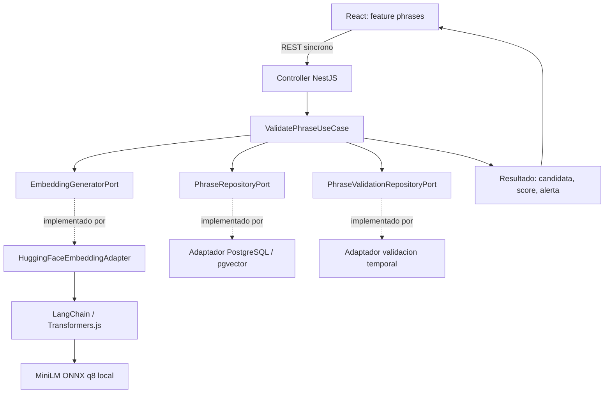
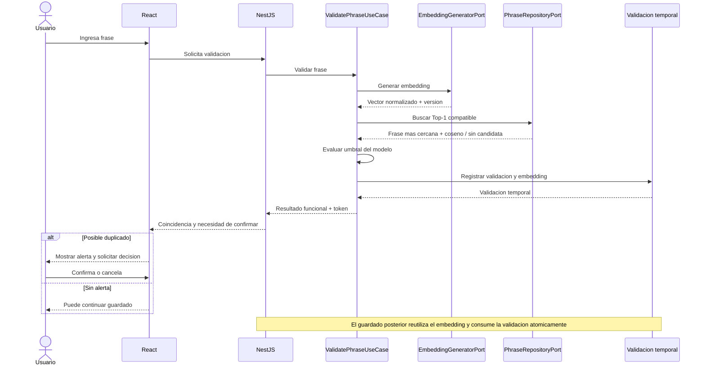
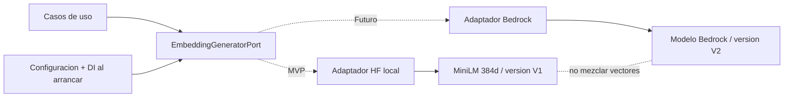

# Bloque 04 — Arquitectura de Inteligencia Artificial

**Proyecto:** Semantic Phrase App  
**Estado:** Aprobado — decisiones B04-D01 a B04-D11  
**Fecha:** 21 de octubre de 2026  
**Ubicación:** `docs/03-architecture/04-ai-architecture.md`  
**Alcance:** Diseño de integración de IA para validación semántica de frases del MVP. No constituye implementación.

## 1. Visión general

La aplicación valida una frase nueva contra las frases registradas y, cuando detecta una posible coincidencia semántica, solicita confirmación humana (*Human-in-the-Loop*, HITL). La IA **advierte sobre posibles duplicados; no decide autónomamente guardar ni rechazar**. La validación y la creación son operaciones distintas: `ValidatePhraseUseCase` genera un embedding, busca la coincidencia más cercana, evalúa el umbral y registra la validación temporal; `CreatePhraseUseCase` reutiliza el embedding de la validación previa y no vuelve a inferir.

La solución se ejecuta dentro de un **monolito modular NestJS/TypeScript**, con un solo módulo de negocio inicial (`PhrasesModule`), arquitectura hexagonal y API REST síncrona. El frontend React conserva la experiencia de confirmación; no ejecuta embeddings ni calcula decisiones de similitud. No se introducen microservicios, colas, workers, servidor Python ni servicio de inferencia remoto para el MVP.

**Límite del bloque:** se definen responsabilidades y contratos conceptuales de IA, no endpoints, esquemas SQL, ORM, índices, despliegue o seguridad general.

## 2. Base documental, evidencias y restricciones

### 2.1 Decisiones heredadas

- `01-system-overview.md`: monolito modular, pnpm workspaces, REST síncrono, Hugging Face local mediante LangChain, puertos hexagonales, HITL y modelos sustituibles.
- `02-backend-architecture.md`: `PhrasesModule`, puertos abstractos TypeScript, `EmbeddingGeneratorPort`, `PhraseRepositoryPort`, `PhraseValidationRepositoryPort`, `PhraseRegistrationPort`; tres casos de uso; validación temporal con token firmado y persistencia previa del embedding; **Jest** para pruebas backend.
- `03-frontend-architecture.md`: feature `phrases` con Screaming Architecture; el frontend interpreta las posibles coincidencias como resultados funcionales y los fallos de inferencia como errores técnicos.
- Evaluación de modelos suministrada por el usuario, titulada **“Evaluación y decisión de modelo para el MVP”**, fechada 20–21/10/2026: prueba de viabilidad local y del flujo completo con PostgreSQL y pgvector.

**Límite de verificación:** no se dispuso de copia verificable del contenido exacto de `docs/00-discovery/product-brief.md`. La evaluación hace referencia a DEC-022, que retiró el 75 % de accuracy como condición obligatoria de entrega; esta afirmación procede de la evaluación, no de una revisión independiente del Product Brief. Tampoco se verificaron en esta elaboración los datasets o scripts enlazados desde la evaluación.

### 2.2 Configuración evaluada y seleccionada

| Propiedad | Valor |
|---|---|
| Modelo original | `sentence-transformers/paraphrase-multilingual-MiniLM-L12-v2` |
| Artefacto local ensayado | `Xenova/paraphrase-multilingual-MiniLM-L12-v2` |
| Runtime ensayado | `@huggingface/transformers` `3.8.1` |
| Formato y cuantización | ONNX, `q8` |
| Dispositivo | CPU |
| Pooling | Mean |
| Normalización | L2 |
| Dimensiones | 384 |
| Umbral inicial del flujo | `0.8538613695045911` |

Este es el **modelo único activo del MVP** (B04-D02). La integración aprobada usa LangChain como fachada en el adaptador (B04-D01). **La equivalencia exacta del vector emitido por esa integración con el pipeline ensayado directamente en Transformers.js debe verificarse mediante test de integración**, incluyendo pooling, normalización, pesos y revisión del artefacto. No se presume que cualquier wrapper o identificador de modelo reproduzca automáticamente los resultados de la prueba.

### 2.3 Resultados de AI Feasibility

| Medición MiniLM | Resultado observado |
|---|---:|
| Comparación de pares v2 — calibración | 31/40 (77,5 %) |
| Comparación de pares v2 — holdout | 13/20 (65 %) |
| Umbral diagnóstico de pares | `0.6763989282227754` |
| Flujo completo — calibración | 22/40 (55 %) |
| Flujo completo — holdout | **12/20 (60 %)** |
| Flujo holdout: TP / TN / FP / FN | **2 / 10 / 0 / 8** |
| Flujo holdout: errores de recuperación Top-1 | 0 |
| Flujo holdout: p95 `validate` | 7,81 ms |
| Inferencia caliente: mediana / p95 (8 repeticiones) | 2,85 / 6,07 ms |
| Carga desde caché | 394,4 ms |
| Pico de memoria RSS | 690,6 MiB |
| Descarga inicial observada | 129,1 MiB |

Las mediciones de rendimiento fueron tomadas en macOS `arm64`, Node.js `v22.12.0`, CPU y `q8`, con muestras pequeñas. El p95 del flujo incluye embedding y búsqueda con tres frases activas y modelo precargado; **no representa la latencia de la API HTTP completa**. La prueba comprobó funcionamiento sin red con caché de modelo preparada; caché vacía o incompleta impidió inicializar.

**Interpretación:** MiniLM se eligió por viabilidad, menor consumo y mejor resultado en el flujo probado frente a BGE-M3, **no por una calidad semántica ya apta para producción**. Con el umbral inicial, quedaron sin alerta 8 de 10 positivos del holdout; la principal limitación fue la decisión por umbral, no la recuperación Top-1 en esa muestra. El umbral de pares (`0.6763989282227754`) no se debe reemplazar por el del flujo: ambos corresponden a tareas y conjuntos distintos. La etiqueta de “duplicado potencial” significa que conviene advertir para revisión humana, no igualdad textual ni probabilidad calibrada.

## 3. Integración con LangChain

El caso de uso no importa LangChain, Transformers.js, modelos ni proveedores. Consume el puerto `EmbeddingGeneratorPort` y recibe un `EmbeddingResult` independiente de librerías. El adaptador `HuggingFaceEmbeddingAdapter` encapsula la interoperabilidad con LangChain y el modelo ONNX local; transforma la salida del runtime, verifica los invariantes del vector y adjunta metadatos.

Responsabilidades del adaptador:

1. Configurar el artefacto MiniLM evaluado y sus opciones de inferencia (CPU, `q8`, mean pooling, L2).
2. Cargar una sola instancia local reutilizable durante el ciclo de vida del proceso.
3. Generar embeddings para el texto suministrado; no interpretar qué constituye duplicado.
4. Validar dimensión 384, finitud de los componentes y norma esperada; rechazar vectores inválidos.
5. Devolver metadatos efectivos de modelo y convertir fallos de librería en errores técnicos del puerto.

El adaptador no escoge candidatos, no consulta SQL, no aplica umbrales ni emite tokens. LangChain se mantiene como detalle de infraestructura; **no se crearán chains, agentes o herramientas LLM** para un problema de embeddings simples.

## 4. Puertos, adaptadores y responsabilidades

### 4.1 Contrato conceptual del puerto

`EmbeddingGeneratorPort` es una **clase abstracta TypeScript**, utilizable como token de Dependency Injection de NestJS, conforme al Bloque 02. Su operación principal es conceptualmente `generate(text) → EmbeddingResult`; no se exige otra operación de negocio para el MVP.

| Campo de `EmbeddingResult` | Significado |
|---|---|
| `vector` | Embedding normalizado (`number[]`), valores finitos |
| `modelId` | Identificador del modelo que generó el vector |
| `dimensions` | Longitud real del vector (384 para MiniLM) |
| `modelVersion` | Identificación efectiva de la configuración de generación |

`modelVersion` debe distinguir combinaciones incompatibles de revisión/pesos, pooling, normalización y configuración que altere el espacio vectorial. No debe asumirse que el nombre comercial del modelo, ni solo su dimensión, garanticen compatibilidad. Puede mantenerse un identificador lógico de versión de embeddings asociado a estos metadatos sin convertirlo en una jerarquía de tipos de dominio.

### 4.2 División funcional

| Elemento | Responsabilidad |
|---|---|
| `ValidatePhraseUseCase` | Obtener embedding, solicitar Top-1, comparar contra umbral y establecer el resultado funcional; coordinar validación temporal y token |
| `EmbeddingGeneratorPort` | Abstraer generación y metadatos del embedding |
| `HuggingFaceEmbeddingAdapter` | LangChain + MiniLM local, inicialización, transformación y validación técnica de vectores |
| `PhraseRepositoryPort` | Ofrecer recuperación conceptual de la coincidencia más cercana, sin exponer pgvector al caso de uso |
| Adaptador de persistencia | Ejecutar la búsqueda exacta Top-1 por distancia coseno y devolver frase y puntuación |
| `PhraseValidationRepositoryPort` | Conservar la validación temporal, incluido su embedding, según arquitectura backend aprobada |
| `CreatePhraseUseCase` / `PhraseRegistrationPort` | Reutilizar el embedding validado y registrar/consumir validación atómicamente, sin segunda inferencia |
| Frontend | Mostrar posible coincidencia, puntuación y permitir confirmación/cancelación |

No se creará `AiModule` separado ni `InfrastructureModule` genérico sin necesidad justificada; `PhrasesModule` conserva la composición de dependencias.

## 5. Pipeline de validación semántica

1. El usuario ingresa una frase y solicita validación desde React.
2. La API pasa el comando al `ValidatePhraseUseCase`.
3. El caso de uso solicita un embedding al `EmbeddingGeneratorPort`.
4. El adaptador Hugging Face produce un vector de 384 dimensiones, normalizado y con metadatos de versión.
5. El caso de uso solicita al `PhraseRepositoryPort` la coincidencia compatible de **mayor similitud** mediante búsqueda exacta Top-1 en PostgreSQL/pgvector.
6. El repositorio devuelve, cuando existe, la frase más cercana y su puntuación coseno. Una coincidencia textual normalizada puede tener prioridad, como en el flujo ensayado, sin asumir aquí reglas textuales no detalladas en los documentos base.
7. `ValidatePhraseUseCase` compara la puntuación con el umbral vigente **del modelo activo** y determina si debe emitirse una alerta de posible duplicado.
8. La validación temporal conserva el embedding generado y la información necesaria para que el registro posterior no requiera inferencia adicional; el mecanismo de token y su persistencia siguen el Bloque 02.
9. El frontend presenta la coincidencia y su puntaje; cuando corresponde, solicita confirmación humana antes de guardar.
10. `CreatePhraseUseCase` verifica las condiciones aprobadas, usa el embedding anterior y coordina guardado y consumo de la validación mediante la operación atómica ya prevista.

**Caso sin frases previas:** no hay coincidencia; el caso de uso debe devolver un resultado funcional válido, no inventar puntuación. **Caso con fallo técnico:** se interrumpe la validación y no se devuelve un resultado de “sin duplicados”.

## 6. Embeddings, similitud y umbral

### 6.1 Generación y normalización

Se aplicará el mismo procesamiento al embedding de consulta y a los almacenados: tokenización/modelo efectivos, mean pooling, normalización L2 y dimensión 384. No se aplicará chunking: las entradas del MVP son frases cortas, no documentos extensos. La normalización no garantiza distinguir negaciones, fechas, entidades ni acciones opuestas.

La similitud coseno entre vectores `a` y `b` es `cos(a,b) = (a·b) / (||a|| ||b||)`. Con vectores unitarios, equivale al producto punto, pero el repositorio utilizará semántica de similitud **coseno**, no una distancia no equivalente asumida por conveniencia. La conversión de distancia a puntuación debe preservar orden y significado y validarse con casos conocidos.

### 6.2 Recuperación y selección

La búsqueda inicial será **Top-1 exacta**, sin índice ANN, reranker ni pipeline Top-K en el MVP. La selección de la frase más cercana pertenece a la persistencia; la decisión de alertar pertenece a aplicación. No se requieren por ahora contratos de búsqueda múltiple ni cross-encoders. Se mantiene la posibilidad de extender el contrato cuando exista evidencia funcional que lo exija.

### 6.3 Calibración y configuración

El valor inicial aprobado para el **flujo completo** es **`0.8538613695045911`**, configurable. Procede de una calibración de 40 validaciones y fue evaluado sin ajustarlo en el holdout de 20. El evaluador eligió el umbral que maximizó decisiones correctas en calibración, resolviendo empates por menos FP, menos FN y umbral más alto. No se recalibrará a partir del mismo holdout publicado, pues introduciría sesgo.

Si cambia el modelo, la configuración de generación o la definición de “posible duplicado”, hay que ejecutar una evaluación nueva, calibrar con datos etiquetados independientes y validar en un holdout separado. **Un puntaje 0,85 no significa 85 % de probabilidad de duplicado.** El umbral detecta coincidencias potenciales para HITL, no ofrece certeza semántica.

## 7. Configuración y ciclo de vida

**B04-D03: Eager Loading + Singleton.** Durante el arranque de NestJS se inicializa el adaptador y carga el modelo local. La aplicación no debe declarar que puede validar frases hasta completar la inicialización y verificar el vector esperado. Cada proceso reutiliza su instancia; no se carga el modelo por petición.

Configuración conceptual (valores documentados frente a valores aún pendientes):

| Parámetro lógico | Valor / política |
|---|---|
| `AI_PROVIDER` | `huggingface` |
| `AI_MODEL` | `Xenova/paraphrase-multilingual-MiniLM-L12-v2` |
| `AI_EMBEDDING_VERSION` | Identificador explícito ligado a configuración efectiva; valor concreto por fijar |
| `AI_EMBEDDING_DIMENSIONS` | `384` |
| `AI_SIMILARITY_THRESHOLD` | `0.8538613695045911` inicialmente |
| `AI_INFERENCE_TIMEOUT_MS` | Configurable; cifra no aprobada |
| Pooling / normalización / cuantización | `mean` / `L2` / `q8` |

La forma exacta de inyectar estos parámetros y la ruta de caché son decisiones de implementación. La evaluación demostró que una caché íntegra permite ejecución sin conexión; no se supondrá que el primer arranque funcione sin artefactos disponibles. El consumo de memoria debe evaluarse en el entorno de destino, pues el pico observado de 690,6 MiB proviene de una medición local.

## 8. Errores y resiliencia

**B04-D09:** timeout configurable, errores técnicos controlados y reintento **manual** desde la interfaz. No habrá reintentos automáticos, fallback entre modelos ni cambio de proveedor a mitad de una validación.

| Escenario | Política |
|---|---|
| Modelo no puede inicializarse / caché incompleta | No declarar el servicio preparado para validaciones; exponer fallo técnico de inicialización |
| Inferencia excede timeout lógico | Fallar de forma controlada; no crear validación exitosa; comprobar durante integración si la operación nativa puede realmente interrumpirse |
| Embedding con NaN, infinito, dimensión o norma inválida | Rechazar como error técnico de inferencia; no consultar similitud con vector inválido |
| Búsqueda vectorial falla | Propagar error técnico normalizado; no responder “sin duplicados” |
| Embedding incompatible con los almacenados | Fallar y señalar problema de compatibilidad; nunca comparar espacios diferentes |
| Similitud sobre el umbral | Resultado funcional de posible duplicado, no una excepción HTTP |

No se prescribe aquí el código HTTP exacto ni el esquema de errores REST, que corresponden al bloque de API. No se debe emitir token válido o permitir el guardado basado en una validación que falló técnicamente.

## 9. Versionado, migración y cambio de proveedores

**B04-D08:** cada embedding se asocia a la identidad efectiva de su espacio vectorial. No se comparan embeddings generados bajo versiones incompatibles. Cambiar de MiniLM a DistilUSE o Bedrock no equivale a modificar una variable y reutilizar los vectores anteriores.

**Política de cambio controlado, sin automatización en el MVP:**

1. Seleccionar y evaluar el nuevo modelo; verificar dimensiones, pooling, normalización, recursos y compatibilidad con el puerto.
2. Calibrar su propio umbral sobre un conjunto adecuado de datos.
3. Ejecutar, **solo cuando se necesite**, una tarea administrativa manual que regenere los embeddings de frases existentes con la nueva versión; se permite reutilizar el adaptador y las operaciones por lotes si procede.
4. Comprobar que todas las frases que participarán en búsquedas tienen vector válido, versión compatible y cobertura completa.
5. Activar el proveedor/modelo y umbral correspondientes **de forma coordinada**, evitando búsquedas mixtas; en caso de error, mantener la versión previa operativa o suspender temporalmente la validación hasta restablecer consistencia.

El MVP **no incluirá** orquestador de migraciones, doble escritura permanente, registro dinámico de plugins, ejecución multimodelo simultánea ni script automático obligatorio desde el inicio. Los detalles de almacenamiento y activación atómica se definirán en el bloque de persistencia.

**B04-D11:** `PhrasesModule` enlazará el puerto abstracto al adaptador activo mediante Dependency Injection y configuración. Hoy solo se implementa Hugging Face local. Un futuro `BedrockEmbeddingAdapter` podrá implementar el mismo puerto; exigiría evaluación y migración de embeddings y posiblemente nuevas credenciales/configuraciones, pero no cambios en el dominio ni en los casos de uso mientras se respete el contrato. No existe selección dinámica por solicitud.

## 10. Evaluación, métricas y testing

**B04-D10:** testing técnico y regresión semántica ligera, sin LangSmith ni plataforma de evaluación continua para el MVP. El Bloque 02 establece **Jest** para pruebas backend; se mantiene esa elección.

| Nivel | Pruebas relevantes |
|---|---|
| Unitario: `ValidatePhraseUseCase` | Usa puertos simulados; aplica umbral; distingue candidato/no candidato; no guarda cuando falla inferencia o búsqueda |
| Unitario: `CreatePhraseUseCase` | Reutiliza embedding de validación; no vuelve a llamar al modelo; respeta token, estado y confirmación según backend |
| Contrato del adaptador | `EmbeddingResult` con 384 números finitos, L2 correcta e identidad de modelo/versión coherente |
| Integración real | Verificar LangChain + Transformers.js + artefacto ONNX `q8`; comparar comportamiento con baseline de evaluación; carga única y reutilización |
| Integración de recuperación | Top-1 exacto, orden correcto, coseno consistente y filtrado por versión compatible |
| Fallos | Caché incompleta, error de inferencia, timeout lógico, dimensión errónea y fallo de búsqueda sin falso resultado exitoso |
| Regresión semántica offline | Reejecutar datasets existentes con modelo y umbral congelados, registrar diferencias TP/TN/FP/FN y errores de recuperación |

Las métricas de calidad relevantes son accuracy, precision, recall, F1 y F2, falsos positivos, falsos negativos y errores Top-1. Las métricas técnicas incluyen carga del modelo, latencia caliente, p95 del flujo y consumo de memoria. Debe mantenerse separada la evaluación de **pares aislados** de la validación completa **contra múltiples frases almacenadas**.

La evaluación disponible ya establece la línea base; no hace falta repetir una selección amplia de modelos antes de implementar. No se establece objetivo universal de accuracy/F1 ni se presenta el holdout como certificación de calidad productiva. Nuevas mejoras semánticas o umbrales alternativos exigirán datos nuevos o un conjunto reservado no utilizado en decisiones previas.

## 11. Diagramas Mermaid

### 11.1 Dependencias hexagonales

Las conexiones de puertos a adaptadores representan implementación y resolución en tiempo de ejecución; el sentido de las dependencias de código permanece hacia los contratos de aplicación.

### 11.2 Validación y confirmación HITL

Ante fallos técnicos, la rama de validación finaliza sin resultado exitoso ni token usable para guardar.

### 11.3 Sustitución futura de proveedor

El diagrama muestra **extensibilidad de diseño**, no dos proveedores implementados ni ejecutándose en paralelo en el MVP.

## 12. Registro de decisiones y trade-offs

| ID | Decisión aprobada | Trade-off y límite |
|---|---|---|
| B04-D01 | LangChain + Hugging Face Transformers local mediante adaptador hexagonal | Sin API externa; consumo de CPU/RAM dentro de NestJS |
| B04-D02 | MiniLM ONNX `q8`, 384 dimensiones, seleccionado tras evaluación | Viabilidad y rendimiento favorables; detección semántica limitada |
| B04-D03 | Eager Loading y una instancia singleton por proceso | Arranque condicionado a carga; evita penalizar primera solicitud |
| B04-D04 | `EmbeddingGeneratorPort` retorna vector, modelo, dimensiones y versión | Más metadatos; habilita comprobaciones de compatibilidad |
| B04-D05 | Mean pooling y normalización L2 en adaptador; similitud coseno | Coherencia de vectores, sin resolver por sí solo errores semánticos |
| B04-D06 | Top-1 exacto con contrato extensible | Suficiente para el reto; no devuelve múltiples candidatos ni reranking |
| B04-D07 | Umbral por modelo calibrado; MiniLM inicia en `0.8538613695045911` | Trazable al flujo completo; holdout detectó solo 2/10 positivos |
| B04-D08 | Versionado de embeddings y migración manual controlada, sin automatización MVP | Menor complejidad actual; cambio de modelo exige operación administrativa |
| B04-D09 | Timeout configurable, error controlado y reintento manual | Sin failover automático; una inferencia fallida no autoriza guardar |
| B04-D10 | Jest + integración real + regresión offline ligera | Sin plataforma continua; evidencia semántica limitada a datasets existentes |
| B04-D11 | Configuración por entorno + NestJS DI; un proveedor activo | Cambio por arranque y migración coordinada; sin registry dinámico |

## 13. Pendientes explícitos y criterios de cierre

**Arquitectura del Bloque 04 cerrada**, con los siguientes datos aún por completar durante los bloques correspondientes o la implementación:

- Consultar el contenido exacto de `product-brief.md` y comprobar sus referencias DEC-022 y reglas específicas de “posible duplicado”.
- Confirmar la revisión exacta de pesos/artefacto ONNX y que el wrapper de LangChain reproduce el pooling, L2 y las salidas evaluadas en Transformers.js `3.8.1`.
- Fijar una identificación concreta de la versión efectiva de embeddings, consistente con los metadatos devueltos por el puerto.
- Ajustar y probar el timeout de inferencia en el entorno de ejecución definitivo; no se ha aprobado un número de milisegundos.
- Definir contratos REST, detalle del token y códigos de error en el bloque API.
- Diseñar esquema, mecanismos de búsqueda compatible por versión y eventual migración manual en el bloque persistencia, sin modificar las decisiones lógicas aquí establecidas.
- Conservar como limitación aceptada del reto los **8 falsos negativos de 10 positivos** del holdout del flujo, hasta disponer de nuevos datos que justifiquen un cambio.

**No se ha implementado código ni inicializado proyectos.** Este documento describe el diseño aprobado y separa expresamente resultados medidos, decisiones y asuntos pendientes.
