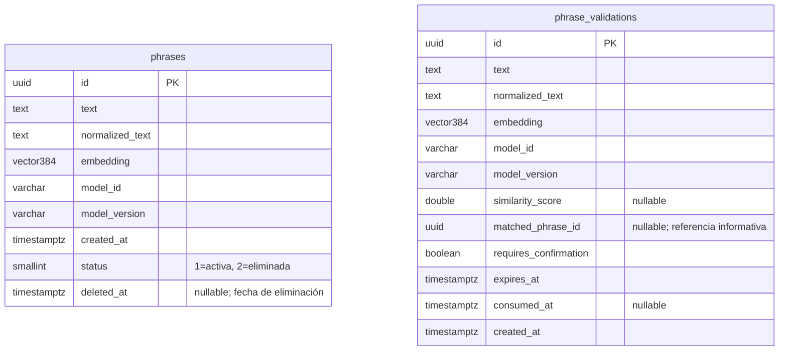
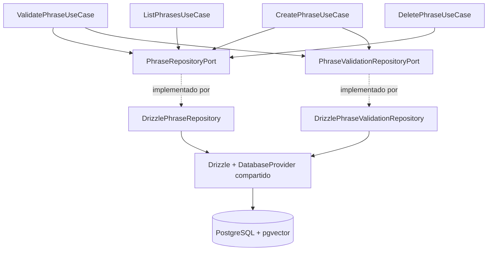
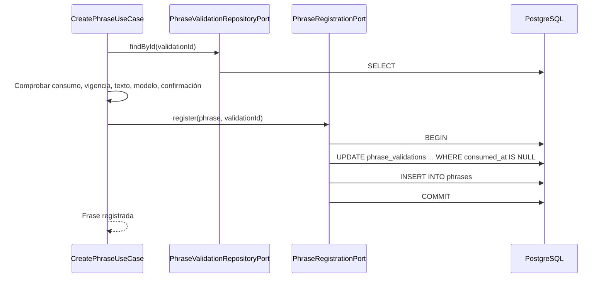
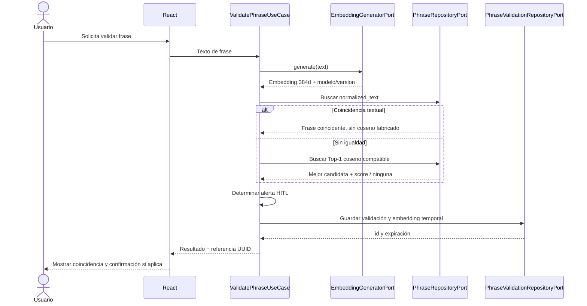

# Bloque 05 — Arquitectura de Persistencia

> **Revisado contra el código implementado (2026-10-24); ante discrepancia manda el código.**

Cambio incompatible (2026-10-22): `validationId` sustituye a `validationToken`, sin alias.
Se devuelve el UUID v4 aleatorio de la validación persistida, sin firma ni JWT.
Los JWT anteriores dejan de formar parte del contrato; las filas existentes pueden
referenciarse por su UUID. No hay migración ni secreto de firma requerido.
El registro (F003) busca por `validationId`, comprueba vigencia (`now >= expiresAt`
implica expiración), texto, modelo/versión, confirmación y estado no consumido, inserta
la frase y después marca la validación como consumida (en una
**única transacción**; ver §9.2). TTL configurable (15 minutos por defecto); respuesta y
fila comparten expiración.


**Proyecto:** Semantic Phrase App  
**Estado:** Diseño aprobado, revisado contra el código implementado — decisiones B05-D01 a B05-D23  
**Fecha:** 21 de octubre de 2026  
**Ruta objetivo:** `docs/03-architecture/05-data-architecture.md`  
**Alcance:** Persistencia implementada (Drizzle + PostgreSQL/pgvector, 3 migraciones en `apps/backend/drizzle/migrations`). Donde el diseño original difería, este documento describe el código.

## 1. Visión general

El MVP utiliza **PostgreSQL + extensión pgvector** para almacenar frases, embeddings y validaciones temporales. La API **NestJS/TypeScript** accede a los datos mediante **Drizzle ORM** y dos repositorios de infraestructura (`DrizzlePhraseRepository`, `DrizzlePhraseValidationRepository`) que implementan los puertos del módulo `PhrasesModule`. Se mantienen dos Aggregate Roots independientes: `Phrase` y `PhraseValidation`.

La validación semántica se produce **antes** del registro definitivo: se genera un embedding MiniLM de 384 dimensiones (servicio TEI), se busca primero igualdad textual normalizada y, si no existe, la coincidencia vectorial **Top-1 exacta**. El resultado se guarda temporalmente en `phrase_validations` y se devuelve el UUID persistido. `CreatePhraseUseCase` verifica la referencia y la confirmación HITL cuando corresponda, inserta la frase y **después** marca la validación como consumida (**en una única transacción**), sin volver a ejecutar el modelo.

**Principios de alcance:** simplicidad del MVP; guardado transaccional (ver §9.2); SQL y Drizzle restringidos a infraestructura; sin HNSW/IVFFlat, workers, colas, tablas de embeddings separadas, repositorios genéricos ni Unit of Work personalizado.

## 2. Fuentes y compatibilidad con bloques anteriores

| Fuente | Restricciones heredadas |
|---|---|
| `docs/03-architecture/01-system-overview.md` | Monolito modular; apps independientes (submódulos Git, sin pnpm workspaces); NestJS REST síncrono; backend hexagonal; frontend React por funcionalidades; HITL. |
| `docs/03-architecture/02-backend-architecture.md` | `Phrase` y `PhraseValidation` como Aggregate Roots independientes; casos de uso (validar, crear, listar, eliminar); `PhraseRepositoryPort` y `PhraseValidationRepositoryPort`; referencia UUID. |
| `docs/03-architecture/04-ai-architecture.md` | MiniLM `sentence-transformers/paraphrase-multilingual-MiniLM-L12-v2` servido por TEI (float32, mean pooling), 384 dimensiones; coseno; Top-1 exacto; umbral inicial `0.8538613695045911`; un solo modelo activo y versionado compatible. |
| Evaluación **«Evaluación y decisión de modelo para el MVP»** (`docs/01-ai-feasibility/model-decision.md`) | Línea base de evaluación de MiniLM y viabilidad del flujo PostgreSQL/pgvector; no supone garantía de detección semántica perfecta. |

## 3. Tecnologías y decisiones de infraestructura

| Componente | Elección | Justificación |
|---|---|---|
| Base relacional | PostgreSQL | Transacciones ACID, restricciones, índices convencionales. |
| Extensión | pgvector | Columna `vector(384)` y operador de distancia coseno `<=>`. |
| Acceso TypeScript | Drizzle ORM | Tipado, consultas SQL transparentes y transacciones. |
| Migraciones | Drizzle Kit + SQL personalizado | Historial reproducible; habilitar la extensión y otros DDL particulares. |
| Driver | `pg` vía `drizzle-orm/node-postgres` | Un único cliente Drizzle compartido (`DatabaseProvider`) con `connectionTimeoutMillis` de 5000 ms; sin conexiones por solicitud. |
| Identidad | UUID v4 | Claves primarias independientes de la base. |
| Pruebas | Jest unitario + e2e (Supertest) | Los e2e simulan los puertos; no hay base de pruebas ni Testcontainers. |

La conexión es una responsabilidad técnica compartida: `DatabaseModule` (no global, en `src/shared/infrastructure/database/`) exporta `DatabaseProvider`, que lee `DATABASE_URL` mediante `ConfigurationPort`, cierra el pool al apagar la aplicación y envuelve los fallos en `DatabaseError`. `PhrasesModule` importa `DatabaseModule` y compone los repositorios mediante DI.

## 4. Modelo de datos y diagrama ER

Hay **dos tablas**, sin FK entre ellas. Los nombres del esquema son físicos y no obligan al dominio a usar entidades anémicas ni tipos de Drizzle.



**Sin línea de relación ER:** `matched_phrase_id` puede referenciar lógicamente el identificador de una frase existente en el momento de validación, pero **no** es FK. Tampoco existe FK entre la frase registrada y la validación consumida. Esto permite limpiar validaciones sin afectar frases definitivas; se acepta perder trazabilidad histórica de cuál validación produjo cada frase.

### 4.1. Tabla `phrases`

| Campo | Tipo PostgreSQL | Nulabilidad y restricciones | Responsabilidad |
|---|---|---|---|
| `id` | `UUID` | PK; `NOT NULL` | Identidad del agregado, UUID v4. |
| `text` | `TEXT` | `NOT NULL` | Texto original de la frase. |
| `normalized_text` | `TEXT` | `NOT NULL`; índice B-tree **no UNIQUE** | Clave de comparación textual sencilla. |
| `embedding` | `VECTOR(384)` | `NOT NULL` | Embedding definitivo generado en validación. |
| `model_id` | `VARCHAR(255)` | `NOT NULL` | Identificador del modelo. |
| `model_version` | `VARCHAR(150)` | `NOT NULL` | Identidad del espacio vectorial efectivo. |
| `created_at` | `TIMESTAMPTZ` | `NOT NULL`; sin `DEFAULT` en BD (lo asigna la aplicación) | Ordenación y auditoría mínima. |
| `status` | `SMALLINT` | `NOT NULL`; `DEFAULT 1`; `CHECK (status IN (1, 2))` | Estado de la frase: `1` = activa, `2` = eliminada (eliminación lógica), irreversible desde el MVP. |
| `deleted_at` | `TIMESTAMPTZ` | `NULL` permitido; inicialmente `NULL` | Fecha de eliminación; la aplicación lo fija solo al pasar a `status = 2` (no hay `CHECK` que lo exija). |

Una frase está **activa** si `status = 1`. Listado, coincidencia textual, Top-1 vectorial y conteo paginado consideran solo frases activas. La eliminación es un `UPDATE ... SET status = 2, deleted_at = NOW() WHERE id = :id AND status = 1`; no hay `DELETE` físico ni restauración.

No habrá `UNIQUE` en `text` o `normalized_text`: HITL puede permitir que una persona confirme un registro pese a una coincidencia. Reglas de longitud, texto vacío y detalles Unicode se aplican según contrato funcional/aplicación, sin agregar restricciones SQL no aprobadas.

### 4.2. Tabla `phrase_validations`

| Campo | Tipo PostgreSQL | Nulabilidad y restricciones | Responsabilidad |
|---|---|---|---|
| `id` | `UUID` | PK; `NOT NULL` | Identidad independiente de validación, UUID v4. |
| `text` | `TEXT` | `NOT NULL` | Frase original validada. |
| `normalized_text` | `TEXT` | `NOT NULL` | Texto normalizado durante la validación. |
| `embedding` | `VECTOR(384)` | `NOT NULL` | Vector temporal que se reutilizará al crear. |
| `model_id` | `VARCHAR(255)` | `NOT NULL` | Modelo empleado para esa validación. |
| `model_version` | `VARCHAR(150)` | `NOT NULL` | Versión efectiva del espacio vectorial. |
| `similarity_score` | `DOUBLE PRECISION` | `NULL` permitido | Coseno de Top-1 **solo si se calculó por búsqueda vectorial**. |
| `matched_phrase_id` | `UUID` | `NULL` permitido; sin FK | Coincidencia encontrada; referencia informativa. |
| `requires_confirmation` | `BOOLEAN` | `NOT NULL` | Resultado funcional calculado por aplicación. |
| `expires_at` | `TIMESTAMPTZ` | `NOT NULL` | Validez lógica de la validación. |
| `consumed_at` | `TIMESTAMPTZ` | `NULL` permitido; inicialmente `NULL` | Momento de utilización para el guardado. |
| `created_at` | `TIMESTAMPTZ` | `NOT NULL`; sin `DEFAULT` en BD | Creación de validación (la aplicación la trunca a segundos, igual que `expires_at`). |

**Aclaración de `similarity_score`:** para una coincidencia textual exacta prioritaria **no se inventará** una puntuación de coseno. Puede haber `matched_phrase_id` informado y `similarity_score = NULL` cuando la coincidencia es textual. Por B05-D21 no se crea un `CHECK` que exija simultaneidad de ambos campos. El resultado de aplicación distingue `textual_exact`, `vector` y `none` conceptualmente; la representación exacta en HTTP corresponde al bloque API. No se añade una nueva columna para ese discriminador sin aprobación: en esta versión, cuando `matched_phrase_id` exista y `similarity_score` sea `NULL`, se interpreta como coincidencia textual; ambos `NULL` significan ausencia de candidata. La lógica de aplicación verifica la coherencia.

**Advertencia de consistencia temporal:** las frases se eliminan lógicamente (`phrases.status`), por lo que `matched_phrase_id` sigue resolviendo a una fila existente aunque la frase ya no esté activa. La evidencia histórica de validaciones previas no se altera.

### 4.3. Reglas de normalización textual

La aplicación produce `normalized_text` desde el texto original mediante función pura TypeScript: `trim`, minúsculas y compresión de secuencias de espacios; se mantienen tildes y puntuación. La misma transformación se utiliza en guardado y consulta. La semántica concreta de espacios Unicode y `toLowerCase` debe fijarse y testearse de manera uniforme; cambiar las reglas exige reevaluar y, si aplica, regenerar `normalized_text` de datos anteriores.

No se confunde esta operación con la normalización **L2** de embeddings. No se agrega un `UNIQUE`, trigger ni columna calculada de PostgreSQL.

## 5. Almacenamiento y compatibilidad de embeddings

- **MVP:** MiniLM servido por TEI (float32, mean pooling, CPU), salida ya normalizada por TEI, **384** componentes; `VECTOR(384)` tanto en `phrases` como en `phrase_validations`.
- El adaptador (`HuggingFaceEmbeddingAdapter`, LangChain `OpenAIEmbeddings` contra TEI) genera el vector; el value object `Embedding` exige 384 componentes finitos. **No** se comprueba la norma L2 ni se consulta `/info` de TEI: `model_id` y `model_version` se copian de `AI_MODEL` y `AI_EMBEDDING_VERSION`. Al arrancar se verifica `AI_EMBEDDING_DIMENSIONS = 384` con una inferencia de prueba.
- La versión representa el **espacio vectorial efectivo** (revisión/pesos, pooling, normalización y parámetros relevantes); el mismo número de dimensiones no garantiza compatibilidad.
- Los adaptadores de Drizzle **no normalizan nuevamente** el vector. PostgreSQL valida la dimensión física y `NOT NULL`; no se añaden `CHECK` de norma o de coherencia de resultados semánticos.
- Los registros de validación retienen el vector generado. Al registrarse una frase, se **copia ese mismo embedding** sin nueva inferencia.
- Los cambios de modelo son operaciones **manuales y coordinadas**, no una selección dinámica por solicitud. Una futura dimensión diferente exige evolución del esquema; no se mezclan vectores incompatibles en una misma búsqueda.

### Evolución manual de modelo

1. Evaluar el nuevo modelo y calibrar su umbral con datos apropiados.
2. Definir la nueva identidad `model_version`; decidir cómo adaptar `VECTOR(384)` si cambian dimensiones.
3. Regenerar manualmente embeddings definitivos, mediante una operación administrativa controlada cuando sea necesaria; conservar integridad y posibilidades de reversión.
4. Comprobar cobertura y compatibilidad de frases que participarán en la búsqueda; no habilitar consultas mixtas.
5. Activar coordinadamente modelo y umbral; suspender validaciones si no existe un conjunto compatible utilizable.
6. Evitar reusar validaciones temporales emitidas para la versión anterior: durante transición deben expirar o rechazarse según compatibilidad.

No se exige automatización de reindexado ni doble escritura de embeddings en el MVP.

## 6. Recuperación textual y consultas vectoriales

### 6.1. Orden de consulta

1. `ValidatePhraseUseCase` obtiene el embedding de 384 dimensiones y su modelo/versión, y llama **una sola vez** a `PhraseRepositoryPort.findValidationMatch`.
2. Esa operación consulta igualdad sobre `normalized_text` (B-tree), solo frases activas e **ignorando el modelo**.
3. **Si hay coincidencia textual**, la devuelve sin consulta vectorial y sin puntaje (`similarityScore: null`); requiere confirmación.
4. **Si no hay igualdad textual**, consulta **Top-1 exacto** por coseno sobre frases activas con `model_id` y `model_version` iguales a los vigentes.
5. **Si no hay candidata vectorial**: sin frases activas → resultado válido sin candidata; con frases activas pero ninguna del modelo/versión vigente → `IncompatiblePhraseCollectionError`, que llega al cliente como 500 `INTERNAL_ERROR`. Los errores de BD se traducen a `DatabaseError` (500 `DATABASE_ERROR`).
6. La comparación con `AI_SIMILARITY_THRESHOLD` (0.8538613695045911 por defecto, inclusiva `>=`) la resuelve el value object `PhraseValidationMatch` **solo para similitud vectorial**; después se guarda la validación temporal.

Para múltiples coincidencias textuales iguales se elige una sola con `created_at DESC, id DESC`; en el Top-1 vectorial el desempate es `distance ASC, id ASC`. La puntuación se acota a [-1, 1]. No implica unicidad ni bloqueo del registro.

### 6.2. SQL ilustrativo (no ejecutado)

**Coincidencia textual:**

```sql
SELECT id, text
FROM phrases
WHERE normalized_text = :normalized_text
  AND status = 1
ORDER BY created_at DESC, id DESC
LIMIT 1;
```

**Top-1 exacto por distancia coseno:**

```sql
SELECT id,
       text,
       1 - (embedding <=> :query_vector::vector) AS similarity
FROM phrases
WHERE status = 1
  AND model_version = :active_model_version
  AND model_id = :active_model_id
ORDER BY embedding <=> :query_vector::vector ASC,
         id ASC
LIMIT 1;
```

`<=>` es **distancia coseno**; `1 - distancia` devuelve **similitud coseno**, no probabilidad. Se debe pasar un vector válido como parámetro enlazado y serializarlo según Drizzle/pgvector. Los marcadores `:...` expresan intenciones, **no** son sintaxis lista para ejecutar con `pg` sin enlazado de parámetros. El desempate por `id` garantiza comportamiento estable, aunque el orden exacto en igualdad de distancia no cambia el criterio Top-1.

El filtro de versión y modelo evita comparar espacios incompatibles, sin que esto sustituya la verificación de compatibilidad durante despliegue. Para este MVP se permite una búsqueda exacta lineal en el subconjunto compatible.

### 6.3. Listado paginado

```sql
SELECT id, text, created_at
FROM phrases
WHERE status = 1
ORDER BY created_at DESC, id DESC
LIMIT :limit OFFSET :offset;
```

El `total` de la paginación cuenta solo frases con `status = 1`.

Tamaño por defecto **20**, máximo 100; `LIMIT/OFFSET`, con valores validados. El `total` sale de una segunda consulta `count(*)` sobre `status = 1`, sin transacción compartida. **Limitación actual:** el repositorio hace `select()` de todas las columnas, incluido `embedding`, y el mapper lo parsea por fila (no se excluye el vector del listado). La respuesta paginada no debe asumir estabilidad absoluta entre páginas cuando hay inserciones concurrentes (trade-off aceptado por el MVP).

## 7. Índices y rendimiento

| Tabla | Índice | Propósito | Estado |
|---|---|---|---|
| `phrases` | PK B-tree sobre `id` | Identidad | Obligatorio. |
| `phrases` | B-tree sobre `normalized_text` | Igualdad textual | Aprobado. |
| `phrases` | B-tree sobre `model_version` (o combinado con `model_id`) | Filtrado eventual | **Condicional** a selectividad/planes; no acelerará por sí solo la distancia coseno. |
| `phrases` | B-tree compuesto `(created_at DESC, id DESC)` | Listado/paginación | Candidato sencillo; medir antes de introducir un índice redundante. |
| `phrases` | B-tree sobre `status` (o parcial `WHERE status = 1`) | Filtrar frases activas | Opcional; medir antes de añadirlo. |
| `phrase_validations` | PK B-tree sobre `id` | Lookup y consumo condicional | Obligatorio. |
| `phrase_validations` | B-tree sobre `expires_at` | Limpieza manual futura | Opcional, si el volumen lo justifica. |

No se crearán **HNSW ni IVFFlat**, porque el contrato exige Top-1 exacto. Estos índices soportan recuperación aproximada; requieren una revisión explícita de B04-D06 antes de usarlos. La consulta exacta se evaluará más adelante con `EXPLAIN (ANALYZE, BUFFERS)` al disponer de datos representativos. Evitar agregar todos los índices candidatos sin comprobar su utilidad.

## 8. Puertos hexagonales, adaptadores y mappers



| Adaptador | Tablas | Operaciones pertinentes |
|---|---|---|
| `DrizzlePhraseRepository` | `phrases` | `save`, `findValidationMatch` (textual → Top-1 → comprobación de compatibilidad), `list` paginado, `softDelete` (`UPDATE ... WHERE status = 1 RETURNING`). |
| `DrizzlePhraseValidationRepository` | `phrase_validations` | `save`, `update` (p. ej. `consumed_at`), `findById`. |

Los puertos son **clases abstractas TypeScript** definidas en aplicación y utilizadas como referencias de DI NestJS; ningún puerto expone Drizzle, SQL o `pg`. Hay un repositorio por tabla y un puerto de registro (`PhraseRegistrationPort`) cuyo adaptador Drizzle abre la transacción de registro; no existe `UnitOfWork` ni coordinador genérico.

`DrizzlePhraseMapper` y `DrizzlePhraseValidationMapper` traducen registros de Drizzle a entidades y viceversa **cuando se necesita reconstruir un Aggregate Root**. Para respuestas de consulta como `{id, text, similarity}` o proyecciones de lista, se pueden devolver resultados tipados de aplicación sin construir entidades completas. No se crea mapper genérico. Las conversiones de fechas, nulabilidad y vector deben ser explícitas cuando cambien de representación.

### Estructura de referencia (no es creación de archivos)

```text
apps/backend/
├── src/
│   ├── modules/phrases/infrastructure/persistence/drizzle/
│   │   ├── phrase/
│   │   │   ├── drizzle-phrases.model.ts
│   │   │   ├── drizzle-phrase.repository.ts
│   │   │   └── drizzle-phrase.mapper.ts
│   │   └── phrase-validation/
│   │       ├── drizzle-phrase-validations.model.ts
│   │       ├── drizzle-phrase-validation.repository.ts
│   │       └── drizzle-phrase-validation.mapper.ts
│   └── shared/infrastructure/database/
│       ├── database.module.ts
│       ├── database.provider.ts
│       ├── pg-vector.column.ts
│       └── errors/database.error.ts
├── drizzle/migrations/        # 0000 phrases + extensión vector, 0001 phrase_validations, 0002 status/deleted_at
└── drizzle.config.ts
```

`drizzle.config.ts` descubre los esquemas con el glob `**/*.model.ts` bajo `persistence/drizzle/` y escribe el historial en `drizzle/migrations`.

## 9. Transacciones, concurrencia y estado HITL

### 9.1. Semántica de consumo

Una validación está **pendiente y vigente** si `consumed_at IS NULL` y `now < expires_at` (la aplicación evalúa la expiración en memoria con `new Date()`, no con `NOW()` de la BD); está **consumida** si `consumed_at IS NOT NULL`, y **expirada sin consumo** si no está consumida y pasó su fecha de expiración. No existe columna `status`.

`PHRASE_VALIDATION_TTL_MINUTES` (15 por defecto) es configurable. La aplicación calcula `expires_at` al validar (truncado a segundos) y la referencia UUID debe respetar esa misma expiración. No se requiere scheduler para invalidarla: expiración **lógica**.

### 9.2. Registro y consumo (transaccional)

`CreatePhraseUseCase` lee la validación por `validationId` y comprueba, en este orden: existencia (`INVALID_VALIDATION_ID`), no consumida (`VALIDATION_ALREADY_USED`), vigencia (`VALIDATION_EXPIRED`), texto idéntico al original (`PHRASE_MISMATCH`), modelo/versión (`INCOMPATIBLE_MODEL`, 409) y confirmación HITL (`CONFIRMATION_REQUIRED`). Luego llama a `PhraseRegistrationPort.register(phrase, validationId)`; `DrizzlePhraseRegistrationRepository` ejecuta en una transacción:

1. `UPDATE phrase_validations SET consumed_at = ... WHERE id = ? AND consumed_at IS NULL RETURNING id`. Si no devuelve filas: rollback y `VALIDATION_ALREADY_USED`.
2. `INSERT INTO phrases` con texto, normalizado, embedding y modelo copiados de la validación (sin segunda inferencia).



**Garantías:** todo o nada. Si falla el `UPDATE` o el `INSERT` se revierte la transacción (500 `DATABASE_ERROR`) y el reintento es seguro. Dos solicitudes concurrentes con la misma validación producen una sola frase; la otra recibe 409 `VALIDATION_ALREADY_USED`. Dos validaciones distintas pueden registrar frases semejantes (coherente con HITL).

### 9.3. Retención

Registros expirados, consumidos o abandonados permanecen físicamente. La **limpieza es manual**, sin cron, workers o eliminación oportunista durante peticiones. La retención exacta se determinará operativamente; la eliminación no afectará frases definitivas por ausencia de FK.

## 10. Migraciones y evolución del esquema

Se usan migraciones versionadas en Git, generadas por Drizzle Kit y complementadas con SQL personalizado. Secuencia conceptual:

1. Migración habilita `CREATE EXTENSION IF NOT EXISTS vector` (antes de utilizar `vector(384)`). La cuenta ejecutora debe disponer de los privilegios correspondientes.
2. Generación de tablas, PK, `NOT NULL` y columnas `VECTOR(384)`.
3. Índice B-tree sobre `phrases.normalized_text` y otros índices convencionales justificados.
4. Revisión manual del SQL y del orden de dependencias antes de aplicar migraciones mediante Drizzle Kit.
5. Migraciones ejecutadas **explícitamente**, no dentro del arranque de NestJS.

`drizzle-kit generate` crea cambios a partir del esquema; `drizzle-kit generate --custom` permite SQL manual sujeto al historial de migraciones; `drizzle-kit migrate` aplica las pendientes. El orden exacto de archivos de extensión y tablas debe verificarse al generar el historial real.

Cambios de esquema, modelo o normalización se revisarán como migraciones explícitas. Se evitará usar `drizzle-kit push` como mecanismo ordinario para entornos versionados. No se gestionarán múltiples modelos dinámicos ni migraciones automáticas de embeddings en el MVP.

## 11. Manejo de errores

Por B05-D15, se hace **traducción selectiva** en infraestructura, sin jerarquías SQL extensas.

| Situación | Manejo |
|---|---|
| Conexión PostgreSQL fallida, SQL inesperado, error de driver, restricción vulnerada | Cada consulta de ambos repositorios se envuelve en try/catch y lanza `DatabaseError`; `ProblemDetailsFilter` responde 500 `DATABASE_ERROR` sin exponer SQL ni credenciales (la causa se registra en log). |
| `softDelete` afecta cero filas | `PhraseNotFoundError` → 404 `PHRASE_NOT_FOUND`. |
| Validación expirada o consumida | Error de aplicación (409); no se registra frase. |
| Incompatibilidad de modelo/versión al registrar | 409 `INCOMPATIBLE_MODEL`. |
| Corpus activo sin frases del modelo vigente al validar (sin igualdad textual) | `IncompatiblePhraseCollectionError`, sin filtro dedicado → 500 `INTERNAL_ERROR`. |
| Falla del `UPDATE` de consumo tras insertar | 500 `DATABASE_ERROR`; la frase queda insertada (ver §9.2). |
| Coincidencia textual o semántica | Resultado **funcional**; requiere HITL cuando corresponda, no error técnico. |

`ProblemDetailsFilter` (global) y filtros específicos por ruta transforman los errores a Problem Details; el contrato está en `06-api-security.md` y `openapi.yaml`.

## 12. Estrategia de pruebas y comprobación

**Decisión B05-D16 (estado real):** pruebas unitarias Jest junto al código (incluidos los repositorios Drizzle con cliente simulado) y 4 suites e2e con Supertest en `apps/backend/test/` que simulan repositorios, generador de embeddings y configuración. No hay base de pruebas, Testcontainers ni pipeline de integración con PostgreSQL/TEI reales.

| Área | Pruebas unitarias sugeridas |
|---|---|
| Dominio | Identidad, invariantes, expiración, consumo. |
| `ValidatePhraseUseCase` | Prioridad textual, comparación con umbral, ausencia de candidata, incompatibilidad de versión, fallos controlados. |
| `CreatePhraseUseCase` | Confirmación, reutilización del embedding, sin inferencia repetida, rechazo de validación vencida, consumida o de modelo incompatible. |
| Mappers | Reconstrucción de entidades, `NULL`, fechas y metadatos. |
| Lógica aislable de adaptadores | Manejo de resultado sin filas y clasificación selectiva de errores, sin pretender validar SQL real mediante mocks. |

**Riesgo aceptado:** las pruebas unitarias no demuestran que el DDL, pgvector o el plan Top-1 operen correctamente sobre PostgreSQL. Antes de considerar terminado el reto se requiere una **comprobación manual real y no destructiva** de: extensión activa, migraciones, guardado y lectura de vector 384, recuperación coseno conocida, prioridad textual, ausencia de candidata, y el comportamiento transaccional del registro (rollback y doble POST simultáneo). No se confunde esta comprobación con cobertura automatizada de integración. El umbral se calibró con vectores Xenova ONNX `q8` y hoy se aplica a vectores TEI float32 sin recalibración registrada: es un **riesgo de integración del Bloque 04**, no verificado aquí.

## 13. Diagramas de secuencia de validación



## 14. Registro de decisiones aprobadas y trade-offs

| ID | Decisión confirmada | Trade-off / límite |
|---|---|---|
| B05-D01 | Drizzle ORM y Drizzle Kit | Buen tipado; requiere revisar SQL de migraciones. |
| B05-D02 | Dos tablas con embedding integrado | Simplicidad; cambio de dimensiones implica migración. |
| B05-D03 | UUID v4 para ambos agregados | Identidades autónomas; índices más amplios que enteros. |
| B05-D04 | `text` y `normalized_text` | Consultas rápidas; requiere sincronización lógica en aplicación. |
| B05-D05 | Normalización TypeScript simple | Testeable; escrituras directas externas podrían omitirla. |
| B05-D06 | `expires_at` y `consumed_at`, sin `status` | Sin estados redundantes; condición temporal en consultas. |
| B05-D07 | Sin FK entre tablas de agregados | Limpieza independiente; menor trazabilidad histórica. |
| B05-D08 | `VECTOR(384)` + `model_id` y `model_version` | Garantiza dimensión, no equivalencia semántica. |
| B05-D09 | Top-1 exacto; índices convencionales; sin ANN | Recuperación exacta; coste crece con volumen. |
| B05-D10 | **Revisada:** transacción con `UPDATE` condicional de `consumed_at` e `INSERT` de la frase (`PhraseRegistrationPort`) | Atómico e impide el doble consumo concurrente. |
| B05-D11 | Limpieza manual | Sin scheduler; requiere mantenimiento eventual. |
| B05-D12 | **Revisada:** dos repositorios (uno por tabla), sin adaptador de registro | Separación simple; el registro coordina ambos desde el caso de uso. |
| B05-D13 | Mappers por agregado solo cuando aporten valor | Sin mapper genérico; algo de código específico. |
| B05-D14 | Drizzle Kit generado + SQL personalizado versionado | Reproducibilidad; revisar orden de migraciones. |
| B05-D15 | Traducción selectiva de errores | Mantiene aislamiento sin taxonomía excesiva. |
| B05-D16 | Jest unitario solamente, por ahora | Sin garantía automática de SQL/pgvector. |
| B05-D17 | Schemas en `PhrasesModule` y conexión técnica compartida | Organización por negocio; configuración Drizzle debe incluir schemas. |
| B05-D18 | Un cliente Drizzle compartido (`DatabaseProvider`) | Reutilización; el pool se cierra al apagar la app. |
| B05-D19 | TTL 15 minutos configurable por ENV | Referencia y persistencia deben tener expiración consistente. |
| B05-D20 | Validez vectorial en el value object `Embedding` + dimensión en BD | Sin comprobación de norma L2 en ningún punto. |
| B05-D21 | Coherencia de similitud solo en aplicación | SQL simple; sin `CHECK` semánticos. |
| B05-D22 | Prioridad textual exacta normalizada | Evita consulta vectorial innecesaria; no fabricar coseno. |
| B05-D23 | Paginación `LIMIT/OFFSET`, 20 por página | Sencillez; menos óptima a gran escala. |

## 15. Pendientes delimitados y criterios de cierre

Pendientes reales: atomicidad del registro, exclusión del `embedding` en el listado, retención/limpieza de `phrase_validations`, recalibración del umbral con vectores TEI y comprobaciones manuales sobre PostgreSQL real.

**Criterio de aceptación:** dos tablas, búsqueda Top-1 exacta, almacenamiento 384d/versionado, flujo HITL y dos repositorios; sin índice ANN. El registro es transaccional.

## Referencias técnicas

- pgvector, documentación oficial: https://github.com/pgvector/pgvector — `vector`, `<=>`, exact nearest-neighbor y opciones ANN.
- Drizzle Kit, migraciones generadas: https://orm.drizzle.team/docs/drizzle-kit-generate
- Drizzle Kit, migraciones personalizadas: https://orm.drizzle.team/docs/kit-custom-migrations

---

**Este archivo describe la persistencia implementada en `apps/backend`.**
