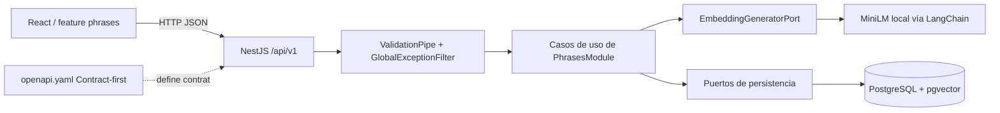
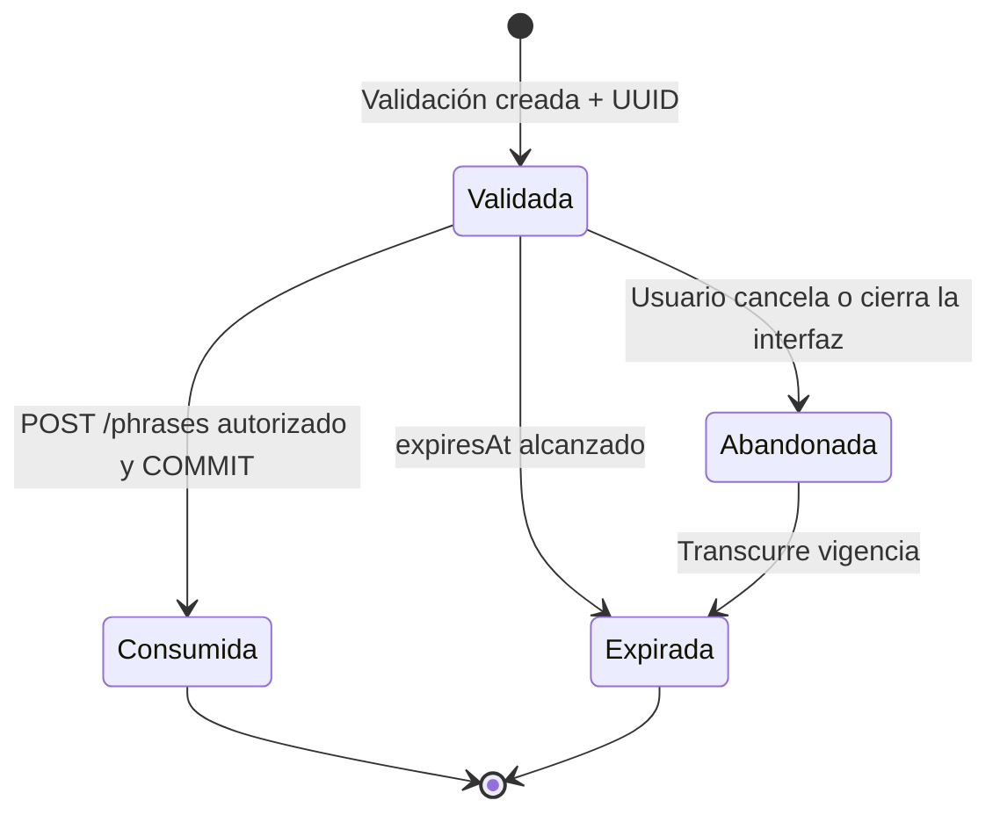

# Bloque 06 — Arquitectura API REST y Seguridad

Cambio incompatible (2026-10-22): `validationId` sustituye a `validationToken`, sin alias.
Se devuelve el UUID v4 aleatorio de la validación persistida, sin firma ni JWT.
Los JWT anteriores dejan de formar parte del contrato; las filas existentes pueden
referenciarse por su UUID. No hay migración ni secreto de firma requerido.
El registro queda fuera de F002: deberá buscar por `validationId`, comprobar
vigencia (`now >= expiresAt` implica expiración), texto, confirmación y estado no
consumido, y consumir la validación atómicamente con el guardado de la frase.
TTL configurable inicialmente de 15 minutos; respuesta y fila comparten expiración.


**Proyecto:** Semantic Phrase App  
**Estado:** aprobado — B06-D01 a B06-D15 y B06-R01 a B06-R06  
**Fecha:** 21 de octubre de 2026  
**Ubicación:** `docs/03-architecture/06-api-security.md`  
**Contrato asociado:** `docs/03-architecture/openapi.yaml` — OpenAPI 3.1.0  
**Alcance:** especificación de diseño para un MVP ejecutado exclusivamente en localhost. No representa una implementación.

## 1. Visión general y trazabilidad

La aplicación permite listar frases, validar una frase candidata frente a frases almacenadas y registrar una frase previamente validada. La validación es **anterior** al registro: un posible duplicado genera una advertencia y requiere confirmación humana (HITL), nunca un rechazo automático. El backend es un monolito modular **NestJS/TypeScript** con arquitectura hexagonal y DDD ligero; frontend **React** con Screaming Architecture. Se comunica mediante REST síncrono; no se introducen colas, workers, microservicios ni servicios de autenticación.

| Artefacto aprobado | Restricción respetada |
|---|---|
| `01-system-overview.md` | pnpm workspaces, NestJS, React, REST síncrono, HITL, simplicidad MVP |
| `02-backend-architecture.md` | `PhrasesModule`; `ValidatePhraseUseCase`, `CreatePhraseUseCase`, `ListPhrasesUseCase`; DTOs solo en HTTP; referencia UUID; puertos hexagonales; agregados `Phrase` y `PhraseValidation` separados |
| `03-frontend-architecture.md` | React/TanStack Query/Axios; el frontend presenta coincidencias y gestiona confirmar/cancelar, sin ejecutar embeddings; modelos/DTOs y mappers cercanos al feature |
| `04-ai-architecture.md` | MiniLM HF local vía LangChain; ONNX q8, pooling mean, L2, 384 dimensiones; umbral configurable inicialmente `0.8538613695045911`; fallo técnico distinto de ausencia de coincidencia |
| `05-data-architecture.md` | PostgreSQL + pgvector + Drizzle; búsqueda textual primero y Top-1 coseno después; TTL 15 minutos; tabla de validaciones temporal; transacción de registro/consumo atómica; listado `LIMIT/OFFSET` |

**Verificación documental:** las copias de los cinco documentos de arquitectura están disponibles en la biblioteca; no se verificó una copia exacta de `docs/00-discovery/product-brief.md`. Las reglas de este documento se basan exclusivamente en la arquitectura disponible y en las 21 aprobaciones explícitas de este bloque. Si apareciera un Product Brief discrepante, la diferencia requerirá decisión explícita, no modificación silenciosa.

## 2. Principios y convenciones REST

- Base local: `http://localhost:3000/api/v1`, versión mediante URI. `v1` versiona el **contrato HTTP**, no el modelo de embeddings.
- Recursos `phrases` y `phrase-validations`, en plural y kebab-case. Solo se publican tres operaciones. No se crean endpoints CRUD artificiales para las validaciones temporales.
- `GET` consulta, `POST` crea. El cliente manda y recibe JSON UTF-8; los fallos usan `application/problem+json`.
- Respuesta exitosa `{ "data": ... }`, más `meta` exclusivamente donde corresponde a listados paginados. No agregar `success`, `message` o `timestamp` redundantes.
- `201 Created` en ambas operaciones POST; `200 OK` para listado. Para MVP no es necesario publicar URI individual ni cabecera `Location` para validaciones temporales sin endpoint GET asociado.
- No autenticación de usuarios. El UUID de validación no es credencial de identidad; no incluir un requisito `securitySchemes` para estos endpoints.
- Los contratos de petición y respuesta se definen en **`openapi.yaml` como única fuente de verdad**. Durante SDD, los controllers/DTOs implementarán dicho YAML y se verificará manualmente su correspondencia (sin generación de SDKs o de tipos).

## 3. Catálogo de endpoints

| Método | Ruta | Caso de uso | Éxito | Descripción |
|---|---|---|---|---|
| `GET` | `/api/v1/phrases` | `ListPhrasesUseCase` | 200 | Consultar frases con paginación |
| `POST` | `/api/v1/phrase-validations` | `ValidatePhraseUseCase` | 201 | Crear validación temporal, generar embedding, resolver coincidencia y devolver validationId |
| `POST` | `/api/v1/phrases` | `CreatePhraseUseCase` | 201 | Comprobar validación y confirmación; registrar y consumir de forma atómica |

No se implementan: login, roles, renovación de sesión, endpoint de confirmación adicional, eliminación, selección de modelos ni endpoints administrativos.

## 4. Contratos Request/Response

### 4.1 `POST /phrase-validations`

Petición:

```json
{ "text": "Me gusta viajar a Cusco" }
```

Resultado vectorial ilustrativo:

```json
{
  "data": {
    "validationId": "550e8400-e29b-41d4-a716-446655440000",
    "expiresAt": "2026-10-21T19:15:00Z",
    "requiresConfirmation": true,
    "match": {
      "type": "vector",
      "phrase": { "id": "123e4567-e89b-42d3-a456-426614174000", "text": "Me encanta viajar a Cusco" },
      "similarityScore": 0.92
    }
  }
}
```

**Variantes discriminadas:**

- `match.type = vector`: incluye `phrase` y `similarityScore` numérica (coseno, **no probabilidad**). El puntaje de la candidata Top-1 puede existir aunque quede por debajo del umbral; `requiresConfirmation` depende del umbral.
- `match.type = textual_exact`: incluye `phrase` y `similarityScore: null`, exige confirmación; no se fabrica similitud coseno cuando se evita la consulta vectorial.
- `match = null`: no hay candidata; `requiresConfirmation: false` y no se inventa puntuación.

En las tres variantes se devuelve `validationId`, `expiresAt` (RFC 3339 / `date-time`) y `requiresConfirmation`. El embedding de 384 componentes y los metadatos internos del modelo nunca se devuelven al navegador. El UUID permite continuar el flujo, no identifica al usuario.

### 4.2 `POST /phrases`

Petición, con confirmación cuando corresponda:

```json
{ "text": "Me gusta viajar a Cusco", "validationId": "550e8400-e29b-41d4-a716-446655440000", "confirmed": true }
```

`confirmed` es un booleano **opcional**, interpretado como `false` si está ausente. No se convierte texto `"true"` ni número `1` a booleano. Si la validación persistida tiene `requires_confirmation = true`, solo `confirmed: true` autoriza registrar. Si no requiere confirmación, se permite omitirlo. Cancelar en frontend equivale a **no llamar** a este endpoint. Se comprueban identidad, texto asociado, versión compatible, expiración y consumo antes y dentro de la operación atómica de registro. No se vuelve a invocar MiniLM.

Resultado:

```json
{
  "data": {
    "id": "123e4567-e89b-42d3-a456-426614174000",
    "text": "Me gusta viajar a Cusco",
    "createdAt": "2026-10-21T19:02:00Z"
  }
}
```

### 4.3 `GET /phrases`

Parámetros `page` entero ≥ 1 (predeterminado 1), `limit` entero entre 1 y 100 (predeterminado 20); se rechazan valores inválidos. Conversión: `offset = (page - 1) * limit`. Orden fijo `created_at DESC, id DESC`, sin orden configurable. `total` es el conteo total y `totalPages = ceil(total / limit)`, igual a 0 cuando `total = 0`.

```json
{
  "data": [{
    "id": "123e4567-e89b-42d3-a456-426614174000",
    "text": "Me gusta viajar a Cusco",
    "createdAt": "2026-10-21T19:02:00Z"
  }],
  "meta": { "page": 1, "limit": 20, "total": 1, "totalPages": 1 }
}
```

Se omiten `embedding`, `normalized_text`, metadatos de modelo y validaciones temporales. `LIMIT/OFFSET` no garantiza páginas inmutables ante inserciones concurrentes; es una concesión consciente del MVP.

## 5. Swagger/OpenAPI — estrategia contract-first

- Archivo contractual **`docs/03-architecture/openapi.yaml`**, versión **OpenAPI 3.1.0**, con servidor local, paths, operaciones, parámetros, request bodies, componentes reutilizables, variantes `oneOf`, ejemplos y errores.
- Swagger UI se visualizará en `http://localhost:3000/api/docs` cuando se implemente NestJS localmente; debe cargar **este YAML**. No se mantienen en paralelo dos especificaciones independientes generadas desde decoradores.
- Los controladores HTTP y DTOs de NestJS deberán reproducir este contrato; TypeScript/class-validator no son por sí solos generadores de conformidad con OpenAPI.
- `oneOf` diferencia `VectorMatch`, `TextualExactMatch` y `null` en la respuesta de validación. `null` es legítimo en OpenAPI 3.1; `type` dentro de `match` es un **discriminador de negocio** y no tiene relación con la omisión de `type` en Problem Details.
- La API no expone un endpoint de autenticación y no define esquema de acceso Bearer en el contrato. El `validationId` viaja únicamente en el cuerpo de `POST /phrases`.
- No se generan clientes TypeScript, SDKs ni interfaces desde el YAML en este bloque. Los eventuales tests de conformidad HTTP quedan para una evolución posterior, no como requisito aprobado del MVP.

## 6. DTOs, validaciones y normalización

- Utilizar `class-validator`, `class-transformer` y **`ValidationPipe` global** con `whitelist`, `forbidNonWhitelisted` y transformación **controlada** de query params. No coercionar el booleano `confirmed` desde strings en el cuerpo.
- `text` obligatorio y cadena real, 1 a **500 puntos de código Unicode** después de aplicar las reglas de aceptación; `trim` no debe dejarlo vacío. Rechazar caracteres de control no permitidos, conservando tildes y signos. El número exacto de puntos de código se verifica en TS, porque la longitud de una cadena JS en unidades UTF-16 puede diferir de la cantidad de puntos de código.
- Distinción deliberada: validar la **admisibilidad** del texto en HTTP y dominio; la **normalización para igualdad textual** previamente aprobada (`trim`, minúsculas y compresión de espacios, preservando tildes/puntuación) se realiza con la misma función pura del Bloque 05, no la reinventa este documento.
- No alterar silenciosamente el texto que se muestra o se guarda por la normalización de búsqueda. La asociación de la referencia comprueba la frase validada; un texto distinto requiere otra validación.
- DTOs y mappers, cuando aporten valor, permanecen en `modules/phrases/infrastructure/inbound/http`, sin importar NestJS al dominio ni transportar Drizzle hacia el cliente.
- Rechazar objetos con propiedades desconocidas y query params fuera de contrato según política de validación configurada; impedir payloads desproporcionados antes de la inferencia.

## 7. Errores y filtro global

Las respuestas fallidas utilizan `application/problem+json` y un subconjunto de **RFC 9457**: `title`, `status`, `detail`, `code` y `errors` opcional. **No incluir explícitamente `type`** equivale a `about:blank`; `code` y `errors` son extensiones acordadas. El estado HTTP real debe coincidir con `status` del cuerpo. Los mensajes evitan datos sensibles o traces. Ejemplo:

```json
{
  "title": "Conflict",
  "status": 409,
  "detail": "La validación expiró. Valida nuevamente la frase.",
  "code": "VALIDATION_EXPIRED"
}
```

| HTTP | Código | Descripción |
|---|---|---|
| 400 | `VALIDATION_ERROR` | DTO o query inválidos; `errors` por campo cuando corresponda |
| 400 | `INVALID_VALIDATION_ID` | validationId ausente o UUID malformado |
| 400 | `PHRASE_MISMATCH` | Texto no corresponde a la validación almacenada |
| 409 | `VALIDATION_EXPIRED` | Validación vencida; React conserva texto y ofrece validar nuevamente |
| 409 | `VALIDATION_ALREADY_USED` | Validación consumida (incluye consumo concurrente perdedor) |
| 409 | `CONFIRMATION_REQUIRED` | Falta confirmación explícita para una coincidencia |
| 429 | `RATE_LIMIT_EXCEEDED` | 60 solicitudes/minuto/IP globales |
| 500 | `INTERNAL_ERROR` | Fallo inesperado ocultando detalles internos |
| 503 | `AI_UNAVAILABLE` | Error de inicialización, timeout o fallo técnico de inferencia |
| 503 | `DATABASE_UNAVAILABLE` | Persistencia no disponible |

El **único** `GlobalExceptionFilter` en `shared/infrastructure/http/filters` traduce `DomainError`, `ApplicationError`, `HttpException` y errores técnicos controlados a Problem Details. Cualquier excepción inesperada produce 500 seguro. El adaptador de infraestructura traduce excepciones de su proveedor a categorías controladas, sin exponer SQL, stack traces, secretos o rutas locales. Registrar información técnica mínima sin contenido del UUID. El frontend distingue fallos técnicos de resultados funcionales; la coincidencia semántica es respuesta **201**, nunca error 409 por el solo hecho de existir.

**Ambigüedad resuelta conservadoramente:** si la validación referenciada es inexistente por expiración/limpieza, la API debe rechazar de forma segura sin revelar más de lo necesario; el mapeo preciso depende de que el repositorio pueda diferenciar expirado, consumido y no encontrado. No se falseará su estado ni se retornará éxito.

## 8. Seguridad HTTP y alcance local

| Control | Política acordada |
|---|---|
| Entorno | Sólo localhost; React `http://localhost:5173`, API `http://localhost:3000` |
| CORS | Origen exacto configurable (`CORS_ORIGINS`), métodos GET, POST y preflight OPTIONS; sin credenciales cross-origin por defecto |
| Cabeceras | Capacidades nativas de la versión NestJS compatible aprobada (`useSecurityHeaders()`); probar compatibilidad con Swagger UI |
| Rate limiting | Global 60 solicitudes/minuto por IP; `@nestjs/throttler`, estado 429; memoria local del proceso, sin Redis |
| HTTPS | No obligatorio para loopback local; si se expone más allá de localhost, revisar TLS y controles contra abuso antes de desplegar |
| Autenticación | Ninguna cuenta, rol, guard de identidad ni proveedor IdP en el MVP |
| UUID | Solo vincula validación temporal con registro, **no** autentica personas |
| Swagger UI | Disponible localmente en `/api/docs` y alimentado por `openapi.yaml` |

**Limitaciones:** CORS regula la lectura desde navegadores, no bloquea clientes externos. El throttle en memoria se aplica por proceso, y **no limita por sí solo inferencias simultáneas**. En localhost se acepta la sencillez; no asumir seguridad para exposición pública. Si se usa proxy en una evolución, evaluar IP real y confianza en cabeceras reenviadas para evitar bypass o agrupar indiscriminadamente usuarios.

Configuración local propuesta (nombres operativos sujetos a implementación fiel al contrato):

```dotenv
PORT=3000
CORS_ORIGINS=http://localhost:5173
PHRASE_VALIDATION_TTL_MINUTES=15
RATE_LIMIT_TTL_MS=60000
RATE_LIMIT_MAX=60
AI_SIMILARITY_THRESHOLD=0.8538613695045911
```

No versionar `.env` con credenciales. La aplicación debe rechazar una clave ausente o débil en inicialización. La semántica de variables debe ser consistente con el runtime `@nestjs/throttler` efectivo al implementar; estos nombres son la interfaz de configuración acordada, no código de bootstrap.

## 9. Guardrails e integridad de IA

MiniLM es un generador de embeddings local, **no un LLM conversacional**. No se introducen filtros de prompt injection generativa, moderadores remotos, cross-encoders, múltiples modelos ni clasificadores de idioma. Se reutilizan controles existentes: longitud de frase, DTOs, throttle y timeout lógico configurable de inferencia. `EmbeddingGeneratorPort` garantiza salida con **384 valores finitos**, norma L2 dentro de tolerancia definida en implementación, `model_id` y `model_version` compatibles. Ante fallo, no consulta pgvector ni emite una validación exitosa.

La búsqueda del Bloque 05 sigue invariable: generar embedding; buscar coincidencia textual normalizada primero; sin ella, Top-1 **exacto** por coseno filtrado por versión compatible; evaluar umbral inicial `0.8538613695045911` solo en caso vectorial. No se introducen índices ANN ni rerankers. Un timeout **lógico** no implica necesariamente interrupción física inmediata del trabajo nativo; el contrato lo expone como fallo controlado de IA y exige que no se registre una validación exitosa.

## 10. Referencia UUID y flujo seguro HITL

**Formato:** UUID v4 aleatorio de la validación persistida. La respuesta y la fila comparten `expiresAt`. El UUID no contiene texto, vectores ni metadatos internos; no autentica personas.

1. `POST /phrase-validations` valida el texto, invoca el caso de uso, guarda la validación y su embedding con `expires_at`, devuelve validationId y devuelve el resultado funcional.
2. React muestra `match`, score cuando aplica y advertencia. Si la persona cancela, no llama a creación; la validación vence por expiración lógica.
3. Si decide registrar, React envía texto, UUID y `confirmed: true` solo si se necesita (también puede enviarlo si no se necesita).
4. `CreatePhraseUseCase` busca por validationId y comprueba texto asociado, versión de embedding compatible, estado no consumido, vigencia y confirmación necesaria.
5. `PhraseRegistrationPort` invoca el adaptador Drizzle y consume condicionalmente la validación e inserta la frase **dentro de una transacción** PostgreSQL `READ COMMITTED`; falla/rollback si el UPDATE no afecta exactamente una fila o no corresponden los datos.
6. React conserva el texto si la validación caduca. Ofrece **Validar nuevamente** y obtiene nueva coincidencia y UUID; no reutiliza una confirmación emitida para una validación anterior.

La referencia confirma una validación y la declaración `confirmed`, pero **no prueba** que la persona observó la alerta. Dos validaciones distintas aún pueden registrar frases equivalentes; no se bloquean inserciones ajenas entre búsqueda y guardado. La expiración no necesita scheduler; limpieza física manual posterior.

```mermaid
sequenceDiagram
    actor U as Usuario
    participant F as React
    participant H as Controller NestJS
    participant V as ValidatePhraseUseCase
    participant E as MiniLM local
    participant P as PostgreSQL/pgvector
    participant C as CreatePhraseUseCase
    U->>F: Ingresa frase
    F->>H: POST /phrase-validations
    H->>V: Validar
    V->>E: Generar embedding
    E-->>V: Embedding 384-D compatible
    V->>P: Igualdad textual o Top-1 coseno + guardar validación
    P-->>V: Coincidencia y validación temporal
    V-->>F: 201 + match + UUID + expiresAt
    alt Potencial duplicado
        F->>U: Solicitar confirmación
    end
    alt Cancelación
        U->>F: Cancelar
        Note over F,P: No registro; validación expira
    else Registro
        F->>H: POST /phrases con UUID y confirmed
        H->>C: Crear frase
        C->>P: Consumir validación e INSERT en transacción
        alt Vigente y autorizada
            P-->>C: COMMIT y frase
            C-->>F: 201 + frase registrada
        else Expirada/consumida/inválida
            P-->>C: ROLLBACK/error controlado
            C-->>F: 400 o 409 Problem Details
            F->>U: Conservar texto y revalidar si expiró
        end
    end
```

## 11. Responsabilidades y estructura técnica

| Límite | Responsabilidades |
|---|---|
| HTTP inbound (`PhrasesModule`) | Rutas versionadas, DTOs, pipes, mappers mínimos, respuestas Swagger-compatible |
| Application | Casos de uso y puertos, control HITL, coordinación referencia y transacción |
| Domain | Invariantes de `Phrase`/`PhraseValidation`, sin HTTP/NestJS |
| Outbound IA | LangChain/HF, timeout, validación técnica de embedding |
| Outbound datos | Drizzle/PostgreSQL/pgvector, Top-1 exacto, consumo/INSERT atómicos |
| Shared HTTP | `GlobalExceptionFilter` y bootstrap de controles globales |

No crear `SecurityModule`/`InfrastructureModule` globales por obligación ni introducir repositorios genéricos. La estructura concreta del código se acordará en SDD manteniendo las fronteras previamente aprobadas.

## 12. Estrategia de testing aprobada

**Sólo Jest unitario para el MVP** (B06-D15 alternativa A), sin Supertest, E2E, base de datos aislada, Testcontainers ni ejecución real de MiniLM en la suite obligatoria:

- DTO/pipes: tipos erróneos, objetos con propiedades desconocidas, texto vacío tras trim, 500/501 puntos de código, controles Unicode, query inválida, `confirmed` no booleano.
- Mapeo de errores: dominio/aplicación/infraestructura y excepciones imprevistas; campos RFC 9457, códigos seguros, ausencia de filtración de secretos.
- UUID: formato válido, vínculo a la fila, expiración, texto, confirmación y reutilización simulada.
- Use cases con puertos dobles: coincidencia textual, vectorial, sin candidata; HITL requerido/no requerido, modificación de texto, vencimiento y falta de segundo embedding en creación.
- Configuración de seguridad: valores CORS, cabeceras y throttle esperados comprobando funciones/configuración aisladas cuando sean testeables unitariamente.
- Contratos: validar transformaciones DTO y shapes serializables con pruebas unitarias de mappers; comparar manualmente contra `openapi.yaml` durante SDD.

**Trade-off aceptado:** las unitarias no prueban integración real de NestJS/Swagger, throttling efectivo, pgvector, UUID con todas las dependencias reales, ni atomicidad/transacciones bajo concurrencia. Estas verificaciones de integración son **recomendaciones posteriores**, no tareas obligatorias del MVP aprobado. La equivalencia entre LangChain y el pipeline de embeddings evaluado permanece una verificación técnica pendiente señalada por el Bloque 04, no algo demostrado por este artefacto.

## 13. Diagramas de arquitectura





La cancelación es un estado de la experiencia de usuario; **no** se persiste un estado adicional en `phrase_validations`. Un intento concurrente de consumir la misma validación debe producir un único COMMIT y respuestas controladas para los demás intentos.

## 14. Registro de decisiones y trade-offs

| ID | Elección aprobada | Trade-off |
|---|---|---|
| B06-D01 | Recursos `/phrases` y `/phrase-validations` | Sin rutas orientadas a acciones ni CRUD innecesario |
| B06-D02 | `data` y `meta` opcional | Envoltorio ligero frente a cuerpos directos |
| B06-D03 | Versionado URI `/api/v1` | Versionado visible y simple; URLs versionadas |
| B06-D04 | OpenAPI 3.1 YAML contract-first | Requiere verificar manualmente correspondencia con código |
| B06-D05 | class-validator y ValidationPipe | DTOs en clases; no duplicar lógica de dominio |
| B06-D06 | Texto ≤500 puntos de código y controles básicos | Puede excluir textos largos; evita consumo excesivo |
| B06-D07 | RFC 9457 sin `type` explícito, `code`, `errors` opcional | Extensiones propias documentadas |
| B06-D08 | Un GlobalExceptionFilter | Centraliza traducción; evitar filtro monolítico complejo |
| B06-D09 | CORS restringido y cabeceras nativas NestJS | Requiere versión compatible y configuración correcta |
| B06-D10 | 60 req/min/IP global en memoria | No pondera costo de endpoints ni escala múltiples instancias |
| B06-D11 | Sin autenticación | Apropiado para demo local, no para exposición pública sostenida |
| B06-D12 | Guardrails técnicos de embeddings | Sin modelos extra ni moderación |
| B06-D13 | UUID v4 de validación persistida | Sin firma; no demuestra identidad de usuario |
| B06-D14 | Confirmación `POST /phrases` y consumo atómico | No demuestra que el humano vio alerta |
| B06-D15 | Jest unitario solamente | Sin pruebas HTTP/integración obligatorias |
| B06-R01 | GET 200; POST 201 | Validación se modela como recurso temporal creado |
| B06-R02 | `match` discriminado, puntaje nulo para textual | Variantes OpenAPI más expresivas |
| B06-R03 | `confirmed` opcional, defecto false | Comportamiento seguro por omisión |
| B06-R04 | page/limit (20 por defecto, 100 máx.), total y totalPages | COUNT adicional; paginación offset inestable bajo escrituras |
| B06-R05 | HTTP + códigos de error estables | Catálogo pequeño a mantener |
| B06-R06 | Exclusivamente localhost, Swagger siempre local | No incluye diseño de exposición a producción |

## 15. Entregables y criterios de cierre

1. `06-api-security.md` registra las decisiones arquitectónicas, sus motivaciones y límites.
2. `openapi.yaml` expresa los tres endpoints en **OpenAPI 3.1**, con schemas, ejemplos, paginación y errores Problem Details.
3. Durante SDD se diseñan e implementan controllers, DTOs, filtros, configuración y adaptadores conforme al YAML, sin reabrir decisiones sin nueva aprobación.
4. Ningún archivo de código fuente, dependencia, proyecto NestJS/React, migración ni base de datos ha sido inicializado o ejecutado por este bloque.

**Fuera de alcance:** autenticación de usuarios, despliegue público, API gateway, certificados TLS en localhost, Redis, workers, reintentos automáticos, guardrails generativos y suite E2E obligatoria.
