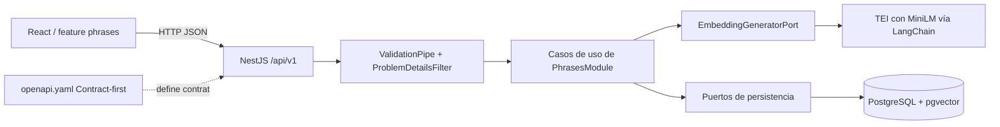
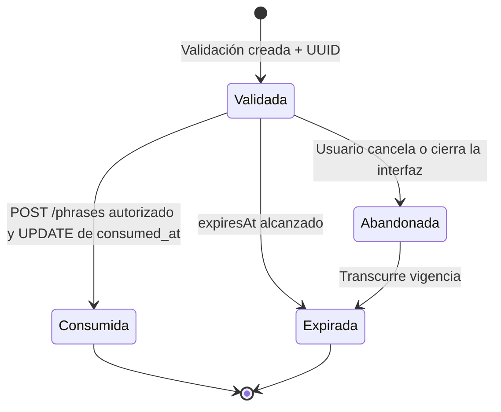

# Bloque 06 — Arquitectura API REST y Seguridad

> **Revisado contra el código implementado (2026-10-24); ante discrepancia manda el código.**

Cambio incompatible (2026-10-22): `validationId` sustituye a `validationToken`, sin alias.
Se devuelve el UUID v4 aleatorio de la validación persistida, sin firma ni JWT.
Los JWT anteriores dejan de formar parte del contrato; las filas existentes pueden
referenciarse por su UUID. No hay migración ni secreto de firma requerido.
El registro (F003) busca por `validationId`, comprueba vigencia (`now >= expiresAt`
implica expiración), texto, modelo/versión, confirmación y estado no consumido, inserta
la frase y después marca la validación como consumida (en una única transacción).
TTL configurable (15 minutos por defecto); respuesta y fila comparten expiración.

**Proyecto:** Semantic Phrase App  
**Estado:** aprobado — B06-D01 a B06-D15 y B06-R01 a B06-R06  
**Fecha:** 21 de octubre de 2026  
**Ubicación:** `docs/03-architecture/06-api-security.md`  
**Contrato asociado:** `docs/03-architecture/openapi.yaml` — OpenAPI 3.1.0  
**Alcance:** API REST implementada para un MVP ejecutado exclusivamente en localhost. Donde el diseño original difería, este documento describe el código.

## 1. Visión general y trazabilidad

La aplicación permite listar frases, validar una frase candidata frente a frases almacenadas y registrar una frase previamente validada. La validación es **anterior** al registro: un posible duplicado genera una advertencia y requiere confirmación humana (HITL), nunca un rechazo automático. El backend es un monolito modular **NestJS/TypeScript** con arquitectura hexagonal y DDD; frontend **React** con Screaming Architecture. Se comunica mediante REST síncrono; no se introducen colas, workers, microservicios ni servicios de autenticación.

| Artefacto aprobado            | Restricción respetada                                                                                                                                                                                                    |
| ----------------------------- | ------------------------------------------------------------------------------------------------------------------------------------------------------------------------------------------------------------------------ |
| `01-system-overview.md`       | Apps independientes (submódulos Git), NestJS, React, REST síncrono, HITL, simplicidad MVP                                                                                                                                |
| `02-backend-architecture.md`  | `PhrasesModule`; `ValidatePhraseUseCase`, `CreatePhraseUseCase`, `ListPhrasesUseCase`, `DeletePhraseUseCase`; DTOs solo en HTTP; referencia UUID; puertos hexagonales; agregados `Phrase` y `PhraseValidation` separados |
| `03-frontend-architecture.md` | React/TanStack Query/Axios; el frontend presenta coincidencias y gestiona confirmar/cancelar, sin ejecutar embeddings; modelos/DTOs y mappers cercanos al feature                                                        |
| `04-ai-architecture.md`       | MiniLM servido por TEI y consumido vía LangChain; float32, pooling mean, 384 dimensiones; umbral configurable inicialmente `0.8538613695045911`; fallo técnico distinto de ausencia de coincidencia                      |
| `05-data-architecture.md`     | PostgreSQL + pgvector + Drizzle; búsqueda textual primero y Top-1 coseno después; TTL 15 minutos; tabla de validaciones temporal; registro y consumo en una única transacción; listado `LIMIT/OFFSET`                    |

## 2. Principios y convenciones REST

- Base local: `http://localhost:3000/api/v1`, versión mediante URI. `v1` versiona el **contrato HTTP**, no el modelo de embeddings.
- Recursos `phrases` y `phrase-validations`, en plural y kebab-case. Solo se publican cuatro operaciones. No se crean endpoints CRUD artificiales para las validaciones temporales.
- `GET` consulta, `POST` crea, `DELETE` elimina lógicamente una frase. El cliente manda y recibe JSON UTF-8; los fallos usan `application/problem+json`.
- Respuesta exitosa `{ "data": ... }`, más `meta` exclusivamente donde corresponde a listados paginados. No agregar `success`, `message` o `timestamp` redundantes.
- `201 Created` en ambas operaciones POST; `200 OK` para listado; `204 No Content` para eliminación. Para MVP no es necesario publicar URI individual ni cabecera `Location` para validaciones temporales sin endpoint GET asociado.
- No autenticación de usuarios. El UUID de validación no es credencial de identidad; no incluir un requisito `securitySchemes` para estos endpoints.
- Los contratos están descritos en **`openapi.yaml`**, mantenido a mano para coincidir con los controllers/DTOs implementados (sin generación de SDKs ni de tipos). Si difieren, manda el código.

## 3. Catálogo de endpoints

| Método   | Ruta                         | Caso de uso             | Éxito | Descripción                                                                                                    |
| -------- | ---------------------------- | ----------------------- | ----- | -------------------------------------------------------------------------------------------------------------- |
| `GET`    | `/api/v1/phrases`            | `ListPhrasesUseCase`    | 200   | Consultar frases con paginación                                                                                |
| `POST`   | `/api/v1/phrase-validations` | `ValidatePhraseUseCase` | 201   | Crear validación temporal, generar embedding, resolver coincidencia y devolver validationId                    |
| `POST`   | `/api/v1/phrases`            | `CreatePhraseUseCase`   | 201   | Comprobar validación y confirmación; insertar la frase y marcar la validación como consumida (una transacción) |
| `DELETE` | `/api/v1/phrases/{id}`       | `DeletePhraseUseCase`   | 204   | Eliminar lógicamente una frase activa (soft delete)                                                            |

No se implementan: login, roles, renovación de sesión, endpoint de confirmación adicional, restauración de frases eliminadas, selección de modelos ni endpoints administrativos.

## 4. Contratos Request/Response

### 4.1 `POST /phrase-validations`

Petición:

```json
{ "text": "Me gusta viajar a Cusco" }
```

Resultado vectorial ilustrativo:

```json
{
  "data": {
    "validationId": "550e8400-e29b-41d4-a716-446655440000",
    "expiresAt": "2026-10-21T19:15:00.000Z",
    "requiresConfirmation": true,
    "match": {
      "type": "vector",
      "phrase": {
        "id": "123e4567-e89b-42d3-a456-426614174000",
        "text": "Me encanta viajar a Cusco"
      },
      "similarityScore": 0.92
    }
  }
}
```

**Variantes discriminadas:**

- `match.type = vector`: incluye `phrase` y `similarityScore` numérica (coseno, **no probabilidad**). El puntaje de la candidata Top-1 puede existir aunque quede por debajo del umbral; `requiresConfirmation` depende del umbral.
- `match.type = textual_exact`: incluye `phrase` y `similarityScore: null`, exige confirmación; no se fabrica similitud coseno cuando se evita la consulta vectorial.
- `match = null`: no hay candidata; `requiresConfirmation: false` y no se inventa puntuación.

En las tres variantes se devuelve `validationId`, `expiresAt` (ISO 8601 con milisegundos, truncado a segundos: `…:00.000Z`) y `requiresConfirmation`. El embedding de 384 componentes y los metadatos internos del modelo nunca se devuelven al navegador. El UUID permite continuar el flujo, no identifica al usuario.

### 4.2 `POST /phrases`

Petición, con confirmación cuando corresponda:

```json
{
  "text": "Me gusta viajar a Cusco",
  "validationId": "550e8400-e29b-41d4-a716-446655440000",
  "confirmed": true
}
```

`confirmed` es un booleano **opcional**, interpretado como `false` si está ausente. No se convierte texto `"true"` ni número `1` a booleano; `null` también es inválido. Si la validación persistida tiene `requires_confirmation = true`, solo `confirmed: true` autoriza registrar. Si no requiere confirmación, se permite omitirlo. Cancelar en frontend equivale a **no llamar** a este endpoint. Se comprueban, en este orden: existencia, consumo previo, expiración, texto idéntico, modelo/versión compatible y confirmación. No hay operación atómica: la frase se inserta y después se marca la validación como consumida. No se vuelve a invocar MiniLM ni buscar similitud. Se permiten duplicados confirmados; no hay límite global por volumen. Los parámetros de query no declarados se **ignoran** (no se rechazan).

Resultado:

```json
{
  "data": {
    "id": "123e4567-e89b-42d3-a456-426614174000",
    "text": "Me gusta viajar a Cusco",
    "createdAt": "2026-10-21T19:02:00.000Z"
  }
}
```

### 4.3 `GET /phrases`

Parámetros `page` entero ≥ 1 (predeterminado 1), `limit` entero entre 1 y 100 (predeterminado 20). Los valores se convierten con `Number()` y deben ser enteros (por tanto `1e1` o `1.0` se aceptan); no numéricos, fuera de rango o repetidos devuelven 400. Conversión: `offset = (page - 1) * limit`. Orden fijo `created_at DESC, id DESC`, sin orden configurable. `total` es el conteo total y `totalPages = ceil(total / limit)`, igual a 0 cuando `total = 0`.

```json
{
  "data": [
    {
      "id": "123e4567-e89b-42d3-a456-426614174000",
      "text": "Me gusta viajar a Cusco",
      "createdAt": "2026-10-21T19:02:00.000Z"
    }
  ],
  "meta": { "page": 1, "limit": 20, "total": 1, "totalPages": 1 }
}
```

Solo se listan frases activas (`status = 1`) y `total` las cuenta únicamente a ellas. La respuesta omite `embedding`, `normalized_text`, metadatos de modelo y validaciones temporales (aunque el repositorio lee la fila completa). `LIMIT/OFFSET` no garantiza páginas inmutables ante inserciones concurrentes; es una concesión consciente del MVP.

### 4.4 `DELETE /phrases/{id}`

Parámetro de ruta `id`: UUID de la frase. Sin cuerpo de petición ni de respuesta. Marca `status = 2` y `deleted_at` con la hora actual; no borra físicamente la fila. Éxito: `204 No Content`. Frase inexistente o ya eliminada: `404 PHRASE_NOT_FOUND` (no idempotente). `id` con formato no UUID: `400 VALIDATION_ERROR`. Fallo de base de datos: `500 DATABASE_ERROR`. La frase eliminada deja de aparecer en el listado y en validaciones futuras; las validaciones previas que la citan no se modifican.

## 5. OpenAPI — contrato documental

- Archivo **`docs/03-architecture/openapi.yaml`**, versión **OpenAPI 3.1.0**, con servidor local, paths, operaciones, parámetros, request bodies, componentes reutilizables, variantes `oneOf`, ejemplos y errores. Se mantiene a mano.
- **No hay Swagger UI ni `@nestjs/swagger`** en el backend; no existe `/api/docs`. El YAML se puede abrir con cualquier visor externo.
- `oneOf` diferencia `VectorMatch`, `TextualExactMatch` y `null` en la respuesta de validación. `null` es legítimo en OpenAPI 3.1; `type` dentro de `match` es un **discriminador de negocio** y no tiene relación con la omisión de `type` en Problem Details.
- La API no expone un endpoint de autenticación y no define esquema de acceso Bearer. El `validationId` viaja únicamente en el cuerpo de `POST /phrases`.
- No se generan clientes TypeScript ni se hacen tests de conformidad contra el YAML.

## 6. DTOs, validaciones y normalización

- Utilizar `class-validator`, `class-transformer` y **`ValidationPipe` global** con `transform`, `whitelist` y `forbidNonWhitelisted` (configurado en `configureApp`). Ver alternativa evaluada (Zod) en [Alternativas evaluadas: validación de DTOs](#alternativas-evaluadas-validación-de-dtos). No se coacciona el booleano `confirmed` desde strings en el cuerpo.
- `text` para validación y registro: cadena real de hasta **280 puntos de código Unicode del original**, incluidos espacios externos; `trim` no vacío, sin controles Unicode `Cc`, **sin emojis** y con **al menos 3 letras** (`\p{L}`). Se permiten la puntuación y los demás símbolos; se conserva el original. Es una única regla: `PhraseText` la aplica al crear la frase y al reconstruirla desde la base de datos, y el formulario del frontend la replica. El número exacto de puntos de código se verifica en TS, porque la longitud de una cadena JS en unidades UTF-16 puede diferir de la cantidad de puntos de código.
- Distinción deliberada: validar la **admisibilidad** del texto en HTTP y dominio; la **normalización para igualdad textual** previamente aprobada (`trim`, minúsculas y compresión de espacios, preservando tildes/puntuación) se realiza con la misma función pura del Bloque 05, no la reinventa este documento.
- No alterar silenciosamente el texto que se muestra o se guarda por la normalización de búsqueda. La asociación de la referencia comprueba la frase validada; un texto distinto requiere otra validación.
- DTOs y mappers, cuando aporten valor, permanecen en `modules/phrases/infrastructure/http/` (`dtos/`, `mapper/`, `validation/`), sin importar NestJS al dominio ni transportar Drizzle hacia el cliente.
- Se rechazan propiedades desconocidas en el **body** (400 `VALIDATION_ERROR`). Los query params no declarados en los `POST` se ignoran; en `GET /phrases` solo se validan `page` y `limit`. El único límite de tamaño es el de 280 puntos de código del DTO (y el límite por defecto de Express para el body).

## 7. Errores y filtros

Las respuestas fallidas utilizan `application/problem+json` y un subconjunto de **RFC 9457**: `title`, `status`, `detail`, `code` y `errors` opcional. **No incluir explícitamente `type`** equivale a `about:blank`; `code` y `errors` son extensiones acordadas. El estado HTTP real debe coincidir con `status` del cuerpo. Los mensajes evitan datos sensibles o traces. Ejemplo:

```json
{
  "title": "Conflict",
  "status": 409,
  "detail": "La validación expiró. Valida nuevamente la frase.",
  "code": "VALIDATION_EXPIRED"
}
```

| HTTP    | Código                                                       | Descripción                                                                                            |
| ------- | ------------------------------------------------------------ | ------------------------------------------------------------------------------------------------------ |
| 400     | `VALIDATION_ERROR`                                           | DTO, parámetros de ruta o query declarados inválidos; `errors` por campo cuando corresponda            |
| 400     | `INVALID_VALIDATION_ID`                                      | validationId ausente, UUID no v4 o referencia inexistente                                              |
| 400     | `PHRASE_MISMATCH`                                            | Texto no corresponde a la validación almacenada                                                        |
| 404     | `PHRASE_NOT_FOUND`                                           | Frase inexistente o ya eliminada lógicamente                                                           |
| 409     | `VALIDATION_EXPIRED`                                         | Validación vencida; React conserva texto y ofrece validar nuevamente                                   |
| 409     | `VALIDATION_ALREADY_USED`                                    | Validación consumida (incluye consumo concurrente perdedor)                                            |
| 409     | `INCOMPATIBLE_MODEL`                                         | Registro con una validación emitida para otro modelo/versión                                           |
| 409     | `CONFIRMATION_REQUIRED`                                      | Falta confirmación explícita para una coincidencia                                                     |
| 500     | `DATABASE_ERROR`                                             | Fallo de conexión, consulta o escritura en PostgreSQL (`detail`: «Ocurrió un error de base de datos.») |
| 500     | `INTERNAL_ERROR`                                             | Fallo inesperado, incluido un corpus activo sin frases del modelo vigente al validar                   |
| 500     | `INVALID_PHRASE`, `INVALID_PHRASE_TEXT`, `INVALID_EMBEDDING` | Datos persistidos inválidos al reconstruir el dominio                                                  |
| 503     | `AI_UNAVAILABLE`                                             | Timeout o fallo técnico de inferencia (incluye respuesta de embedding inválida)                        |
| 4xx/5xx | `HTTP_ERROR`                                                 | Cualquier otra `HttpException` (por ejemplo 404 en ruta inexistente o 415)                             |

Un fallo de inicialización del servicio de IA **no** produce HTTP: el proceso no arranca. No existe `DATABASE_UNAVAILABLE` (503).

`ProblemDetailsFilter` (`shared/infrastructure/http/filters`, global con `@Catch()`) traduce `DatabaseError`, `HttpException` y cualquier excepción inesperada a Problem Details; hay además 7 filtros específicos en `modules/phrases/infrastructure/http/filters` (registro, validación de texto, no encontrada, IA no disponible, `INVALID_*`) para los errores de dominio/aplicación. El `detail` del 400 varía según la ruta (p. ej. «Los datos enviados no son válidos.» en `POST /phrases`, «Los parámetros de la solicitud no son válidos.» en el filtro global). Los errores de proveedor se traducen a categorías controladas sin exponer SQL, stack traces ni secretos, aunque el repositorio registra a nivel LOG el texto normalizado y las frases coincidentes. El frontend distingue fallos técnicos de resultados funcionales; la coincidencia semántica es respuesta **201**, nunca error 409 por el solo hecho de existir.

Una referencia inexistente, incluida limpieza física, produce 400 `INVALID_VALIDATION_ID`; no se infiere expiración ni consumo previo. Al registrar, un modelo/versión incompatible produce 409 `INCOMPATIBLE_MODEL`; al validar, un corpus activo sin ninguna frase del modelo vigente (y sin igualdad textual) produce 500 `INTERNAL_ERROR`. Si una validación está expirada **y** consumida, se informa `VALIDATION_ALREADY_USED` (se comprueba antes).

## 8. Seguridad HTTP y alcance local

| Control       | Política implementada                                                                                                                                    |
| ------------- | -------------------------------------------------------------------------------------------------------------------------------------------------------- |
| Entorno       | Sólo localhost; React `http://localhost:5173`, API `http://localhost:3000`                                                                               |
| CORS          | `enableCors({ origin: 'http://localhost:5173' })` **fijo en `configureApp`**, sin variable de entorno; métodos por defecto de Express (incluye `DELETE`) |
| Cabeceras     | Sin helmet ni configuración adicional de cabeceras de seguridad                                                                                          |
| Rate limiting | Ninguno (sin `@nestjs/throttler`); validación y registro no producen 429                                                                                 |
| HTTPS         | No obligatorio para loopback local; si se expone más allá de localhost, revisar TLS y controles contra abuso antes de desplegar                          |
| Autenticación | Ninguna cuenta, rol, guard de identidad ni proveedor IdP                                                                                                 |
| UUID          | Solo vincula validación temporal con registro, **no** autentica personas                                                                                 |
| Swagger UI    | No implementado                                                                                                                                          |

**Limitaciones:** CORS regula la lectura desde navegadores, no bloquea clientes externos. Sin límite de tasa, nada limita inferencias simultáneas. En localhost se acepta la sencillez; no asumir seguridad para exposición pública.

Variables de entorno de la API que afectan al contrato (ver `apps/backend/.env.example` para la lista completa):

```dotenv
PORT=3000
PHRASE_VALIDATION_TTL_MINUTES=15
AI_SIMILARITY_THRESHOLD=0.8538613695045911
AI_INFERENCE_TIMEOUT_MS=5000
```

No versionar `.env` con credenciales. No hay claves ni secretos de aplicación. No existen `CORS_ORIGINS` ni `RATE_LIMIT_*`.

## 9. Guardrails e integridad de IA

MiniLM (servido por un contenedor TEI local) es un generador de embeddings, **no un LLM conversacional**. No se introducen filtros de prompt injection generativa, moderadores remotos, cross-encoders, múltiples modelos ni clasificadores de idioma. Se reutilizan controles existentes: longitud de frase, DTOs y timeout configurable de inferencia (`AI_INFERENCE_TIMEOUT_MS`, delegado al SDK, sin reintentos). El value object `Embedding` exige **384 valores finitos**; **no** se comprueba la norma L2, y `model_id`/`model_version` se toman de la configuración. Ante cualquier fallo del adaptador (incluida una respuesta inválida), no se consulta pgvector ni se emite una validación exitosa: se responde 503 `AI_UNAVAILABLE`.

La búsqueda del Bloque 05 sigue invariable: generar embedding; buscar coincidencia textual normalizada primero; sin ella, Top-1 **exacto** por coseno filtrado por versión compatible; evaluar el umbral (`AI_SIMILARITY_THRESHOLD`, por defecto `0.8538613695045911`, inclusivo) solo en caso vectorial. No se introducen índices ANN ni rerankers. El timeout lo aplica el SDK de LangChain; el contrato lo expone como fallo controlado de IA y no se registra una validación exitosa.

## 10. Referencia UUID y flujo seguro HITL

**Formato:** UUID v4 aleatorio de la validación persistida. La respuesta y la fila comparten `expiresAt`. El UUID no contiene texto, vectores ni metadatos internos; no autentica personas.

1. `POST /phrase-validations` valida el texto, invoca el caso de uso, guarda la validación y su embedding con `expires_at`, devuelve validationId y devuelve el resultado funcional.
2. React muestra `match`, score cuando aplica y advertencia. Si la persona cancela, no llama a creación; la validación vence por expiración lógica.
3. Si decide registrar, React envía texto, UUID y `confirmed: true` solo si se necesita (también puede enviarlo si no se necesita).
4. `CreatePhraseUseCase` busca por validationId y comprueba, en orden, existencia, consumo, vigencia, texto asociado, modelo/versión compatible y confirmación necesaria.
5. El caso de uso llama a `PhraseRegistrationPort.register`: una transacción con `UPDATE consumed_at ... WHERE consumed_at IS NULL` e `INSERT` de la frase. Si algo falla se revierte todo (500 `DATABASE_ERROR`); si ya estaba consumida, 409 `VALIDATION_ALREADY_USED`.
6. React conserva el texto si la validación caduca. Ofrece **Validar nuevamente** y obtiene nueva coincidencia y UUID; no reutiliza una confirmación emitida para una validación anterior.

La referencia confirma una validación y la declaración `confirmed`, pero **no prueba** que la persona observó la alerta. Dos validaciones distintas aún pueden registrar frases equivalentes; no se bloquean inserciones ajenas entre búsqueda y guardado. La expiración no necesita scheduler; limpieza física manual posterior (las validaciones no consumidas permanecen en la tabla).

```mermaid
sequenceDiagram
    actor U as Usuario
    participant F as React
    participant H as Controller NestJS
    participant V as ValidatePhraseUseCase
    participant E as TEI (MiniLM)
    participant P as PostgreSQL/pgvector
    participant C as CreatePhraseUseCase
    U->>F: Ingresa frase
    F->>H: POST /phrase-validations
    H->>V: Validar
    V->>E: Generar embedding
    E-->>V: Embedding 384-D compatible
    V->>P: Igualdad textual o Top-1 coseno + guardar validación
    P-->>V: Coincidencia y validación temporal
    V-->>F: 201 + match + UUID + expiresAt
    alt Potencial duplicado
        F->>U: Solicitar confirmación
    end
    alt Cancelación
        U->>F: Cancelar
        Note over F,P: No registro; validación expira
    else Registro
        F->>H: POST /phrases con UUID y confirmed
        H->>C: Crear frase
        C->>P: Transacción: UPDATE condicional consumed_at + INSERT frase
        alt Vigente y autorizada
            P-->>C: Frase insertada y validación consumida
            C-->>F: 201 + frase registrada
        else Expirada/consumida/inválida
            C-->>F: 400 o 409 Problem Details
            F->>U: Conservar texto y revalidar si expiró
        end
    end
```

## 11. Responsabilidades y estructura técnica

| Límite                         | Responsabilidades                                                               |
| ------------------------------ | ------------------------------------------------------------------------------- |
| HTTP inbound (`PhrasesModule`) | Rutas versionadas, DTOs, pipes, mappers mínimos, filtros de error               |
| Application                    | Casos de uso y puertos, control HITL, coordinación de referencia y consumo      |
| Domain                         | Invariantes de `Phrase`/`PhraseValidation`, sin HTTP/NestJS                     |
| Outbound IA                    | LangChain `OpenAIEmbeddings` contra TEI, timeout, sonda de arranque             |
| Outbound datos                 | Drizzle/PostgreSQL/pgvector, Top-1 exacto, INSERT y UPDATE de consumo separados |
| Shared HTTP                    | `ProblemDetailsFilter`, factory de validación y `configureApp`                  |

No crear `SecurityModule`/`InfrastructureModule` globales por obligación ni introducir repositorios genéricos. La estructura real está descrita en `02-backend-architecture.md`.

## 12. Estrategia de testing (estado real)

Jest unitario junto al código (28 suites) y **4 suites e2e con Supertest** en `apps/backend/test/` (`pnpm test:e2e`). Los e2e arrancan `AppModule` con `configureApp`, pero **sustituyen** los repositorios, `EmbeddingGeneratorPort` y `ConfigurationPort` (uno de ellos simula TEI sobre el SDK); no usan PostgreSQL ni TEI reales. Cubren DTOs/pipes, mapeo de errores a Problem Details, referencia UUID (vigencia, texto, modelo, confirmación, reutilización), casos de uso con dobles y paginación.

**Trade-off aceptado:** no se prueban pgvector, SQL real, concurrencia ni la equivalencia entre el pipeline Xenova con que se calibró el umbral y el servicio TEI (riesgo pendiente señalado por el Bloque 04).

## 13. Diagramas de arquitectura





La cancelación es un estado de la experiencia de usuario; **no** se persiste un estado adicional en `phrase_validations`. Un intento concurrente de consumir la misma validación está protegido por el UPDATE condicional dentro de la transacción: solo una solicitud crea la frase y las demás reciben 409.

## 14. Registro de decisiones y trade-offs

| ID      | Elección aprobada                                                               | Trade-off                                                       |
| ------- | ------------------------------------------------------------------------------- | --------------------------------------------------------------- |
| B06-D01 | Recursos `/phrases` y `/phrase-validations`                                     | Sin rutas orientadas a acciones ni CRUD innecesario             |
| B06-D02 | `data` y `meta` opcional                                                        | Envoltorio ligero frente a cuerpos directos                     |
| B06-D03 | Versionado URI `/api/v1`                                                        | Versionado visible y simple; URLs versionadas                   |
| B06-D04 | OpenAPI 3.1 YAML contract-first                                                 | Requiere verificar manualmente correspondencia con código       |
| B06-D05 | class-validator y ValidationPipe                                                | DTOs en clases; no duplicar lógica de dominio                   |
| B06-D06 | Texto ≤280 puntos de código, ≥3 letras, sin emojis ni Cc; misma regla al leer   | Rechaza textos largos, solo signos y emojis; evita consumo excesivo |
| B06-D07 | RFC 9457 sin `type` explícito, `code`, `errors` opcional                        | Extensiones propias documentadas                                |
| B06-D08 | **Revisada:** `ProblemDetailsFilter` global + filtros por ruta                  | Traducción repartida; códigos estables                          |
| B06-D09 | **Revisada:** CORS con origen fijo `http://localhost:5173`; sin cabeceras extra | Sin configuración por entorno                                   |
| B06-D10 | Sin límite global por volumen                                                   | Cada petición sigue sus reglas funcionales                      |
| B06-D11 | Sin autenticación                                                               | Apropiado para demo local, no para exposición pública sostenida |
| B06-D12 | Guardrails técnicos de embeddings                                               | Sin modelos extra ni moderación                                 |
| B06-D13 | UUID v4 de validación persistida                                                | Sin firma; no demuestra identidad de usuario                    |
| B06-D14 | **Revisada:** confirmación en `POST /phrases`; consumo no atómico               | No demuestra que el humano vio alerta; riesgo de doble registro |
| B06-D15 | **Revisada:** Jest unitario + e2e con puertos simulados                         | Sin pruebas con PostgreSQL/TEI reales                           |
| B06-R01 | GET 200; POST 201                                                               | Validación se modela como recurso temporal creado               |
| B06-R02 | `match` discriminado, puntaje nulo para textual                                 | Variantes OpenAPI más expresivas                                |
| B06-R03 | `confirmed` opcional, defecto false                                             | Comportamiento seguro por omisión                               |
| B06-R04 | page/limit (20 por defecto, 100 máx.), total y totalPages                       | COUNT adicional; paginación offset inestable bajo escrituras    |
| B06-R05 | HTTP + códigos de error estables                                                | Catálogo pequeño a mantener                                     |
| B06-R06 | Exclusivamente localhost (sin Swagger UI en el código)                          | No incluye diseño de exposición a producción                    |

## Alternativas evaluadas: validación de DTOs

| Decisión                                                          | Alternativas consideradas | Justificación                                                                                                                                                                                                                                                                      |
| ----------------------------------------------------------------- | ------------------------- | ---------------------------------------------------------------------------------------------------------------------------------------------------------------------------------------------------------------------------------------------------------------------------------- |
| `class-validator` + `class-transformer` + `ValidationPipe` global | Zod                       | Se integra nativamente con decoradores de NestJS y el `ValidationPipe` global, sin capa adicional. Zod ya se descartó también para validar el esquema de configuración (`07-infrastructure-quality.md`) por la misma razón: no sumar una segunda librería de esquemas al proyecto. |

## 15. Entregables y criterios de cierre

1. `06-api-security.md` registra las decisiones arquitectónicas, sus motivaciones y límites.
2. `openapi.yaml` expresa los cuatro endpoints en **OpenAPI 3.1**, con schemas, ejemplos, paginación y errores Problem Details.
3. Controllers, DTOs, filtros y adaptadores están implementados en `apps/backend`; ante discrepancia con el YAML o con este documento manda el código.

**Fuera de alcance:** autenticación de usuarios, despliegue público, API gateway, certificados TLS en localhost, Redis, workers, reintentos automáticos, guardrails generativos, Swagger UI, rate limiting y cabeceras de seguridad.
